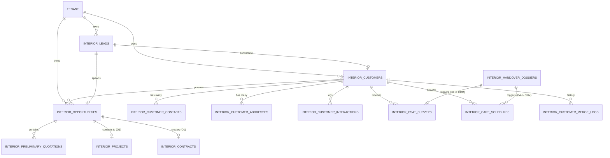

# BELLA INTERIOR CRM — ARCHITECTURE DESIGN & DOMAIN CONTRACT
## ĐẶC TẢ KIẾN TRÚC MIỀN & HỢP ĐỒNG NGHIỆP VỤ CRM & CUSTOMER SUCCESS
### GIAI ĐOẠN A · THIẾT KẾ KIẾN TRÚC · CHƯA TRIỂN KHAI DATABASE

**Hệ thống:** Bella Interior OS | **Phân hệ:** CRM & Customer Success (Vòng đời Khách hàng Trọn vẹn)\
**Kiến trúc Baseline:** v2.0 (Approved 18/11/2026)\
**Nhánh Cô lập Thiết kế:** `feat/interior-crm-architecture-design` (từ baseline `7b95be0762f54cc69a0608b9d1b91002824e9229`)\
**Ranh giới Kỹ thuật:** 
- `Production Database: STRICTLY READ-ONLY`
- `O4 Local Implementation: SEALED & ON HOLD`
- `Chưa tạo Migration thực thi — Chưa ghi dữ liệu — Giữ nguyên UI hiện tại 100%`
**Thời điểm lập:** 19/11/2026 06:15 +07\
**Trạng thái Phê duyệt:** `APPROVED — CRM ARCHITECTURE DESIGN (PHASE A)`

---

## 1. NGUYÊN TẮC THIẾT KẾ CỐT LÕI (ARCHITECTURAL INVARIANTS)

1. **Phân tách Độc lập giữa Khách hàng và Đầu mối (Lead $\neq$ Customer):** 
   - Một `Lead` có thể chỉ là một liên hệ sơ bộ (chưa rõ họ tên, chỉ có Zalo/SĐT hoặc thông tin giới thiệu, nhu cầu chưa xác nhận). Hệ thống **không bắt buộc** tạo `CustomerProfile` ngay khi vừa tiếp nhận Lead.
2. **Khách hàng Đa quan hệ (Multi-Relationship Customer):**
   - Một khách hàng không chỉ là `name` và `phone`. Khách hàng hỗ trợ các loại hình: Cá nhân, Doanh nghiệp, Chủ đầu tư, Người đại diện, Người liên hệ kỹ thuật, Người thanh toán, Người thụ hưởng / sử dụng công trình.
   - Một khách hàng có thể sở hữu nhiều địa chỉ, nhiều đầu mối liên hệ và nhiều công trình.
3. **Số điện thoại KHÔNG PHẢI là Định danh Duy nhất (Phone is not Unique Identifier):**
   - Khách hàng có thể đổi số điện thoại, dùng chung số điện thoại của trợ lý hoặc công ty. Tuyệt đối không tự động gộp hai hồ sơ chỉ vì trùng số điện thoại. Hệ thống thiết kế cơ chế phát hiện trùng lặp, đề xuất hợp nhất và lưu vết lịch sử hợp nhất.
4. **Cơ hội Kinh doanh Độc lập với Công trình (Opportunity $\neq$ Project):**
   - Một khách hàng có thể có nhiều Cơ hội (`Opportunity`), nhiều Công trình (`Project`) đang thi công, một công trình đã bàn giao và một cơ hội mới đang đàm phán. Trạng thái dự án không được dùng để suy đoán trạng thái khách hàng.
5. **Báo giá Sơ bộ Độc lập với Bóc tách Kỹ thuật (Preliminary Quotation $\neq$ BOQ):**
   - Báo giá sơ bộ thương mại hỗ trợ tính toán theo khoảng ngân sách (Min - Max), suất đầu tư m2, phong cách thiết kế, phạm vi phòng ốc và các giả định thương mại trước khi có bản vẽ chi tiết. Khi chuyển sang O1, báo giá sơ bộ đóng vai trò là ngân sách trần tham chiếu, không thay thế BOQ kỹ thuật.
6. **Xử lý Bàn giao O4 Chống trùng lặp (Idempotent O4 $\rightarrow$ CRM Integration):**
   - Sự kiện nghiệm thu bàn giao từ O4 được xử lý theo cơ chế Idempotent Outbox/Event: Một lần bàn giao chỉ kích hoạt duy nhất một bộ lịch chăm sóc và một khảo sát CSAT, bảo đảm an toàn khi mạng hoặc worker gửi lại sự kiện.

---

## 2. SƠ ĐỒ THỰC THỂ QUAN HỆ MIỀN CRM (ENTITY RELATIONSHIP DIAGRAM)



---

## 3. ĐẶC TẢ CHI TIẾT 6 TRỤ CỘT MIỀN (CORE DOMAIN DEFINITIONS)

### 3.1. Trụ cột 1: Customer Domain (Hồ sơ Khách hàng Đa quan hệ & Hợp nhất)
* **`CustomerProfile`**: Định danh khách hàng cốt lõi (UUID `id`, `code` độc bản ví dụ `KH-000128`, `name`, `type: individual | enterprise | organization`, `tier: standard | silver | gold | vip`, `status: active | inactive | merged`).
* **`CustomerContact`**: Danh bạ những người liên quan của khách hàng:
  - `role`: `primary_contact` | `legal_representative` | `decision_maker` | `payer` | `site_manager` | `occupant`.
  - `name`, `phone`, `email`, `position`, `is_primary`.
* **`CustomerAddress`**: Sổ địa chỉ công trình và giao dịch:
  - `address_type`: `billing` | `site_location` | `headquarters` | `private_residence`.
  - `street`, `ward`, `district`, `city`, `is_default`.
* **Cơ chế Phát hiện & Hợp nhất Trùng lặp (Duplicate Resolution):**
  - Thuật toán chấm điểm trùng lặp dựa trên 5 trọng số: Tên tương đồng ($\ge 85\%$), Trùng MST công ty (100%), Trùng số điện thoại chính, Trùng địa chỉ công trình, Trùng email.
  - Khi vượt ngưỡng $\ge 80\%$, hệ thống sinh bản ghi `DuplicateCandidate` ở trạng thái `pending_review`.
  - Khi Quản lý duyệt hợp nhất: Toàn bộ Opportunity, Dự án và Lịch sử tương tác của `SourceCustomer` được trỏ về `TargetCustomer`; `SourceCustomer` chuyển sang trạng thái `merged` và ghi vết vào bảng `interior_customer_merge_logs`.

---

### 3.2. Trụ cột 2: Lead & Opportunity Domain (Phễu Bán hàng & Chuyển đổi)
* **`Lead` (Đầu mối chưa định danh hoàn toàn):**
  - Cho phép thông tin tối thiểu: `source` (Website, Facebook, Showroom, KTS giới thiệu, Khách cũ), `contact_name` (có thể chưa đủ họ tên), `phone` hoặc `social_link`, `initial_notes`.
  - Vòng đời: `NEW` $\rightarrow$ `CONTACTED` $\rightarrow$ `QUALIFIED` $\rightarrow$ `UNQUALIFIED` hoặc `CONVERTED`.
  - Tiêu chí Đạt chuẩn (Qualification): Xác nhận có nhu cầu thực tế, xác định được khu vực công trình, ngân sách sơ bộ phù hợp năng lực Bella.
* **`Opportunity` (Cơ hội Kinh doanh):**
  - Liên kết bắt buộc với `CustomerProfile` (nếu xuất phát từ Lead đạt chuẩn, hệ thống tự động tạo hoặc liên kết Customer trước khi mở Opportunity).
  - Phễu bán hàng (Pipeline Stages):
    1. `SURVEY_CONSULTATION`: Tiếp nhận mặt bằng, tư vấn phong cách, khảo sát hiện trạng.
    2. `CONCEPT_DESIGN`: Lên mặt bằng công năng 2D và concept 3D sơ bộ.
    3. `PRELIMINARY_QUOTATION`: Lập dự toán ngân sách sơ bộ và gửi khách duyệt.
    4. `COMMERCIAL_NEGOTIATION`: Đàm phán phạm vi công việc, chiết khấu và tiến độ.
    5. `CLOSED_WON`: Khách đồng ý ký hợp đồng (chuyển giao sang O1).
    6. `CLOSED_LOST`: Khách không tiếp tục (bắt buộc nhập lý do thất bại).

---

### 3.3. Trụ cột 3: Preliminary Quotation Domain (Báo giá Sơ bộ Độc lập)
* **Khác biệt cốt lõi:** Không đòi hỏi `project_id` hay `boq_id` bóc tách chi tiết.
* **Cấu trúc Dữ liệu Báo giá Sơ bộ:**
  - `opportunity_id`: Thuộc về cơ hội nào.
  - `version_number`: Quản lý phiên bản thương mại (`v1`, `v2`, `v3`).
  - `interior_style`: Phong cách kiến trúc (Hiện đại, Tân cổ điển, Indochine, Japandi, Wabi Sabi, Luxury).
  - `estimated_area_m2`: Diện tích sàn thiết kế & thi công.
  - `budget_range_min` & `budget_range_max`: Khoảng ngân sách dự kiến (ví dụ: 450 triệu - 550 triệu).
  - `room_package_scopes`: Danh sách các gói không gian (Phòng khách, Phòng bếp, Master Bedroom, WC, Ban công).
  - `pricing_assumptions`: Các điều kiện tiên quyết (ví dụ: "Đã bao gồm thiết bị bếp Hafele, chưa bao gồm đập phá tường hiện trạng").
  - `validity_days`: Thời hạn báo giá (mặc định 15 - 30 ngày).

---

### 3.4. Trụ cột 4: Customer Interaction Domain (Nhật ký Tương tác 360)
* Ghi lại toàn bộ hành trình trao đổi giữa nhân sự Bella và khách hàng:
  - `channel`: `call` | `meeting` | `site_survey` | `zalo` | `email` | `showroom_visit`.
  - `summary`: Tóm tắt nội dung trao đổi.
  - `customer_sentiment`: Đánh giá thái độ khách hàng (`positive` | `neutral` | `demanding` | `hesitant`).
  - `next_follow_up_date`: Ngày giờ lịch hẹn tiếp theo.
  - `assigned_staff_id`: Nhân viên chịu trách nhiệm.

---

### 3.5. Trụ cột 5: Customer Success Domain (Hài lòng, Bảo dưỡng & Khách hàng Giới thiệu)
* **`CSATSurvey` (Khảo sát Hài lòng):**
  - Kích hoạt ngay sau khi ký bàn giao O4.
  - Đánh giá 4 chiều chất lượng (thang điểm 1 - 5 sao):
    1. Tính thẩm mỹ & chuẩn xác so với 3D.
    2. Độ tinh xảo gia công đồ gỗ & hoàn thiện hiện trường.
    3. Thái độ và tính chuyên nghiệp của Giám sát công trình.
    4. Tiến độ bàn giao.
  - Điểm chỉ số Net Promoter Score (NPS): Khả năng sẵn sàng giới thiệu Bella cho bạn bè/người thân (0 - 10).
* **`ScheduledCareActivity` (Kế hoạch Chăm sóc Chủ động):**
  - **Mốc 30 ngày:** Khảo sát độ êm của phụ kiện ray trượt, bản lề, khóa từ.
  - **Mốc 180 ngày:** Kiểm tra hiện tượng co ngót, nứt nẻ của gỗ tự nhiên và mối ghép công nghiệp sau một mùa khí hậu.
  - **Mốc 330 ngày:** Kiểm tra toàn diện trước khi hết hạn bảo hành năm đầu; tặng gói bảo dưỡng bề mặt đá và sơn gỗ.
* **`ReferralProgram`:** Ghi nhận và trả quyền lợi cho khách hàng cũ khi giới thiệu hợp đồng mới thành công.

---

### 3.6. Trụ cột 6: Integration Contracts (Hợp đồng Tích hợp CRM $\leftrightarrow$ O1–O4)

#### HỢP ĐỒNG 1: CRM $\longrightarrow$ O1 (`convertOpportunityToProjectContract`)
* **Chức năng:** Chuyển đổi Cơ hội bán hàng thành công thành Dự án Công trình và Hợp đồng O1.
* **Tính Nguyên tử & Chống trùng (Atomicity & Idempotency):**
  - Ràng buộc: `origin_opportunity_id UUID UNIQUE` trên bảng `interior_projects`.
  - Khi gọi hàm chuyển đổi:
    1. Kiểm tra `Opportunity.status == 'CLOSED_WON'`.
    2. Nếu `origin_opportunity_id` đã tồn tại trong `interior_projects`, trả về ngay ID dự án đã tạo trước đó, **không sinh thêm bản ghi mới**.
    3. Lấy `customer_profile_id` từ Opportunity.
    4. Khởi tạo `interior_projects` kế thừa địa chỉ công trường, người phụ trách và ngân sách.
    5. Khởi tạo `interior_contracts` dạng bản thảo (Draft) với giá trị hợp đồng kế thừa từ Báo giá sơ bộ được duyệt.
    6. Chuyển giao trách nhiệm sang Phân hệ O1 (KTS trưởng tiếp nhận mặt bằng và bắt đầu vẽ thiết kế chi tiết).

#### HỢP ĐỒNG 2: O4 $\longrightarrow$ CRM (`handleHandoverCompletedEvent`)
* **Chức năng:** Nhận sự kiện hoàn tất bàn giao từ O4 để khởi tạo dịch vụ sau bán.
* **Đặc tả Sự kiện Idempotent:**
  ```typescript
  export interface InteriorHandoverCompletedEvent {
    readonly eventId: string; // UUID
    readonly tenantId: string; // UUID
    readonly projectId: string; // UUID
    readonly handoverDossierId: string; // UUID
    readonly customerProfileId: string; // UUID
    readonly customerName: string;
    readonly customerPhone: string;
    readonly siteAddress: string;
    readonly handoverDate: string; // ISO-8601
    readonly idempotencyKey: string; // "handover:{handoverDossierId}"
  }
  ```
* **Quy tắc Xử lý:**
  - Kiểm tra bảng `interior_crm_processed_events` theo `idempotencyKey`. Nếu đã xử lý, trả về thành công ngay lập tức.
  - Khởi tạo duy nhất 1 bản ghi `interior_csat_surveys`.
  - Khởi tạo đúng 3 bản ghi `interior_care_schedules` (mốc 30 ngày, 180 ngày, 330 ngày).
  - Cập nhật chỉ số quan hệ khách hàng trong CRM: `status = 'active_warranty'`.

---

## 4. TYPESCRIPT DOMAIN TYPES CHI TIẾT

```typescript
/**
 * Bella Interior OS — Customer Relationship Management (CRM) Domain Types
 * Phase A Architecture Design Specification
 *
 * @module src/products/bella-interior/domain/crm/types
 */

export type CustomerType = 'individual' | 'enterprise' | 'organization';
export type CustomerTier = 'standard' | 'silver' | 'gold' | 'vip';
export type CustomerLifecycleStatus = 'lead' | 'prospect' | 'active_project' | 'active_warranty' | 're_engagement' | 'churned';
export type ContactRole = 'primary_contact' | 'legal_representative' | 'decision_maker' | 'payer' | 'site_manager' | 'occupant';
export type AddressType = 'site_location' | 'billing' | 'headquarters' | 'private_residence';

export type LeadSource = 'website' | 'facebook' | 'showroom' | 'architect_referral' | 'client_referral' | 'partner' | 'event';
export type LeadStatus = 'new' | 'contacted' | 'qualified' | 'unqualified' | 'converted';

export type OpportunityStage = 
  | 'survey_consultation'
  | 'concept_design'
  | 'preliminary_quotation'
  | 'commercial_negotiation'
  | 'closed_won'
  | 'closed_lost';

export type InteractionChannel = 'call' | 'meeting' | 'site_survey' | 'zalo' | 'email' | 'showroom_visit';
export type CustomerSentiment = 'positive' | 'neutral' | 'demanding' | 'hesitant';

export type CareMilestoneType = 'day_30_hardware' | 'day_180_wood_expansion' | 'day_330_warranty_renewal';
export type CareScheduleStatus = 'scheduled' | 'in_progress' | 'completed' | 'cancelled';

/**
 * 1. Khách hàng Cốt lõi
 */
export interface CustomerProfile {
  readonly id: string;
  readonly tenantId: string;
  readonly code: string; // KH-000128
  readonly name: string;
  readonly legalName?: string;
  readonly taxCode?: string;
  readonly type: CustomerType;
  readonly tier: CustomerTier;
  readonly status: CustomerLifecycleStatus;
  readonly primaryPhone?: string;
  readonly primaryEmail?: string;
  readonly assignedStaffId?: string;
  readonly totalContractValue: number;
  readonly totalPaidAmount: number;
  readonly receivableDebt: number;
  readonly createdAt: string;
  readonly updatedAt: string;
}

export interface CustomerContact {
  readonly id: string;
  readonly tenantId: string;
  readonly customerId: string;
  readonly name: string;
  readonly role: ContactRole;
  readonly phone: string;
  readonly email?: string;
  readonly position?: string;
  readonly isPrimary: boolean;
}

export interface CustomerAddress {
  readonly id: string;
  readonly tenantId: string;
  readonly customerId: string;
  readonly addressType: AddressType;
  readonly fullAddress: string;
  readonly ward?: string;
  readonly district?: string;
  readonly city: string;
  readonly isDefault: boolean;
}

/**
 * 2. Đầu mối & Cơ hội Bán hàng
 */
export interface Lead {
  readonly id: string;
  readonly tenantId: string;
  readonly source: LeadSource;
  readonly contactName: string;
  readonly phone?: string;
  readonly email?: string;
  readonly socialLink?: string;
  readonly status: LeadStatus;
  readonly estimatedBudget?: number;
  readonly targetLocation?: string;
  readonly notes?: string;
  readonly assignedStaffId?: string;
  readonly convertedCustomerId?: string;
  readonly convertedOpportunityId?: string;
  readonly createdAt: string;
}

export interface Opportunity {
  readonly id: string;
  readonly tenantId: string;
  readonly customerId: string;
  readonly title: string; // Căn hộ 3PN Ecopark Aqua Bay
  readonly stage: OpportunityStage;
  readonly estimatedValue: number;
  readonly winProbabilityPercent: number;
  readonly expectedCloseDate?: string;
  readonly interiorStyle: string;
  readonly estimatedAreaM2?: number;
  readonly siteAddress: string;
  readonly assignedSalesRepId: string;
  readonly assignedArchitectId?: string;
  readonly convertedProjectId?: string;
  readonly convertedContractId?: string;
  readonly lossReason?: string;
  readonly createdAt: string;
  readonly updatedAt: string;
}

/**
 * 3. Báo giá Sơ bộ Độc lập
 */
export interface PreliminaryQuotation {
  readonly id: string;
  readonly tenantId: string;
  readonly opportunityId: string;
  readonly versionNumber: number;
  readonly budgetRangeMin: number;
  readonly budgetRangeMax: number;
  readonly estimatedAreaM2: number;
  readonly interiorStyle: string;
  readonly roomPackageScopes: readonly string[]; // ['living_room', 'kitchen', 'master_bedroom']
  readonly pricingAssumptions: readonly string[];
  readonly validityDays: number;
  readonly isAccepted: boolean;
  readonly clientFeedback?: string;
  readonly createdAt: string;
}

/**
 * 4. Lịch sử Tương tác
 */
export interface CustomerInteractionLog {
  readonly id: string;
  readonly tenantId: string;
  readonly customerId: string;
  readonly opportunityId?: string;
  readonly channel: InteractionChannel;
  readonly summary: string;
  readonly sentiment: CustomerSentiment;
  readonly nextFollowUpDate?: string;
  readonly staffId: string;
  readonly loggedAt: string;
}

/**
 * 5. Customer Success & Chăm sóc Sau bàn giao
 */
export interface CSATSurvey {
  readonly id: string;
  readonly tenantId: string;
  readonly customerId: string;
  readonly projectId: string;
  readonly handoverDossierId: string;
  readonly designScore: number; // 1-5
  readonly craftsmanshipScore: number; // 1-5
  readonly attitudeScore: number; // 1-5
  readonly timelinessScore: number; // 1-5
  readonly npsScore: number; // 0-10
  readonly comment?: string;
  readonly submittedAt?: string;
}

export interface ScheduledCareActivity {
  readonly id: string;
  readonly tenantId: string;
  readonly customerId: string;
  readonly projectId: string;
  readonly handoverDossierId: string;
  readonly milestoneType: CareMilestoneType;
  readonly scheduledDate: string;
  readonly status: CareScheduleStatus;
  readonly assignedTechnicianId?: string;
  readonly executionNotes?: string;
  readonly completedAt?: string;
}
```

---

## 5. REPOSITORY INTERFACES CHI TIẾT

```typescript
/**
 * Repository Contracts for Bella Interior CRM Domain
 * Complies with Pure In-Memory & Supabase Persistence Architecture
 */

export interface IInteriorCustomerRepository {
  // Customer Profile & Multi-Relationship
  findById(tenantId: string, id: string): Promise<CustomerProfile | null>;
  findByCode(tenantId: string, code: string): Promise<CustomerProfile | null>;
  list(tenantId: string, filter?: { status?: CustomerLifecycleStatus; tier?: CustomerTier; search?: string }): Promise<readonly CustomerProfile[]>;
  createCustomer(tenantId: string, input: Omit<CustomerProfile, 'id' | 'createdAt' | 'updatedAt'>): Promise<CustomerProfile>;
  updateCustomer(tenantId: string, id: string, updates: Partial<CustomerProfile>): Promise<CustomerProfile>;
  
  // Contacts & Addresses
  listContacts(tenantId: string, customerId: string): Promise<readonly CustomerContact[]>;
  addContact(tenantId: string, input: Omit<CustomerContact, 'id'>): Promise<CustomerContact>;
  listAddresses(tenantId: string, customerId: string): Promise<readonly CustomerAddress[]>;
  addAddress(tenantId: string, input: Omit<CustomerAddress, 'id'>): Promise<CustomerAddress>;
  
  // Duplicate Resolution & Merging
  findPotentialDuplicates(tenantId: string, criteria: { name?: string; phone?: string; taxCode?: string }): Promise<readonly CustomerProfile[]>;
  mergeCustomers(tenantId: string, sourceId: string, targetId: string, reason: string, actorId: string): Promise<{ success: boolean; targetCustomerId: string }>;
}

export interface IInteriorLeadOpportunityRepository {
  // Leads
  findLeadById(tenantId: string, id: string): Promise<Lead | null>;
  listLeads(tenantId: string, filter?: { status?: LeadStatus; source?: LeadSource }): Promise<readonly Lead[]>;
  createLead(tenantId: string, input: Omit<Lead, 'id' | 'createdAt'>): Promise<Lead>;
  updateLead(tenantId: string, id: string, updates: Partial<Lead>): Promise<Lead>;
  convertLead(tenantId: string, leadId: string, targetCustomerId: string, opportunityTitle: string): Promise<{ customerId: string; opportunityId: string }>;
  
  // Opportunities
  findOpportunityById(tenantId: string, id: string): Promise<Opportunity | null>;
  listOpportunitiesByCustomer(tenantId: string, customerId: string): Promise<readonly Opportunity[]>;
  listOpportunitiesByStage(tenantId: string, stage: OpportunityStage): Promise<readonly Opportunity[]>;
  createOpportunity(tenantId: string, input: Omit<Opportunity, 'id' | 'createdAt' | 'updatedAt'>): Promise<Opportunity>;
  transitionOpportunityStage(tenantId: string, id: string, newStage: OpportunityStage, reason?: string): Promise<Opportunity>;
  
  // Preliminary Quotation
  createPreliminaryQuotation(tenantId: string, input: Omit<PreliminaryQuotation, 'id' | 'createdAt'>): Promise<PreliminaryQuotation>;
  listPreliminaryQuotations(tenantId: string, opportunityId: string): Promise<readonly PreliminaryQuotation[]>;
}

export interface IInteriorCustomerSuccessRepository {
  // Interactions
  logInteraction(tenantId: string, input: Omit<CustomerInteractionLog, 'id' | 'loggedAt'>): Promise<CustomerInteractionLog>;
  listInteractions(tenantId: string, customerId: string): Promise<readonly CustomerInteractionLog[]>;
  
  // CSAT & Handover Aftercare
  recordCSATSurvey(tenantId: string, input: Omit<CSATSurvey, 'id'>): Promise<CSATSurvey>;
  getCSATSurveyByProject(tenantId: string, projectId: string): Promise<CSATSurvey | null>;
  
  // Scheduled Care
  createCareSchedule(tenantId: string, input: Omit<ScheduledCareActivity, 'id'>): Promise<ScheduledCareActivity>;
  listUpcomingCareSchedules(tenantId: string, daysAhead: number): Promise<readonly ScheduledCareActivity[]>;
  completeCareActivity(tenantId: string, id: string, technicianId: string, notes: string): Promise<ScheduledCareActivity>;
  
  // Idempotency Tracking
  hasProcessedIntegrationEvent(tenantId: string, idempotencyKey: string): Promise<boolean>;
  recordProcessedIntegrationEvent(tenantId: string, eventId: string, idempotencyKey: string): Promise<void>;
}
```

---

## 6. MA TRẬN CHUYỂN ĐỔI TRẠNG THÁI (STATE TRANSITION MATRICES)

### 6.1. Ma trận Trạng thái Đầu mối (Lead Lifecycle)
```
[ NEW ] ──────► [ CONTACTED ] ──────► [ QUALIFIED ] ──────► [ CONVERTED ]
   │                 │                      │
   └─────────────────┴──────────────────────┴─────────────► [ UNQUALIFIED ]
```
* **Quy tắc:**
  - `NEW` $\rightarrow$ `CONTACTED`: Khi nhân viên bán hàng thực hiện cuộc gọi hoặc gửi tin nhắn đầu tiên.
  - `CONTACTED` $\rightarrow$ `QUALIFIED`: Khi xác nhận được 3 tiêu chí: Có mặt bằng/nhà, có khung ngân sách, có thời gian dự kiến.
  - `QUALIFIED` $\rightarrow$ `CONVERTED`: Khi mở `Opportunity` chính thức gắn với `CustomerProfile`.

---

### 6.2. Ma trận Phễu Bán hàng (Opportunity Pipeline)
```
[ SURVEY_CONSULTATION ] ──► [ CONCEPT_DESIGN ] ──► [ PRELIMINARY_QUOTATION ] ──► [ COMMERCIAL_NEGOTIATION ]
         │                          │                         │                               │
         ▼                          ▼                         ▼                               ▼
    [ CLOSED_LOST ] ◄────────────────────────────────────────────────────────────────── [ CLOSED_WON ]
                                                                                              │
                                                                               (Chuyển giao sang O1)
```
* **Quy tắc:**
  - Mỗi bước chuyển giai đoạn đều ghi log lịch sử và nhân sự thực hiện.
  - Chỉ khi đạt trạng thái `CLOSED_WON` mới được phép kích hoạt hợp đồng chuyển giao `CRM -> O1`.

---

## 7. MA TRẬN PHÂN QUYỀN & CÔ LẬP TENANT (GATE 0 RBAC)

| Quyền hạn hệ thống | Quyền hành vi | Vai trò được phép (Roles) | Kiểm tra RLS / Backend Scope |
| :--- | :--- | :--- | :--- |
| `interior:lead:create` | Tiếp nhận và tạo Lead mới | `sales`, `consultant`, `admin`, `manager` | Bắt buộc `tenant_id` từ session |
| `interior:lead:convert`| Đạt chuẩn và chuyển đổi Lead | `sales`, `admin`, `manager` | Kiểm tra quyền sở hữu Lead hoặc Admin |
| `interior:customer:read`| Xem thông tin hồ sơ khách | `sales`, `architect`, `pm`, `admin` | Phân quyền theo chi nhánh / dự án phụ trách |
| `interior:customer:edit`| Sửa hồ sơ, liên hệ, địa chỉ | `sales`, `admin`, `manager` | Ghi log kiểm toán `interior_audit_logs` |
| `interior:customer:merge`| Phê duyệt hợp nhất 2 khách trùng | `admin`, `director`, `general_director` | Quyền cấp cao; lưu vết bảng merge log |
| `interior:quotation:preliminary` | Lập dự toán sơ bộ | `sales`, `estimator`, `architect` | Độc lập với quyền duyệt BOQ kỹ thuật |
| `interior:opportunity:close` | Ký chốt thắng/thua cơ hội | `sales_manager`, `director`, `admin` | Kích hoạt giao dịch chuyển giao sang O1 |
| `interior:csat:view` | Xem đánh giá mức độ hài lòng | `director`, `qa_qc`, `customer_service`| Không cho phép sửa đổi đánh giá của khách |

---

## 8. GIẢI QUYẾT 5 CÂU HỎI NGHIỆM THU KIẾN TRÚC GIAI ĐOẠN A

### Câu hỏi 1: Customer được tạo, cập nhật, hợp nhất và định danh như thế nào?
* **Định danh:** Khách hàng được định danh bởi cặp khóa `(tenant_id, id: UUID)` và mã khách hàng nghiệp vụ duy nhất trong tenant `code` (ví dụ `KH-000128`).
* **Đa quan hệ:** Tách rời danh tính khách hàng khỏi danh bạ người liên hệ (`CustomerContact`) và sổ địa chỉ (`CustomerAddress`). Không dùng số điện thoại làm khóa chính.
* **Hợp nhất (Merge Resolution):** Khi có nghi vấn trùng lặp (trùng MST hoặc trùng $\ge 85\%$ tên & địa chỉ), hệ thống không tự động gộp mà tạo đề xuất. Quản trị viên duyệt lệnh `mergeCustomers(sourceId, targetId)`. Toàn bộ dữ liệu của `sourceId` chuyển quyền sở hữu sang `targetId`, `sourceId` bị đánh dấu `status = 'merged'`, và mọi truy vấn tìm kiếm theo `sourceId` tự động được điều hướng sang `targetId` thông qua bảng `customer_aliases`.

---

### Câu hỏi 2: Lead chuyển thành Opportunity và Customer theo quy tắc nào?
* **Tiếp nhận linh hoạt:** Lead được phép tạo với thông tin tối thiểu (ví dụ: chỉ có nick Facebook hoặc SĐT nhân viên bảo vệ ghi lại).
* **Quy tắc chuyển đổi:** Khi Lead được tư vấn và xác nhận đủ tiêu chuẩn (`QUALIFIED`):
  1. Kiểm tra đối soát xem người này đã có hồ sơ trong `interior_customers` chưa (tra cứu tên, SĐT, email).
  2. Nếu **ĐÃ CÓ:** Liên kết Lead với Customer Profile sẵn có.
  3. Nếu **CHƯA CÓ:** Tự động tạo một `CustomerProfile` mới với trạng thái `prospect` và chuyển các liên hệ sang `CustomerContact`.
  4. Tạo một `Opportunity` mới gán cho nhân viên bán hàng phụ trách.
  5. Đánh dấu Lead thành `CONVERTED`.

---

### Câu hỏi 3: Opportunity thắng chuyển giao sang O1 mà không tạo trùng Project hoặc Contract như thế nào?
* **Nguyên tắc Khóa Cơ hội (Idempotent Conversion Gate):**
  - Bảng `interior_projects` bổ sung cột `origin_opportunity_id UUID` với ràng buộc `UNIQUE (tenant_id, origin_opportunity_id)`.
  - Hàm nghiệp vụ `convertOpportunityToProjectContract` thực hiện trong một giao dịch cơ sở dữ liệu nguyên tử (Atomic Transaction):
    1. Kiểm tra trạng thái `Opportunity.stage == 'CLOSED_WON'`.
    2. Nếu đã tồn tại dự án có `origin_opportunity_id`, trả về ngay ID dự án đó (chống bấm đúp chuột hoặc lỗi mạng gọi lại).
    3. Tạo bản ghi `interior_projects` mới với `customer_id` trỏ về `CustomerProfile.id`.
    4. Tạo bản ghi `interior_contracts` dạng `draft` với giá trị hợp đồng bằng giá trị chốt đàm phán của Opportunity.
    5. Cập nhật `Opportunity.convertedProjectId = project.id`.

---

### Câu hỏi 4: O4 bàn giao kích hoạt Customer Success mà không tạo sự kiện hoặc lịch chăm sóc trùng lặp như thế nào?
* **Cơ chế Idempotent Event Handling:**
  - Sự kiện `INTERIOR_HANDOVER_COMPLETED` từ O4 mang theo khóa định danh duy nhất:
    `idempotencyKey = "handover:" || handover_dossier_id`.
  - Phân hệ CRM duy trì bảng theo dõi `interior_crm_processed_events(tenant_id, idempotency_key, processed_at)`.
  - Khi nhận sự kiện:
    1. Kiểm tra nếu `idempotency_key` đã tồn tại $\rightarrow$ Bỏ qua, không sinh lại lịch.
    2. Nếu chưa có $\rightarrow$ Ghi nhận khóa và sinh đúng:
       - 1 phiếu khảo sát `CSATSurvey`.
       - 3 mốc bảo dưỡng định kỳ (`30 ngày`, `180 ngày`, `330 ngày`) trong bảng `interior_care_schedules` với ràng buộc `UNIQUE (tenant_id, handover_dossier_id, milestone_type)`.

---

### Câu hỏi 5: Làm thế nào chuẩn hóa `customer_id TEXT` hiện tại sang Customer ID có quan hệ dữ liệu thật mà không phá vỡ các công trình đang chạy?
* **Lộ trình Tương thích Ngược 5 Giai đoạn (5-Phase Zero-Downtime Roadmap):**

```
┌────────────────────────────────────────────────────────────────────────────────────────┐
│               LỘ TRÌNH CHUẨN HÓA DỮ LIỆU KHÁCH HÀNG 5 GIAI ĐOẠN (ZERO-DOWNTIME)       │
├────────────────────────────────────────────────────────────────────────────────────────┤
│ GIAI ĐOẠN 1: MỞ RỘNG (EXPAND)                                                          │
│ - Bổ sung cột mới có thể NULL: interior_projects.customer_profile_id UUID             │
│ - Giữ nguyên 100% cột cũ: customer_id TEXT, customer_name TEXT, customer_phone TEXT   │
│ - Mọi code O1-O4 hiện tại tiếp tục chạy bình thường, không hề bị ảnh hưởng             │
├────────────────────────────────────────────────────────────────────────────────────────┤
│ GIAI ĐOẠN 2: CHUYỂN ĐỔI NGẦM (BACKFILL)                                                │
│ - Viết script quét toàn bộ các chuỗi customer_id/customer_name duy nhất trong dự án    │
│ - Tạo các bản ghi CustomerProfile chuẩn trong interior_customers                      │
│ - Cập nhật ID mới vào cột customer_profile_id của các dự án hiện hữu                  │
├────────────────────────────────────────────────────────────────────────────────────────┤
│ GIAI ĐOẠN 3: ĐỌC/GHI SONG SONG (DUAL READ / WRITE)                                     │
│ - Khi tạo dự án mới: Backend ghi cả 2 cột (customer_profile_id UUID & customer_id TEXT)│
│ - Khi đọc dữ liệu: Ưu tiên đọc từ quan hệ CustomerProfile, fallback về chuỗi cũ        │
├────────────────────────────────────────────────────────────────────────────────────────┤
│ GIAI ĐOẠN 4: ĐỐI SOÁT & KIỂM CHỨNG (VERIFY)                                           │
│ - Chạy script đối soát tự động: Đảm bảo 100% dự án đều có customer_profile_id hợp lệ  │
│ - Xác nhận thông tin tên, số điện thoại, địa chỉ khớp 100% giữa bảng mới và dữ liệu cũ│
├────────────────────────────────────────────────────────────────────────────────────────┤
│ GIAI ĐOẠN 5: CHUYỂN GIAO TOÀN DIỆN (CUTOVER)                                          │
│ - Đặt customer_profile_id làm khóa ngoại chính thức                                   │
│ - Giữ các cột TEXT cũ làm bản sao lưu lịch sử (Snapshot), không cần DROP COLUMN        │
└────────────────────────────────────────────────────────────────────────────────────────┘
```

---

## 9. KẾT LUẬN & ĐỀ XUẤT CHO BƯỚC TIẾP THEO

Bản đặc tả kiến trúc **GIAI ĐOẠN A** đã giải quyết triệt để 6 trụ cột của CRM nội thất, thiết lập 2 hợp đồng tích hợp bất biến giữa CRM và O1–O4, và trả lời đầy đủ 5 câu hỏi nghiệm thu mà **không làm thay đổi UI hiện tại, không sửa code O1–O4, không chạy migration và không ghi dữ liệu lên Production**.

Công việc được cô lập hoàn toàn trên nhánh kiến trúc `feat/interior-crm-architecture-design`, bảo toàn nguyên vẹn worktree của Batch O4.

Sau khi anh xem xét và thông qua Bản Đặc tả Kiến trúc Giai đoạn A này, chúng ta sẽ sẵn sàng bước vào **Giai đoạn B: Xây dựng Domain Types, In-Memory Repository và Bộ Kiểm thử Giả lập (Simulated Test Suite)** cho Customer Domain!
