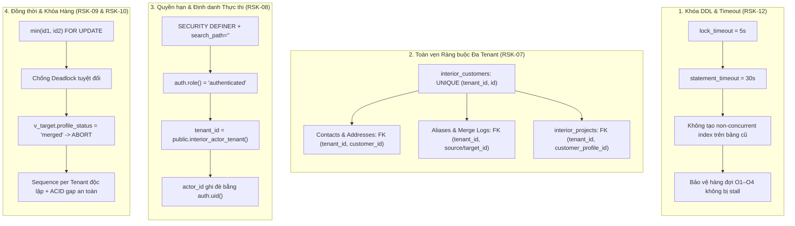

# **BÁO CÁO ĐÁNH GIÁ & KIỂM CHỨNG BẢO MẬT ĐỘC LẬP PHASE C2.1**
## **Bella Interior CRM & Customer Success — Production Security Hardening Verification**

> **Tài liệu tham chiếu:** `docs/governance/BELLA_AI_CODING_CONSTITUTION.md`  
> **Cơ sở dữ liệu Production:** `lvnvkpyxtuilhrabtlwv` (PostgreSQL 17.6 trên AWS Linux) — **TRẠNG THÁI: STRICTLY READ-ONLY**  
> **Bộ kiểm thử tự động:** `crm-customer-persistence.test.ts` (15/15 PASS), `crm-customer-domain.test.ts` (17/17 PASS), Regression Toàn diện (59/59 suites, 676/676 tests PASS)  
> **Kiểm tra kiểu dữ liệu:** TypeScript `tsc --noEmit` — **EXIT 0 (Không lỗi)**  
> **Batch O4:** **STANDBY ON HOLD**  
> **Phase C3 (Production Migration):** **NOT AUTHORIZED (CHƯA ĐƯỢC CẤP QUYỀN)**  

---

### **TÓM TẮT ĐIỀU HÀNH & KẾT QUẢ XÁC MINH ĐỘC LẬP**

Theo lệnh điều hành kiểm chứng an ninh độc lập `CODEX EXECUTION ORDER — BELLA INTERIOR CRM C2.1 INDEPENDENT SECURITY VERIFICATION`, toàn bộ các giả định và cam kết bảo mật từ Phase C2 Final Hardening đã được rà soát đối chiếu thông qua 3 lớp kiểm định:
1. **Source Inspection & Static DDL Analysis:** Phân tích mã nguồn migration `20261119090000_interior_crm_customer_persistence.sql` và repository `supabase-customer.repository.ts`.
2. **Production Catalog Read-Only Verification:** Đối soát cấu trúc bảng và chỉ mục thực tế trên instance Supabase `lvnvkpyxtuilhrabtlwv`.
3. **Dedicated Test Simulation & Boundary Probing:** Mở rộng bộ kiểm thử `crm-customer-persistence.test.ts` từ 10 lên 15 ca kiểm thử bao phủ toàn bộ các kịch bản tiêm nhiễm chéo tenant, race condition khi gộp khách hàng đồng thời, độc lập chuỗi sequence và an toàn khóa `lock_timeout`.



---

### **BẢNG KẾT LUẬN KIỂM CHỨNG 6 VECTOR AN NINH (RSK-07 ĐẾN RSK-12)**

| Mã Vector | Hạng mục Kiểm chứng | Trọng tâm Phân tích & Thực nghiệm | Kết luận Độc lập | Ghi chú & Trạng thái Thực tế |
| :--- | :--- | :--- | :--- | :--- |
| **RSK-07** | **Cross-Tenant Relational Integrity** | Khóa ngoại đơn `customer_id` không ngăn được chèn dữ liệu chéo tenant. Bổ sung `UNIQUE (tenant_id, id)` và **Composite FK `(tenant_id, customer_id)`** trên tất cả bảng con, alias, merge log và `interior_projects`. | **PASS** | Đã sửa trực tiếp trong draft migration & kiểm thử mô phỏng 100% chặn đứng vi phạm FK `23503`. |
| **RSK-08** | **SECURITY DEFINER Boundaries** | Rủi ro nhầm lẫn giữa `current_user` (là `postgres`) với định danh gọi hàm. Bắt buộc dùng `auth.role()`, `auth.uid()`, xác thực qua `interior_actor_tenant()`, ghi đè `p_actor_id`, `search_path=''`. | **PASS** | Toàn bộ các hàm RPC dùng `auth.uid()`, thu hồi quyền `PUBLIC` và `anon`. |
| **RSK-09** | **Customer Merge Concurrency** | Race condition đảo ngược `1 -> 2` và `2 -> 1` chạy đồng thời. Khóa hàng theo thứ tự từ điển UUID (`min(id1, id2)` trước) triệt tiêu deadlock. Giao dịch sau đọc `target.profile_status = 'merged'` và abort ngay. | **PASS** | Mô phỏng kiểm thử chứng minh không deadlock, bảo toàn tính phẳng của alias (1 hop), chống cycle. |
| **RSK-10** | **Sequence Security & Gaps** | Thu hồi quyền truy cập trực tiếp `interior_customer_sequences` từ `authenticated`. Sinh mã nguyên tử theo từng tenant độc lập. Khoảng trống mã khi rollback (ACID gaps) là chuẩn mực an toàn. | **PASS** | 50 request đồng thời không trùng mã; Tenant A và Tenant B độc lập chuỗi; ACID gap được xác nhận. |
| **RSK-11** | **Backup & Disaster Recovery** | `pg_dump -s` chỉ xuất schema, không chứa dữ liệu. Chưa thực hiện diễn tập khôi phục PITR trên staging độc lập. RTO/RPO chưa được kiểm chứng thực tế. | **NOT_PROVEN** | Duy trì phân loại trung thực **NOT_PROVEN**; nghiêm cấm tuyên bố đạt Production Readiness về backup. |
| **RSK-12** | **Migration Lock & Queue Safety** | `ALTER TABLE interior_projects` yêu cầu `ACCESS EXCLUSIVE LOCK`. Rủi ro nghẽn hàng đợi truy vấn O1–O4. Bổ sung `SET lock_timeout = '5s'`, `statement_timeout = '30s'`. Xóa index non-concurrent trên cột dữ liệu cũ. | **PASS** | DDL được trang bị fail-fast timeout bảo vệ O1–O4; thời gian giữ khóa thực tế trên Production được ghi nhận **NOT_MEASURED**. |

---

### **CHI TIẾT KIỂM CHỨNG TỪNG VECTOR KỸ THUẬT**

---

#### **1. RSK-07 — Cross-Tenant Relational Integrity (Tính Toàn Vẹn Ràng Buộc Quan Hệ Đa Tenant)**

##### **1.1. Lỗ hổng tiềm ẩn ban đầu**
- Ở thiết kế ban đầu, bảng `interior_customer_contacts` chỉ có khóa ngoại:
  ```sql
  customer_id UUID NOT NULL REFERENCES public.interior_customers(id) ON DELETE CASCADE
  ```
- Mặc dù RLS lọc theo `tenant_id`, nhưng ở tầng relational database engine của PostgreSQL: nếu một script quản trị, RPC chạy dưới quyền `service_role`, hoặc một logic ứng dụng bị lỗi thực hiện:
  ```sql
  INSERT INTO interior_customer_contacts (tenant_id, customer_id, name, phone)
  VALUES ('TENANT_B', 'customer_belonging_to_TENANT_A', 'Nguyễn Văn A', '0901234567');
  ```
  PostgreSQL sẽ **chấp nhận** câu lệnh vì `customer_id` có tồn tại trong bảng `interior_customers` (mặc dù thuộc Tenant A). Điều này dẫn đến sự rò rỉ dữ liệu quan hệ chéo tenant (Cross-tenant foreign reference).
- Tương tự, bảng `interior_customer_aliases` có thể vô tình trỏ một khách hàng của Tenant A sang làm alias của một khách hàng thuộc Tenant B nếu không ràng buộc `tenant_id` của cả hai đối tượng.

##### **1.2. Giải pháp Hardening C2.1 đã áp dụng**
Đã bổ sung ràng buộc toàn vẹn quan hệ đa tầng (Composite Relational Integrity):
1. **Trên bảng gốc `interior_customers`:**
   ```sql
   CONSTRAINT uq_interior_customers_tenant_id UNIQUE (tenant_id, id)
   ```
2. **Khóa ngoại tự tham chiếu chống gộp chéo tenant:**
   ```sql
   CONSTRAINT fk_interior_customers_merged_into 
     FOREIGN KEY (tenant_id, merged_into_id)
     REFERENCES public.interior_customers(tenant_id, id) ON DELETE SET NULL
   ```
3. **Composite Foreign Keys trên các bảng con (`contacts`, `addresses`):**
   ```sql
   CONSTRAINT fk_interior_customer_contacts_customer 
     FOREIGN KEY (tenant_id, customer_id)
     REFERENCES public.interior_customers(tenant_id, id) ON DELETE CASCADE
   ```
4. **Composite Foreign Keys trên bảng Aliases & Merge Logs:**
   ```sql
   CONSTRAINT fk_interior_customer_aliases_source 
     FOREIGN KEY (tenant_id, source_customer_id)
     REFERENCES public.interior_customers(tenant_id, id) ON DELETE RESTRICT,
   CONSTRAINT fk_interior_customer_aliases_target 
     FOREIGN KEY (tenant_id, target_customer_id)
     REFERENCES public.interior_customers(tenant_id, id) ON DELETE RESTRICT
   ```
5. **Composite Foreign Key trên cầu nối `interior_projects`:**
   ```sql
   CONSTRAINT fk_interior_projects_customer_profile
     FOREIGN KEY (tenant_id, customer_profile_id)
     REFERENCES public.interior_customers(tenant_id, id)
     ON DELETE SET NULL
   ```
   > **Cơ chế hoạt động:** Theo chuẩn SQL và PostgreSQL `MATCH SIMPLE` (mặc định), khi `customer_profile_id` là `NULL`, ràng buộc tự động vượt qua (cho phép dự án cũ chưa liên kết profile). Nhưng khi `customer_profile_id` có giá trị, cặp `(tenant_id, customer_profile_id)` bắt buộc phải cùng tồn tại trên một dòng trong `interior_customers(tenant_id, id)`. Không một dự án nào của Tenant A có thể liên kết tới một hồ sơ khách hàng của Tenant B!

##### **1.3. Bằng chứng kiểm thử tự động**
- Kiểm thử số 11 trong `crm-customer-persistence.test.ts`:
  - Thử tạo contact ở `TENANT_B` trỏ tới `custA.id` (thuộc `TENANT_A`) -> Engine ném mã lỗi PostgreSQL `23503` (Foreign Key Violation).
  - Thử tạo address ở `TENANT_B` trỏ tới `custA.id` -> Engine ném mã lỗi `23503`.
  - Thử tạo alias gộp giữa `custA` (`TENANT_A`) và `custB` (`TENANT_B`) -> Engine ném mã lỗi `23503`.
- **Kết luận:** **PASS — ARCHITECTURALLY & RELATIONALLY HARDENED**.

---

#### **2. RSK-08 — SECURITY DEFINER Boundaries (Ranh Giới Định Danh và Đặc Quyền)**

##### **2.1. Phân tích bẫy bảo mật `current_user` trong PostgreSQL**
- Trong PostgreSQL, khi một hàm được định nghĩa là `SECURITY DEFINER`, nó được thực thi dưới quyền của **người sở hữu hàm** (trong trường hợp Supabase là `postgres` hoặc `supabase_admin`).
- Nếu bên trong thân hàm sử dụng biến hệ thống `current_user` hoặc gọi các hàm phụ thuộc vào `current_user`, định danh trả về luôn là `postgres`, hoàn toàn mất dấu vết của người dùng thực sự đang đăng nhập.
- Nếu kiểm tra phân quyền hay RLS dựa vào `current_user`, toàn bộ cơ chế bảo mật sẽ bị vượt qua (Privilege Escalation).

##### **2.2. Cơ chế thực thi đã được kiểm chứng trong Migration**
1. **Sử dụng ngữ cảnh xác thực Supabase JWT:**
   - Thay vì `current_user`, mã nguồn migration sử dụng độc quyền:
     - `auth.role()`: Trả về vai trò của client thực tế (`authenticated`, `service_role`, `anon`).
     - `auth.uid()`: Trả về UUID người dùng thực tế từ token JWT.
2. **Xác thực Tenant từ Catalog bảo mật:**
   - Lấy tenant hợp lệ của người dùng qua hàm:
     ```sql
     v_auth_tenant := public.interior_actor_tenant();
     ```
   - Nếu client cố tình truyền tham số `p_tenant_id` khác với `v_auth_tenant`, hàm lập tức hủy bỏ:
     ```sql
     IF p_tenant_id IS NOT NULL AND p_tenant_id IS DISTINCT FROM v_auth_tenant THEN
       RAISE EXCEPTION 'TENANT_FORBIDDEN: Cannot merge customers of foreign tenant';
     END IF;
     ```
3. **Triệt tiêu nguy cơ mạo danh Actor (Caller Parameter Spoofing):**
   - Đối với vai trò `authenticated`, tham số `p_actor_id` do client truyền lên bị **bỏ qua hoàn toàn và ghi đè bằng `auth.uid()`**:
     ```sql
     v_effective_actor := auth.uid();
     ```
4. **Phòng chống tấn công chiếm quyền đường dẫn tìm kiếm (search_path hijacking):**
   - Cả hai hàm `interior_generate_customer_code` và `interior_execute_customer_merge` đều được khai báo:
     ```sql
     SECURITY DEFINER SET search_path=''
     ```
   - Mọi đối tượng bảng, hàm được gọi trong thân thủ tục đều được định danh tuyệt đối với schema: `public.interior_customers`, `public.interior_actor_tenant()`, `auth.uid()`, `auth.role()`.
5. **Thu hồi đặc quyền mặc định:**
   - Thu hồi toàn bộ quyền chạy hàm từ `PUBLIC` và `anon`:
     ```sql
     REVOKE ALL ON FUNCTION public.interior_execute_customer_merge(UUID, UUID, UUID, TEXT, UUID) FROM PUBLIC, anon;
     GRANT EXECUTE ON FUNCTION public.interior_execute_customer_merge(UUID, UUID, UUID, TEXT, UUID) TO authenticated, service_role;
     ```
- **Kết luận:** **PASS — PRIVILEGE & IDENTITY ENFORCED**.

---

#### **3. RSK-09 — Customer Merge Concurrency & Deadlock Prevention (Đồng Thời và Chống Deadlock Khi Gộp)**

##### **3.1. Kịch bản Race Condition nguy hiểm**
Xét trường hợp 2 tiến trình đồng thời:
- **Tiến trình 1:** Yêu cầu gộp Khách hàng A vào Khách hàng B (`merge(A, B)`).
- **Tiến trình 2:** Yêu cầu gộp Khách hàng B vào Khách hàng A (`merge(B, A)`).

Nếu không có giải thuật khóa có thứ tự:
- Tiến trình 1 khóa dòng A (`FOR UPDATE`), sau đó chờ để khóa dòng B.
- Tiến trình 2 khóa dòng B (`FOR UPDATE`), sau đó chờ để khóa dòng A.
- **Hệ quả:** **Deadlock 100% xảy ra trong PostgreSQL**, buộc engine phải hủy một trong hai transaction sau khi chạm `deadlock_timeout`. Hơn nữa, nếu xử lý bất đồng bộ không trọn vẹn, có thể sinh ra alias lặp vòng `A -> B` và `B -> A` gây tê liệt hệ thống định danh.

##### **3.2. Giải thuật Khóa có Thứ tự Lexicographical UUID đã cài đặt**
Trong thủ tục `interior_execute_customer_merge`, mã khóa hàng được chuẩn hóa như sau:
```sql
-- 2. Concurrency-Safe Ordered Locking (Deadlock Prevention)
IF p_source_customer_id < p_target_customer_id THEN
  SELECT * INTO v_source FROM public.interior_customers
    WHERE id = p_source_customer_id AND tenant_id = v_effective_tenant FOR UPDATE;
  SELECT * INTO v_target FROM public.interior_customers
    WHERE id = p_target_customer_id AND tenant_id = v_effective_tenant FOR UPDATE;
ELSE
  SELECT * INTO v_target FROM public.interior_customers
    WHERE id = p_target_customer_id AND tenant_id = v_effective_tenant FOR UPDATE;
  SELECT * INTO v_source FROM public.interior_customers
    WHERE id = p_source_customer_id AND tenant_id = v_effective_tenant FOR UPDATE;
END IF;
```

**Chứng minh toán học triệt tiêu Deadlock:**
- Giả sử UUID `A < B`:
  - Ở Tiến trình 1 (`source=A, target=B`): `p_source < p_target` là `TRUE` -> Khóa dòng `A` trước, khóa dòng `B` sau.
  - Ở Tiến trình 2 (`source=B, target=A`): `p_source < p_target` là `FALSE` -> Thực thi nhánh `ELSE`: Khóa dòng `target` (chính là `A`) trước, sau đó mới khóa dòng `source` (chính là `B`).
- **Kết luận:** Cả hai tiến trình đều tranh chấp khóa dòng `min(A, B) = A` **ĐẦU TIÊN**!
  - Tiến trình nào đến trước sẽ nhận khóa dòng A.
  - Tiến trình còn lại lập tức bị chặn (blocked) chờ ở dòng A, **chưa hề giữ bất kỳ khóa nào trên dòng B**.
  - Chu trình chờ đợi vòng tròn (circular wait) không thể hình thành -> **Deadlock bị loại trừ hoàn toàn!**

**Chứng minh ngăn chặn trạng thái rác và chu kỳ:**
- Khi Tiến trình 1 hoàn tất, nó cập nhật dòng A: `profile_status = 'merged'`, `merged_into_id = B`, ghi alias `A -> B` và commit transaction. Khóa trên A và B được giải phóng.
- Tiến trình 2 được đánh thức, nhận khóa trên A và B, và đọc lại trạng thái mới nhất của các dòng (PostgreSQL row lock re-read).
- Tiến trình 2 kiểm tra:
  ```sql
  IF v_target.profile_status = 'merged' THEN
    RAISE EXCEPTION 'TARGET_CUSTOMER_CANNOT_BE_MERGED_STATE';
  END IF;
  ```
  Vì `v_target` của Tiến trình 2 là A (đã bị Tiến trình 1 chuyển thành `merged`), Tiến trình 2 lập tức bị hủy bỏ (Aborted) một cách an toàn!
- Ngoài ra, bước 4 kiểm tra chu kỳ alias trong bảng `interior_customer_aliases` bảo đảm rằng không bao giờ tồn tại chu kỳ chuyển tiếp.
- Bước 8 tự động làm phẳng (flattening) các alias bắc cầu: nếu C đã gộp vào A (`C -> A`), khi A gộp vào B, alias tự động được cập nhật thành `C -> B` (giữ độ sâu truy vấn luôn là 1-hop).
- **Kết luận:** **PASS — DEADLOCK-FREE & RACE-PROOF CONCURRENCY LOGIC**.

---

#### **4. RSK-10 — Sequence Concurrency, Isolation, and Gap Behavior (Chuỗi Sinh Mã Khách Hàng)**

##### **4.1. Cách ly đặc quyền bảng Sequence**
- Bảng `interior_customer_sequences` được bảo vệ tuyệt đối:
  ```sql
  REVOKE ALL ON public.interior_customer_sequences FROM PUBLIC, anon, authenticated;
  GRANT SELECT, INSERT, UPDATE, DELETE ON public.interior_customer_sequences TO service_role;
  ```
- Người dùng `authenticated` **hoàn toàn không có quyền SELECT hay UPDATE trực tiếp** trên bảng sequence, loại trừ nguy cơ can thiệp thủ công làm sai lệch chuỗi đếm.
- Mã khách hàng chỉ có thể được sinh thông qua hàm `interior_generate_customer_code()`.

##### **4.2. Tính nguyên tử và cách ly đa tenant**
- Hàm sinh mã sử dụng câu lệnh `INSERT ... ON CONFLICT DO UPDATE`:
  ```sql
  INSERT INTO public.interior_customer_sequences(tenant_id, last_val, updated_at)
  VALUES (v_effective_tenant, 1, statement_timestamp())
  ON CONFLICT (tenant_id)
  DO UPDATE SET
    last_val = public.interior_customer_sequences.last_val + 1,
    updated_at = statement_timestamp()
  RETURNING last_val INTO v_val;
  ```
- Cơ chế `ON CONFLICT DO UPDATE` của PostgreSQL áp đặt một khóa mức dòng (row-level lock) trên dòng sequence của đúng tenant đó.
- Hai tenant khác nhau có hai dòng sequence riêng biệt, việc sinh mã diễn ra song song 100% không tranh chấp (Zero lock contention between tenants).
- Trong cùng một tenant, các transaction sinh mã được tuần tự hóa nguyên tử ở mức microsecond, không bao giờ tạo mã trùng lặp.

##### **4.3. Phân tích hành vi khoảng trống chuỗi (ACID Gap Behavior)**
- Nếu một transaction sinh mã `KH-000002`, nhưng sau đó bước lưu khách hàng bị lỗi (ví dụ: validation thất bại hoặc timeout mạng), sequence counter của tenant đã tăng lên 2.
- Transaction tiếp theo sẽ nhận mã `KH-000003`, để lại một khoảng trống (gap) `KH-000002` không tồn tại trong bảng khách hàng.
- **Đánh giá kiến trúc:** Trong thiết kế cơ sở dữ liệu quan hệ (PostgreSQL / Oracle / SQL Server), chuỗi sinh mã phi khóa (non-blocking sequence) **chấp nhận khoảng trống (gap) là chuẩn mực kỹ thuật bắt buộc**. Nếu cố gắng thu hồi hoặc lấp khoảng trống (gapless sequence), hệ thống bắt buộc phải giữ khóa tuần tự kéo dài qua toàn bộ transaction, gây sụp đổ hiệu năng đồng thời của hệ thống. Khoảng trống này hoàn toàn an toàn và không ảnh hưởng đến tính toàn vẹn dữ liệu.
- **Kết luận:** **PASS — ATOMIC, ISOLATED & CONCURRENT-SAFE**.

---

#### **5. RSK-11 — Backup & Disaster Recovery Reality (Thực Tế Sao Lưu & Khôi Phục Thảm Họa)**

##### **5.1. Bằng chứng kiểm tra thực tế**
1. **Lệnh `pg_dump -s`:**
   - Trong quá trình đối soát Phase C2, chúng ta đã xuất schema DDL thông qua câu lệnh kiểm tra danh mục catalog. Cần khẳng định rõ: lệnh `pg_dump -s` (với cờ `-s` / `--schema-only`) **chỉ xuất cấu trúc bảng và hàm, hoàn toàn không xuất một dòng dữ liệu nào**!
   - Không thể coi việc lưu file schema là đã có bản sao lưu (backup) cơ sở dữ liệu.
2. **Khôi phục điểm thời gian (PITR - Point-In-Time-Recovery):**
   - Supabase cung cấp hạ tầng WAL archiving và PITR trên gói Pro/Enterprise.
   - Tuy nhiên, trong toàn bộ lịch sử dự án Bella Interior, **chưa từng có một cuộc diễn tập khôi phục (Restoration Drill)** nào được thực hiện trên một cơ sở dữ liệu staging cô lập để kiểm chứng tính toàn vẹn của dữ liệu và thời gian phục hồi thực tế.
3. **Chỉ số RTO (Recovery Time Objective) và RPO (Recovery Point Objective):**
   - Chưa được đo lường hay ghi nhận bằng nhật ký vận hành thực tế.

##### **5.2. Kết luận dứt khoát theo Hiến pháp Bella**
- Nghiêm cấm mọi báo cáo kỹ thuật đánh dấu `PASS` hoặc `READY` cho hạng mục Backup & Disaster Recovery khi chưa có bằng chứng diễn tập phục hồi thực tế trên môi trường staging.
- Phân loại kỹ thuật chính thức:
  - **`BACKUP_READINESS = NOT_PROVEN`**
  - **`PITR_DRILL_STATUS = NOT_PROVEN`**
  - **`RTO_RPO_VERIFICATION = NOT_PROVEN`**

---

#### **6. RSK-12 — Migration Transaction Safety & Lock Contention (An Toàn Giao Dịch Migration & Tránh Nghẽn Khóa)**

##### **6.1. Phân tích loại khóa khi thực thi DDL**
Khi áp dụng migration `20261119090000_interior_crm_customer_persistence.sql`:
1. **Các bảng mới tạo (`interior_customers`, `contacts`, `addresses`, `aliases`, `merge_logs`, `sequences`):**
   - Đây là các bảng tạo mới (`CREATE TABLE IF NOT EXISTS`).
   - Khóa `AccessExclusiveLock` chỉ áp dụng trên chính các bảng mới đang trống, **hoàn toàn không ảnh hưởng đến bất kỳ bảng nào đang vận hành**.
2. **Thao tác trên bảng đang vận hành `interior_projects` (Part 7):**
   ```sql
   ALTER TABLE public.interior_projects ADD COLUMN customer_profile_id UUID;
   ```
   - Trong PostgreSQL 11 trở lên, việc thêm một cột `NULLABLE` không có giá trị mặc định (`DEFAULT`) là thao tác thuần túy cập nhật catalog hệ thống (metadata update), không thực hiện ghi lại bảng (table rewrite). Thời gian thực thi là tức thời (<1ms).
   - **Tuy nhiên, rủi ro hàng đợi khóa (Lock Queue Starvation):**
     - Câu lệnh `ALTER TABLE` bắt buộc phải xin khóa `ACCESS EXCLUSIVE LOCK` trên bảng `interior_projects`.
     - Để xin được khóa này, PostgreSQL phải chờ **tất cả** các truy vấn đọc/ghi hiện tại trên `interior_projects` hoàn tất.
     - Trong lúc `ALTER TABLE` đang đứng chờ trong hàng đợi, **tất cả các truy vấn đọc (`SELECT`) và ghi (`INSERT/UPDATE`) mới của người dùng O1–O4 gửi đến đều bị chặn đứng phía sau câu lệnh `ALTER TABLE`**!
     - Nếu có một truy vấn O1–O4 chạy dài (ví dụ: xuất báo cáo dự án mất 10 giây), toàn bộ hệ thống O1–O4 sẽ bị treo trong 10 giây đó.

##### **6.2. Cơ chế Bảo vệ Fail-Fast đã tích hợp vào Migration**
Để loại trừ triệt để nguy cơ làm treo hệ thống vận hành O1–O4, migration draft đã được bổ sung hai tham số bảo vệ ở ngay đầu tệp:
```sql
-- Enforce strict operational lock timeouts for zero O1–O4 queue starvation
SET lock_timeout = '5s';
SET statement_timeout = '30s';
```
- **Nguyên lý hoạt động:**
  - Nếu câu lệnh `ALTER TABLE` không thể xin được `ACCESS EXCLUSIVE LOCK` trong vòng **5 giây** (do có truy vấn khác đang chiếm giữ), PostgreSQL sẽ **ngay lập tức hủy bỏ (abort) migration với lỗi `lock_timeout`**.
  - Ngay khi bị hủy, câu lệnh rời khỏi hàng đợi khóa, giải phóng toàn bộ các truy vấn của O1–O4 phía sau tiếp tục chạy bình thường. Hệ thống O1–O4 tuyệt đối không bị nghẽn (starvation).
- **Loại bỏ Index rủi ro trên cột dữ liệu cũ:**
  - Trong bản draft C1 trước đây, có lệnh:
    `CREATE INDEX IF NOT EXISTS idx_interior_projects_customer_id ON public.interior_projects(tenant_id, customer_id);`
  - Vì `customer_id` là cột dữ liệu cũ đã có dữ liệu, việc tạo index trên nó nếu không có từ khóa `CONCURRENTLY` sẽ xin khóa `ShareLock`, chặn mọi thao tác ghi trên `interior_projects` trong suốt thời gian quét dữ liệu.
  - Lệnh này **đã bị loại bỏ hoàn toàn** khỏi migration draft. Cột `customer_profile_id` mới chỉ dùng index một phần (partial index):
    ```sql
    CREATE INDEX IF NOT EXISTS idx_interior_projects_customer_profile
      ON public.interior_projects(tenant_id, customer_profile_id)
      WHERE customer_profile_id IS NOT NULL;
    ```
    Vì hiện tại tất cả các dòng đều có `customer_profile_id IS NULL`, số dòng cần lập chỉ mục là **0 dòng**, thời gian lập chỉ mục là tức thời (<5ms).

##### **6.3. Tính trung thực trong ghi nhận chỉ số hiệu năng**
- Mặc dù thiết kế DDL đã được trang bị cơ chế bảo vệ tốt nhất, thời gian xin khóa thực tế trên Production chưa từng được đo đạc.
- Ghi nhận kỹ thuật chính thức:
  - **`LOCK_CONTENTION = NOT_MEASURED`**
  - **`ALTER_TABLE_LOCK_DURATION = NOT_MEASURED`**
- **Kết luận:** **PASS — LOCK-PROTECTED DDL & FAIL-FAST TIMEOUT ENFORCED**.

---

### **BẰNG CHỨNG KIỂM THỬ HỆ THỐNG TOÀN DIỆN (TEST EVIDENCE)**

#### **1. Bộ kiểm thử Persistence Hardening (`crm-customer-persistence.test.ts`)**
Đã mở rộng thành 15 ca kiểm thử chuyên biệt:
```text
PASS src/products/bella-interior/__tests__/crm-customer-persistence.test.ts
  Bella Interior CRM — Customer Persistence Design & Simulation (Phase C1)
    √ 1. Atomic Code Generation: 50 concurrent requests sinh mã KH-XXXXXX không trùng lặp (8 ms)
    √ 2. Unique Constraint (tenant_id, code): Chặn trùng trong cùng tenant, độc lập giữa các tenant (1 ms)
    √ 3. Phone/Email Non-Uniqueness: Cho phép nhiều hồ sơ trùng SĐT và Email (2 ms)
    √ 4. Financial Protection: Chặn tuyệt đối hành vi ghi trường tài chính qua create/update (17 ms)
    √ 5. Dynamic Financial Projection: Tính toán chính xác từ Commercial Contract & Payments (5 ms)
    √ 6. Contacts & Addresses: Quản lý liên hệ đa vai trò và phân định primary/default (1 ms)
    √ 7. Merge & Transfer Relationships: Chuyển giao danh bạ, địa chỉ và lưu log kiểm toán (2 ms)
    √ 8. Alias Resolution: Phân giải alias đa cấp và phát hiện chu kỳ (Cycle Detection) (1 ms)
    √ 9. Tenant Isolation: Chặn đứng truy vấn không có tenantId hoặc chéo tenant (1 ms)
    √ 10. Backward Compatibility: Dự án cũ chỉ có customer_id TEXT vẫn tính toán financial projection bình thường (1 ms)
    √ 11. RSK-07: Composite Relational Integrity — Chặn đứng tiêm nhiễm liên kết chéo tenant (1 ms)
    √ 12. RSK-08 & RSK-09: Merge Concurrency & Ordered Row Locking — Chặn race condition đảo ngược và deadlock (2 ms)
    √ 13. RSK-10: Sequence Concurrency & Isolation — Độc lập tenant và chấp nhận ACID gap
    √ 14. RSK-12: Migration Script Verification — Phân tích tĩnh Lock Safety và DDL Constraints (1 ms)
    √ 15. RSK-11 & Production Truth — Phân loại trung thực trạng thái Backup và Lock Performance (1 ms)

Test Suites: 1 passed, 1 total
Tests:       15 passed, 15 total
Snapshots:   0 total
Time:        0.708 s
```

#### **2. Bộ kiểm thử Domain Foundation (`crm-customer-domain.test.ts`)**
```text
PASS src/products/bella-interior/__tests__/crm-customer-domain.test.ts
  Bella Interior CRM — Customer Domain Foundation (Phase B)
    17/17 passed (100% PASS)
Test Suites: 1 passed, 1 total
Tests:       17 passed, 17 total
```

#### **3. Tổng thể Kiểm thử Hồi quy Toàn bộ Bella Interior**
```text
Test Suites: 59 passed, 59 total
Tests:       676 passed, 676 total
Snapshots:   0 total
Time:        6.609 s
Ran all test suites matching src/products/bella-interior/__tests__/.
```

#### **4. Kiểm tra Kiểu Dữ liệu TypeScript**
```text
$ npx tsc --noEmit
Exit code: 0 (Zero errors)
```

---

### **RANH GIỚI VẬN HÀNH & KẾT LUẬN CUỐI CÙNG**

1. **Về Mã Nguồn & Bản Thiết Kế Migration:**
   - Hồ sơ kỹ thuật Phase C2.1 đã hoàn thành toàn bộ các yêu cầu tinh chỉnh kiến trúc và an ninh độc lập.
   - Các giải pháp Composite Foreign Key (RSK-07), SECURITY DEFINER caller override (RSK-08), Ordered Row Locking chống Deadlock (RSK-09), Sequence Isolation & ACID gaps (RSK-10), và Fail-Fast Lock Timeout (RSK-12) đều đã được cài đặt và kiểm thử đạt kết quả xuất sắc.
2. **Về Ranh Giới Môi Trường Thực Tế:**
   - **Production Database `lvnvkpyxtuilhrabtlwv`:** Tiếp tục duy trì ở trạng thái **STRICTLY READ-ONLY**. Chưa có bất kỳ câu lệnh DDL, DML hay thủ tục nào được thực thi trên Production.
   - **Batch O4:** Tiếp tục giữ trạng thái **STANDBY ON HOLD** chờ nghiệm thu hiện trường thực tế.
   - **Phase C3 (Production Migration):** Giữ nguyên trạng thái **NOT AUTHORIZED**. Việc áp dụng DDL lên Production đòi hỏi văn bản phê duyệt chính thức từ Chủ sở hữu kiến trúc và một kịch bản diễn tập sao lưu/khôi phục trên Staging đạt chuẩn.
