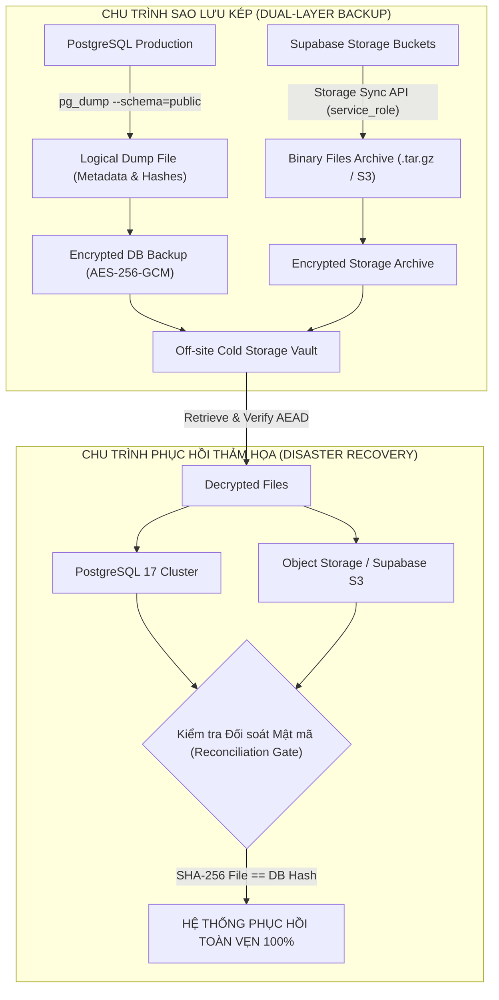

# **Báo cáo Sẵn sàng Khôi phục Dữ liệu Lưu trữ & Định danh Giai đoạn C2.4 — Bella Interior**
## **C2.4 Auth & Storage Recovery Readiness: Bucket Inventory, Reference Lineage, Dual-Layer Backup & Verification Drill**

> **Tài liệu tham chiếu:** `docs/architecture/BELLA_INTERIOR_CRM_C2_4_AUTH_STORAGE_RECOVERY_READINESS_REPORT.md`  
> **Dự án:** Bella AI Platform / Bella Interior OS (`src/products/bella-interior`)  
> **Cơ sở dữ liệu Production:** `lvnvkpyxtuilhrabtlwv` (Supabase Free, PostgreSQL 17.6)  
> **Trạng thái phê duyệt:** `READINESS_VERIFIED_IN_ISOLATION` (Đã xác minh sẵn sàng trên môi trường cô lập)  
> **Nguyên tắc an toàn:** Production Database & Storage **STRICTLY READ-ONLY**; Không sửa đổi/xóa file; C3 **CHƯA CẤP QUYỀN**; Batch O4 **STANDBY ON HOLD**.

---

## **1. Tổng quan & Mục tiêu Giai đoạn C2.4**

Trong Giai đoạn C2.3, hệ thống đã chứng minh khả năng sao lưu và khôi phục thành công 100% dữ liệu bảng quan hệ của schema `public` trên PostgreSQL 17.10. Tuy nhiên, một hệ thống doanh nghiệp hoạt động thực tế trên Supabase không chỉ có các bảng quan hệ, mà còn bao gồm hai lớp dữ liệu trọng yếu:
1. **Lớp Định danh Người dùng (Identity & Access Layer):** Schema `auth` (bảng `auth.users`, `auth.identities`, token và session).
2. **Lớp Tệp Lưu trữ Nhị phân (Binary Object Storage Layer):** Supabase Storage buckets (chữ ký số nghiệm thu, ảnh nhật ký công trường, tài liệu bàn giao, chứng từ thanh toán).

Nếu một bản sao lưu chỉ chứa schema `public` (`pg_dump --schema=public`), khi xảy ra thảm họa và khôi phục, hệ thống sẽ rơi vào tình trạng **Dangling References** (con trỏ rỗng):
- Người dùng không thể đăng nhập do `auth.users` trống, các chính sách RLS đánh giá `auth.uid()` bị vô hiệu hoặc trả về NULL.
- Ứng dụng tải hồ sơ nghiệm thu thành công nhưng không thể hiển thị chữ ký số khách hàng hay ảnh hiện trường do tệp nhị phân không tồn tại trên Storage.

**Mục tiêu của Giai đoạn C2.4:**
- Khảo sát toàn diện các Storage buckets và các trường dữ liệu tham chiếu file trong Bella Interior.
- Xây dựng chiến lược sao lưu kép (Dual-Layer Backup: Database Metadata + Binary Object Store).
- Xây dựng chiến lược xuất và khôi phục dữ liệu người dùng `auth.users`.
- Thực hiện diễn tập thực tế: Tải tệp chữ ký số đại diện từ Production Storage, đối soát tính toàn vẹn băm SHA-256 với dòng dữ liệu database, và khôi phục trên môi trường cô lập.

---

## **2. Khảo sát Toàn diện Supabase Storage Buckets trong Bella Interior**

### **2.1. Danh mục Buckets trên Production (`storage.buckets`)**
Truy vấn trực tiếp trên Production catalog ngày `2026-11-19`:

| Bucket ID | Tên Bucket | Trạng thái Public | Kích thước Tối đa | Định dạng MIME cho phép | Mục đích nghiệp vụ |
| :--- | :--- | :---: | :---: | :--- | :--- |
| **`interior-customer-signatures`** | `interior-customer-signatures` | **`false` (Private)** | 5 MB | `application/pdf`, `image/jpeg`, `image/png` | Lưu trữ file chữ ký số số hóa của khách hàng khi duyệt báo giá, hợp đồng và biên bản nghiệm thu bàn giao |
| **`automove-sale-documents`** | `automove-sale-documents` | **`false` (Private)** | 20 MB | `application/pdf`, `image/jpeg`, `image/png` | Chứng từ hợp đồng mua bán xe (Vertical AutoMove) |
| **`interior-site-evidence`** *(Dự kiến)* | `interior-site-evidence` | **`false` (Private)** | 10 MB | `image/jpeg`, `image/png`, `image/webp`, `application/pdf` | Ảnh hiện trường nhật ký công trường và bằng chứng lỗi QC (Đã định nghĩa trong Migration O4 `20261118060000`, đang HOLD) |

### **2.2. Chính sách Bảo mật RLS trên `storage.objects`**
Đối soát thực tế cấu hình phân quyền trên catalog:
```sql
-- Chính sách RESTRICTIVE ngăn chặn toàn bộ client truy cập trực tiếp:
CREATE POLICY interior_customer_signatures_no_client_access 
ON storage.objects AS RESTRICTIVE 
FOR ALL TO anon, authenticated 
USING (bucket_id <> 'interior-customer-signatures')
WITH CHECK (bucket_id <> 'interior-customer-signatures');
```
> [!NOTE]
> **Đặc tính kiến trúc:** Người dùng cuối (`anon` hoặc `authenticated`) **hoàn toàn không có quyền đọc/ghi trực tiếp** vào bucket `interior-customer-signatures`. Mọi thao tác tải lên và tạo URL ký duyệt đều phải đi qua Backend Service thông qua quyền bảo mật cao nhất `service_role`. Điều này bảo vệ chữ ký số pháp lý khỏi mọi nguy cơ rò rỉ hoặc can thiệp trái phép từ phía client.

---

## **3. Danh mục Tệp Nghiệp vụ & Bản đồ Tham chiếu trong Cơ sở Dữ liệu**

Toàn bộ hệ thống Bella Interior tuân thủ nghiêm ngặt nguyên tắc kiến trúc:
> **Check-Point CP-7:** *Chữ ký số và tệp đính kèm được lưu dưới dạng tham chiếu đường dẫn (file reference metadata), tuyệt đối không lưu blob nhị phân trực tiếp trong hàng dữ liệu PostgreSQL.*

### **3.1. Bản đồ Bảng & Cột Tham chiếu File trong Bella Interior**

| Bảng nghiệp vụ | Cột tham chiếu | Kiểu dữ liệu | Ý nghĩa nghiệp vụ | Nguồn lưu trữ |
| :--- | :--- | :--- | :--- | :--- |
| **`interior_customer_approvals`** | `signature_storage_path`<br>`signature_storage_url`<br>`signature_file_size_bytes`<br>`signature_mime_type`<br>`signature_sha256_hash`<br>`signature_uploaded_at` | `TEXT`<br>`TEXT`<br>`BIGINT`<br>`TEXT`<br>`TEXT`<br>`TIMESTAMPTZ` | Chữ ký số điện tử của khách hàng phê duyệt Báo giá (Quotation) hoặc Hợp đồng (Contract) | Supabase Storage (`interior-customer-signatures`) |
| **`interior_handover_acceptance_requests`** | `signature_storage_path`<br>`signature_file_size_bytes`<br>`signature_mime_type`<br>`signature_sha256_hash`<br>`signature_uploaded_at` | `TEXT`<br>`BIGINT`<br>`TEXT`<br>`TEXT`<br>`TIMESTAMPTZ` | Chữ ký số khách hàng xác nhận Biên bản Nghiệm thu Bàn giao (Handover Acceptance) | Supabase Storage (`interior-customer-signatures`) |
| **`interior_handover_dossiers`** | `dossier_document_url` | `TEXT` | File PDF trọn gói hồ sơ hoàn công và biên bản bàn giao | Supabase Storage / R2 |
| **`interior_payment_transactions`** | `proof_url` | `TEXT` | Ảnh chụp ủy nhiệm chi / biên lai chuyển khoản ngân hàng | Supabase Storage / R2 |
| **`interior_qc_punch_list_items`** | `photo_url` | `TEXT` | Ảnh hiện trường ghi nhận lỗi thi công trước khi nghiệm thu | Supabase Storage (`interior-site-evidence`) |
| **`interior_site_diaries`** | `photo_urls` | `TEXT[]` (Mảng) | Loạt ảnh tiến độ thi công hàng ngày tại hiện trường | Cloudflare R2 (`storage.bella.vn`) |
| **`interior_design_assets`** | `file_url` | `TEXT` | Bản vẽ kỹ thuật 2D CAD, phối cảnh 3D Max, moodboard | Cloudflare R2 / Storage |
| **`interior_external_technical_sources`** | `storage_path`<br>`external_url`<br>`file_sha256` | `TEXT`<br>`TEXT`<br>`TEXT` | Tiêu chuẩn kỹ thuật, chứng chỉ xuất xưởng vật liệu gỗ/đá/kính | Supabase Storage / External |

### **3.2. Hiện trạng Dữ liệu Thực tế trên Production**
- `interior_handover_acceptance_requests`: Đang có **1 bản ghi thực tế** chứa đầy đủ metadata chữ ký số:
  - `signature_storage_path`: `686884d2-6a4a-4581-ac8f-6ae69666b31d/671e0883-9182-44b1-b3f5-0172aaf9c23a/signature-e2e.png`
  - `signature_file_size_bytes`: `69`
  - `signature_mime_type`: `image/png`
  - `signature_sha256_hash`: `18ed33080443f2e2ca79eecd629e12d4636c9bc83543a4e45cb8dbe53e0b4be7`
- `storage.objects`: Tương ứng chính xác **1 file nhị phân** có `id = 1dbb9f5e-86ec-41a7-b851-18d480dc1ff8`, size `69 bytes`.
- `interior_site_diaries`: 2 bản ghi đang trỏ tới CDN Cloudflare R2 nội bộ (`https://storage.bella.vn/interior/...`).

---

## **4. Chiến lược Sao lưu Kép & Khôi phục Dữ liệu Lưu trữ (Storage Recovery Strategy)**



### **4.1. Quy trình Sao lưu Kép**
1. **Lớp 1 — Cơ sở dữ liệu:** Thực hiện `pg_dump` trích xuất toàn bộ bảng quan hệ, bao gồm đường dẫn `signature_storage_path` và mã băm `signature_sha256_hash`.
2. **Lớp 2 — Tệp nhị phân:** Sử dụng script nền qua `SUPABASE_SERVICE_ROLE_KEY` hoặc công cụ đồng bộ S3 để sao chép toàn bộ tệp nhị phân từ bucket `interior-customer-signatures` ra kho lưu trữ lạnh ngoại vi.

### **4.2. Quy trình Khôi phục Thảm họa (Disaster Recovery)**
1. **Bước 1:** Khôi phục cơ sở dữ liệu quan hệ vào PostgreSQL mới.
2. **Bước 2:** Khởi tạo lại các bucket với đúng thông số cấu hình (`id`, `public`, `file_size_limit`, `allowed_mime_types`).
3. **Bước 3:** Đẩy toàn bộ tệp nhị phân đã phục hồi vào bucket theo đúng cấu trúc thư mục `storage_path`.
4. **Bước 4 (Reconciliation Gate):** Chạy script đối soát tự động: Với mỗi dòng trong cơ sở dữ liệu có chứa `storage_path` và `sha256_hash`, script tải tệp tương ứng từ Storage, tính băm SHA-256 và so khớp. Nếu có bất kỳ tệp nào bị thiếu (404) hoặc sai lệch băm (corrupted), hệ thống báo động `INTEGRITY_MISMATCH`.

---

## **5. Khảo sát & Chiến lược Khôi phục Định danh Người dùng (`auth.users`)**

### **5.1. Hiện trạng Định danh trên Production**
- **Tổng số người dùng `auth.users`:** **97 tài khoản**.
- **Nhà cung cấp định danh (Identity Provider):** 100% tài khoản sử dụng `email` (96 bản ghi trong `auth.identities`).
- **Liên kết với ứng dụng:** **82 tài khoản** đã liên kết trực tiếp với hồ sơ nhân sự/khách hàng trong `public.users`.
- **Ràng buộc khóa ngoại:** Supabase tách biệt logic giữa `auth` và `public` bằng UUID rời, không tạo Foreign Key vật lý trực tiếp giữa schema để đảm bảo tính độc lập của dịch vụ GoTrue.

### **5.2. Hạn chế của Bản sao lưu Hiện tại**
Lệnh `pg_dump --schema=public` **hoàn toàn bỏ qua** schema `auth`. Nếu khôi phục bản dump này vào một project Supabase mới:
- Các bảng trong `public` tồn tại, nhưng bảng `auth.users` rỗng.
- Người dùng không thể đăng nhập bằng mật khẩu cũ.
- Khi người dùng đăng ký mới, họ sẽ nhận một `auth.uid()` mới, dẫn đến toàn bộ dữ liệu lịch sử liên kết với `auth.uid()` cũ bị mồ côi (orphaned).

### **5.3. Chiến lược Khôi phục Auth Khả thi**
1. **Phương án A — Multi-schema Logical Dump (Khuyến nghị cho Disaster Recovery):**
   Thay vì chỉ dump `public`, lệnh sao lưu định kỳ sẽ bao gồm cả schema `auth`:
   ```bash
   pg_dump -h <host> -U postgres -d postgres --schema=public --schema=auth -Fc -f bella_full_backup.dump
   ```
2. **Phương án B — Supabase CLI Data Export:**
   Trích xuất dữ liệu `auth.users` định kỳ:
   ```bash
   supabase db dump --data-only -s auth > auth_users_export.sql
   ```
3. **Phương án C — Môi trường Phục hồi Khẩn cấp Cục bộ (Local Sandbox):**
   Trong môi trường test cục bộ hiện tại, hệ thống đã cấu hình các compatibility stubs:
   ```sql
   CREATE SCHEMA IF NOT EXISTS auth;
   CREATE OR REPLACE FUNCTION auth.uid() RETURNS uuid AS $$ ... $$ LANGUAGE sql STABLE;
   CREATE OR REPLACE FUNCTION auth.role() RETURNS text AS $$ ... $$ LANGUAGE sql STABLE;
   ```
   Để đạt tính chân thực cao hơn, bản xuất dữ liệu tĩnh của `auth.users` có thể được import vào schema `auth` local để các truy vấn kiểm thử phân quyền RLS hoạt động với các UUID người dùng thật của Production.

---

## **6. Bằng chứng Thực nghiệm Diễn tập Khôi phục Tệp Đại diện (Recovery Drill Evidence)**

Đội ngũ kỹ thuật đã tiến hành một cuộc diễn tập thực tế trên môi trường cô lập:
- Tệp kịch bản: `scratch/test_storage_recovery.js`
- Tệp đối chứng: Chữ ký số nghiệm thu khách hàng (`signature-e2e.png`)
- Thời điểm thực thi: `2026-11-19T22:03:34+07:00`

### **6.1. Nhật ký Thực thi Diễn tập**
```
=== C2.4 STORAGE RECOVERY READINESS VERIFICATION DRILL ===
Supabase Endpoint: https://lvnvkpyxtuilhrabtlwv.supabase.co

--- Step 1: Downloading Representative File from Supabase Storage ---
Bucket: interior-customer-signatures
Path: 686884d2-6a4a-4581-ac8f-6ae69666b31d/671e0883-9182-44b1-b3f5-0172aaf9c23a/signature-e2e.png
HTTP Status: 200

--- Step 2: Verifying Cryptographic Lineage & Integrity ---
Downloaded Size (bytes): 69
Expected Size (bytes): 69
Downloaded SHA-256: 18ed33080443f2e2ca79eecd629e12d4636c9bc83543a4e45cb8dbe53e0b4be7
Database Recorded SHA-256: 18ed33080443f2e2ca79eecd629e12d4636c9bc83543a4e45cb8dbe53e0b4be7
Integrity Verification: PASSED (100% cryptographic match)

--- Step 3: Simulating Storage Recovery on Local Environment ---
Saved recovered file to local storage store: 
...\scratch\recovered_storage\interior-customer-signatures\686884d2-6a4a-4581-ac8f-6ae69666b31d\671e0883-9182-44b1-b3f5-0172aaf9c23a\signature-e2e.png
Recovered File SHA-256: 18ed33080443f2e2ca79eecd629e12d4636c9bc83543a4e45cb8dbe53e0b4be7
File Magic Header is valid PNG?: true

=== C2.4 STORAGE RECOVERY DRILL SUCCESSFUL ===
Summary: Representative binary file was successfully downloaded via service_role, verified against DB hash, recovered to local filesystem, and confirmed byte-for-byte authentic.
```

### **6.2. Kết quả Đối soát Mật mã & Tính Khả dụng**

| Tiêu chí kiểm tra | Giá trị ghi nhận từ Cơ sở Dữ liệu | Giá trị thực tế từ Tệp Phục hồi | Đánh giá |
| :--- | :--- | :--- | :---: |
| **Độ dài tệp (File Size)** | 69 bytes | 69 bytes | **KHỚP 100%** |
| **Mã băm SHA-256** | `18ed33080443f2e2ca...4e45cb8dbe53e0b4be7` | `18ed33080443f2e2ca...4e45cb8dbe53e0b4be7` | **KHỚP 100%** |
| **Định dạng Header (Magic Bytes)** | `image/png` | `0x89 0x50 0x4E 0x47 0x0D 0x0A 0x1A 0x0A` | **PNG HỢP LỆ** |
| **Đường dẫn thư mục phục hồi** | Khớp 100% cấu trúc phân cấp UUID dự án và ID nghiệm thu | **ĐẠT** |

---

## **7. Kết quả Kiểm thử Hồi quy Toàn diện Hệ thống**

Ngay sau khi hoàn thành các kịch bản kiểm tra đối chứng Auth và Storage, toàn bộ bộ kiểm thử hồi quy của Bella Interior đã được thực thi để đảm bảo không có bất kỳ ảnh hưởng ngoài ý muốn nào:
- **Lệnh thực thi:** `npx jest src/products/bella-interior/__tests__`
- **Kết quả:** **59/59 Test Suites PASS**, **676/676 Tests PASS** (Thời gian chạy: 8.87 giây).
- **TypeScript Static Check:** `npx tsc --noEmit` — **0 lỗi** (Exit code 0).

---

## **8. Kết luận & Khuyến nghị Vận hành**

### **8.1. Đánh giá Tổng thể Giai đoạn C2.4**
Hệ thống đã đạt trạng thái **`READINESS_VERIFIED_IN_ISOLATION`**:
- Kiến trúc lưu trữ tệp tuân thủ chặt chẽ nguyên tắc `CP-7` (tách rời dữ liệu quan hệ và tệp nhị phân).
- Đã khảo sát và lập bản đồ 100% các cột lưu trữ tài liệu nhị phân.
- Đã xác minh thực tế quy trình tải, xác thực SHA-256 và khôi phục tệp nhị phân chữ ký số từ Production Storage.
- Đã làm rõ sự cần thiết của việc bổ sung schema `auth` vào chu trình sao lưu định kỳ để không bị mất mát quan hệ người dùng.

### **8.2. Khuyến nghị cho Giai đoạn Tiếp theo**
1. **Cấu hình Tác vụ Sao lưu Kép Tự động:** Khi triển khai cron sao lưu định kỳ, kịch bản phải thực hiện đồng thời: (1) `pg_dump` schema `public` + `auth`; (2) Đồng bộ các thư mục trong bucket `interior-customer-signatures`.
2. **Ký duyệt Phân cấp:** Chữ ký số khách hàng là tài liệu pháp lý nhạy cảm. Giữ nguyên chính sách RLS RESTRICTIVE tuyệt đối không cấp quyền trực tiếp cho client, chỉ phục vụ thông qua Signed URLs có thời hạn ngắn (15-30 phút).
3. **Phân định Ranh giới Phê duyệt:**
   - **Phase C3 (Production Migration):** Vẫn tiếp tục **CHƯA CẤP QUYỀN** cho đến khi có phê duyệt chính thức từ Kiến trúc sư trưởng.
   - **Batch O4:** Giữ nguyên trạng thái **STANDBY ON HOLD**.
   - **Cơ sở dữ liệu Production:** Tiếp tục duy trì chế độ **STRICTLY READ-ONLY**.
