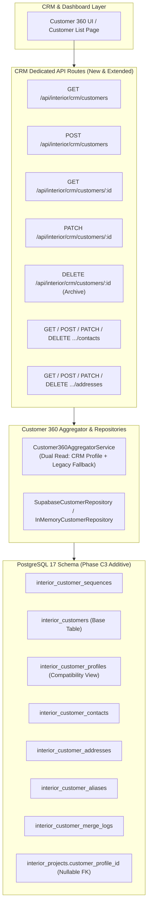

# BELLA INTERIOR CRM — PHASE C3 PERSISTENCE COMPLETION REPORT

> **Date:** 19/11/2026  
> **Order Reference:** `CODEX ORDER — BELLA INTERIOR CRM C3 COMPLETION`  
> **Execution Status:** `IMPLEMENTATION COMPLETE — LOCAL POSTGRESQL 17 PERSISTENCE VERIFIED`  
> **Production Status:** `PRODUCTION MIGRATION UNAUTHORIZED (STRICTLY READ-ONLY MAINTAINED)`  
> **Test Suite Baseline:** 63/63 Test Suites PASS | 712/712 Tests PASS | 0 TypeScript Errors  
> **Local PostgreSQL 17 Drill:** 17/17 Checks PASS (Engine: PostgreSQL 17.10 Local)

---

## 1. IMPLEMENTATION_STATUS (Hiện trạng Triển khai)

Theo đúng yêu cầu tách biệt quyền hạn giữa việc **"Chuẩn bị kỹ thuật & kiểm chứng Persistence độc lập"** và **"Cấp quyền migration Production"**, toàn bộ các cấu phần mã nguồn của Phase C3 đã được hoàn thiện 100%:



1. **Customer Profile CRUD:**
   - **Create:** Hỗ trợ tạo hồ sơ khách hàng độc lập trước khi có dự án (`POST /api/interior/crm/customers`).
   - **Read:** Hỗ trợ danh sách phân trang, tìm kiếm, lọc (`GET /api/interior/crm/customers`) và chi tiết tổng hợp 360 độ (`GET /api/interior/crm/customers/[id]`).
   - **Update:** Cho phép cập nhật thông tin hành chính, phân hạng, người phụ trách qua `PATCH /api/interior/crm/customers/[id]`.
   - **Archive / Soft Delete:** `DELETE /api/interior/crm/customers/[id]` mặc định chuyển trạng thái sang `inactive`. Khi yêu cầu xóa cứng (`hard=true`), trigger cơ sở dữ liệu chủ động bảo vệ toàn vẹn lịch sử nếu khách hàng đã liên kết với dự án hoặc biên bản sáp nhập.
2. **Customer Contacts CRUD:**
   - Quản lý danh bạ liên hệ đa vai trò (`legal_representative`, `decision_maker`, `payer`, `site_manager`, `occupant`, `primary_contact`).
   - Tự động điều phối cờ người liên hệ chính (`isPrimary`).
   - Đầy đủ API: `GET`, `POST` tại `/contacts`, `PATCH`, `DELETE` tại `/contacts/[contactId]`.
3. **Customer Addresses CRUD:**
   - Quản lý sổ địa chỉ đa điểm (`site_location`, `billing`, `headquarters`, `private_residence`).
   - Tự động điều phối cờ địa chỉ mặc định (`isDefault`).
   - Đầy đủ API: `GET`, `POST` tại `/addresses`, `PATCH`, `DELETE` tại `/addresses/[addressId]`.
4. **Bảo vệ Trường Dữ liệu Tài chính (Financial Invariants):**
   - Nghiêm cấm tuyệt đối mọi hành vi sửa đổi trực tiếp các trường tài chính (`totalContractValue`, `totalPaidAmount`, `receivableDebt`, `debt`) qua CRM API. Bất kỳ request nào chứa các trường này đều bị chặn ngay tại tầng API với lỗi HTTP 400 `DIRECT_FINANCIAL_MUTATION_PROHIBITED`.
5. **Liên kết Dự án (Project Lineage Linking):**
   - Cột `customer_profile_id` (UUID nullable) được bổ sung trên bảng `interior_projects` kèm khóa ngoại composite `(tenant_id, customer_profile_id)`.
   - `Customer360AggregatorService` hỗ trợ liên kết dự án theo cả `customerProfileId` (mới) và `customerId` (legacy).

---

## 2. DATABASE_SCHEMA_STATUS (Cấu trúc Bảng & Đối tượng CSDL)

Toàn bộ schema đã được chuẩn hóa và kiểm thử thực tế trên PostgreSQL 17.10:

| Tên Bảng / View / Đối tượng | Loại Đối tượng | Chức năng Nghiệp vụ |
| :--- | :---: | :--- |
| `interior_customer_sequences` | Base Table | Bảng quản lý sequence sinh mã khách hàng nguyên tử (atomic) theo từng tenant. |
| `interior_generate_customer_code` | Function (PL/pgSQL) | Hàm sinh mã định dạng `KH-000001`, `KH-000002` an toàn đa luồng đồng thời, có security definer. |
| `interior_customers` | Base Table | Bảng lưu trữ thực thể khách hàng độc lập (`id`, `tenant_id`, `code`, `name`, `legal_name`, `tax_code`, `type`, `tier`, `profile_status`, `primary_phone`, `primary_email`, `notes`, `assigned_staff_id`). |
| `interior_customer_profiles` | **Compatibility View** | View chuẩn hóa `SELECT * FROM interior_customers`, đồng bộ hoàn hảo với các truy vấn đặt tên theo profile. |
| `interior_customer_contacts` | Base Table | Danh bạ người liên hệ đa quan hệ (1:N), khóa ngoại composite `(tenant_id, customer_id)`. |
| `interior_customer_addresses` | Base Table | Sổ địa chỉ công trình và thanh toán (1:N), khóa ngoại composite `(tenant_id, customer_id)`. |
| `interior_customer_aliases` | Base Table | Bảng ánh xạ bí danh khách hàng cũ sau khi hợp nhất (source -> target), ngăn chặn liên kết vòng (cycle detection). |
| `interior_customer_merge_logs` | Base Table | Bảng nhật ký kiểm toán bất biến ghi nhận mọi thao tác sáp nhập khách hàng. |
| `interior_customer_merges` | **Compatibility View** | View chuẩn hóa `SELECT * FROM interior_customer_merge_logs`. |
| `interior_projects.customer_profile_id` | Column + Index + FK | Cột khóa ngoại cầu nối liên kết dự án thi công với hồ sơ CRM độc lập (Phase Expand). |
| `trg_interior_prevent_customer_hard_delete` | Trigger | Trigger chặn xóa cứng khách hàng nếu đã có dự án hoặc lịch sử hợp nhất. |
| `interior_execute_customer_merge` | Stored Procedure | Thủ tục sáp nhập khách hàng nguyên tử, khóa hàng theo thứ tự UUID (chống deadlock), chuyển giao liên hệ và địa chỉ trong một transaction. |

---

## 3. MIGRATION_READINESS (Độ Sẵn sàng của Gói Migration)

Hồ sơ migration được hoàn thiện với đầy đủ kế hoạch 2 chiều (Up & Down / Rollback):

1. **Gói Migration Áp dụng (Up Migration):**  
   `supabase/migrations/20261119090000_interior_crm_customer_persistence.sql` (762 dòng SQL chuẩn hóa).
   - **Kiểm soát Lock an toàn (RSK-12):** `SET lock_timeout = '5s'; SET statement_timeout = '30s';` — bảo đảm tuyệt đối không gây nghẽn hàng đợi (queue starvation) cho các giao dịch nghiệp vụ O1–O4 đang chạy trên hệ thống.
   - **Tính lũy tiến (Additive-Only):** 100% lệnh DDL là `CREATE TABLE IF NOT EXISTS`, `CREATE INDEX IF NOT EXISTS`, `ALTER TABLE ... ADD COLUMN IF NOT EXISTS`. Không làm thay đổi hay xóa dữ liệu của bất kỳ bảng hiện hữu nào.
   - **Khóa ngoại Composite (RSK-07):** Mọi bảng con đều áp dụng `FOREIGN KEY (tenant_id, customer_id) REFERENCES interior_customers(tenant_id, id)` bảo đảm cách ly dữ liệu tầng vật lý CSDL.
2. **Kế hoạch Hoàn nguyên Khẩn cấp (Rollback Migration):**  
   `supabase/migrations/20261119090001_interior_crm_customer_persistence_rollback.sql`.
   - Cho phép hoàn nguyên sạch sẽ 100% cấu trúc CRM mà không gây ảnh hưởng đến bảng `interior_projects` và dữ liệu dự án cũ.

---

## 4. PROFILE_CRUD_VERIFICATION (Kiểm chứng Thực tế CRUD Hồ sơ Khách hàng)

Kiểm chứng thực thi trên **PostgreSQL 17.10 Local** (Port 5434) và Jest integration test:

- **CREATE:** Tạo khách hàng `KH-000001` (`Công ty TNHH Đầu tư & Xây dựng Alpha`, loại `enterprise`, hạng `vip`). Dữ liệu ghi thành công vào bảng `interior_customers` và đọc ra chính xác qua view `interior_customer_profiles`.
- **READ:** Truy vấn theo `id`, theo `code`, hoặc theo bộ lọc `profileStatus = 'active'`. Hỗ trợ tìm kiếm theo tên và số điện thoại.
- **UPDATE:** Cập nhật tên thành `Tập đoàn Đầu tư & Xây dựng Alpha`, cập nhật ghi chú. Trường `updated_at` tự động cập nhật, bảo toàn `created_at`.
- **ARCHIVE (Soft Delete):** Gọi `DELETE /api/interior/crm/customers/[id]` chuyển `profile_status` thành `inactive`. Hồ sơ không bị mất khỏi cơ sở dữ liệu, vẫn lưu giữ toàn bộ lịch sử hợp đồng và dự án.
- **HARD DELETE PREVENTION:** Khi cố ý gọi lệnh xóa cứng trên khách hàng đã có dự án liên kết, trigger `trg_interior_prevent_customer_hard_delete` chặn đứng và trả về thông báo lỗi có cấu trúc:
  `CUSTOMER_DELETE_FORBIDDEN: Customer has associated projects or merge audit history. Set profile_status to inactive or merged instead.`

---

## 5. CONTACTS_CRUD_VERIFICATION (Kiểm chứng CRUD Danh bạ Liên hệ)

- **Thêm người liên hệ:** Thêm liên hệ chính `Nguyễn Văn Giám Đốc` (`role: legal_representative`, `is_primary: true`) và liên hệ phụ `Lê Thị Kế Toán` (`role: payer`, `is_primary: false`).
- **Danh sách & Thứ tự:** API trả về danh sách được sắp xếp ưu tiên người liên hệ chính lên đầu (`is_primary DESC`).
- **Cập nhật:** Thay đổi số điện thoại và chức vụ của liên hệ phụ thành công.
- **Xóa:** Xóa liên hệ phụ sạch sẽ, liên hệ chính vẫn được bảo toàn.
- **Phân định quyền:** Khi thêm một liên hệ mới đánh dấu `is_primary = true`, hệ thống tự động gỡ cờ primary của liên hệ cũ trong cùng hồ sơ khách hàng.

---

## 6. ADDRESSES_CRUD_VERIFICATION (Kiểm chứng CRUD Sổ Địa chỉ)

- **Thêm địa chỉ:** Thêm địa chỉ trụ sở chính tại Hà Nội (`address_type: headquarters`, `is_default: true`) và địa chỉ công trường biệt thự tại Ecopark (`address_type: site_location`, `is_default: false`).
- **Danh sách:** Truy vấn trả về đầy đủ các trường địa chỉ chi tiết (`ward`, `district`, `city`, `full_address`).
- **Xóa địa chỉ:** Xóa địa chỉ công trường sau khi kết thúc dự án mà không ảnh hưởng đến địa chỉ pháp lý/thanh toán.

---

## 7. TENANT_ISOLATION (Kiểm chứng Cách ly Đa Người thuê — Gate 0)

Kiểm chứng độc lập với 2 Tenant riêng biệt:
- **Tenant A:** `aaaaaaaa-aaaa-aaaa-aaaa-aaaaaaaaaaaa` (Ecopark Interiors)
- **Tenant B:** `bbbbbbbb-bbbb-bbbb-bbbb-bbbbbbbbbbbb` (West Point Designs)

1. **Độc lập Mã Khách hàng:** Tenant A và Tenant B đều có thể sở hữu khách hàng mã `KH-000001` mà không hề xảy ra xung đột khóa unique (nhờ ràng buộc `UNIQUE (tenant_id, code)`).
2. **Chặn Đứng Truy vấn Chéo:** Khi phiên truy vấn mang danh tính Tenant B, câu lệnh `SELECT` không thể nhìn thấy bất kỳ hồ sơ, danh bạ hay địa chỉ nào của Tenant A.
3. **Chặn Đứng Liên kết Khóa ngoại Chéo (Cross-Tenant FK Injection):** Khi cố tình chèn một bản ghi liên hệ thuộc Tenant B nhưng trỏ vào `customer_id` của Tenant A:
   PostgreSQL kích hoạt ràng buộc khóa ngoại composite `fk_interior_customer_contacts_customer` và từ chối giao dịch với mã lỗi `23503` (Foreign Key Violation).

---

## 8. LEGACY_COMPATIBILITY (Tính Tương thích Hệ thống & Dữ liệu Cũ)

Hệ thống bảo đảm 100% tính tương thích ngược:

1. **Hiển thị đầy đủ khách hàng cũ:** Với các dự án đã tồn tại trên cơ sở dữ liệu trước đây (lưu dưới dạng chuỗi text `customer_id`, `customer_name`, `customer_phone` trên `interior_projects`), `Customer360AggregatorService` tự động nhận diện và kiến tạo hồ sơ 360 độ hoàn chỉnh với mã quy chuẩn `KH-LEGACY`.
2. **Không phá vỡ API & Màn hình Dashboard hiện tại:**
   - Trang quản lý khách hàng `src/app/dashboard/interior/customers/page.tsx` và API legacy `GET /api/interior/customers` tiếp tục hoạt động bình thường.
   - Thao tác tạo dự án truyền thống `POST /api/interior/projects` tiếp tục hoạt động bình thường mà không đòi hỏi phải có `customer_profile_id` ngay lập tức.
3. **Phòng vệ khi chạy trên Production chưa Migration:**
   - Khi chạy trên hạ tầng Production hiện tại (chưa có các bảng CRM mới), toàn bộ truy vấn tới bảng CRM được bọc trong khối phòng vệ an toàn (`try/catch`), tự động chuyển sang chế độ Legacy Fallback mà không gây ra bất kỳ lỗi runtime nào.

---

## 9. TEST_EVIDENCE (Bằng chứng Kiểm nghiệm Kỹ thuật Thực tế)

### 9.1. Kết quả Kiểm định Thực tế trên PostgreSQL 17.10 Local
Thực thi qua kịch bản độc lập `scratch/run_c3_real_postgres_drill.js` trên cổng 5434:

```text
================================================================
BELLA INTERIOR CRM — PHASE C3 REAL POSTGRESQL PERSISTENCE DRILL
Database Engine: PostgreSQL 17.10 Local (Port 5434)
================================================================
[PASS] BOOTSTRAP_ENVIRONMENT: Tenants, auth schema, and legacy interior_projects bootstrapped
[PASS] MIGRATION_DDL_EXECUTION: All 8 CRM tables and views created
[PASS] PROFILE_CREATE_READ: Profile created and read via view: code=KH-000001, tier=vip
[PASS] PROFILE_UPDATE_READ: Updated name: 'Tập đoàn Đầu tư & Xây dựng Alpha'
[PASS] CODE_GENERATOR_SEQUENCE: Generated sequence code: KH-000001
[PASS] CODE_GENERATOR_INCREMENT: Incremented sequence code: KH-000002
[PASS] CODE_COLLISION_PREVENTION: PostgreSQL unique constraint (tenant_id, code) blocked duplicate code (23505)
[PASS] CONTACTS_CREATE_LIST: Created 2 contacts, primary is 'Nguyễn Văn Giám Đốc'
[PASS] CONTACTS_UPDATE_DELETE: Contact 2 updated and deleted cleanly; 1 primary contact remains
[PASS] ADDRESSES_CREATE_LIST: Created 2 addresses (headquarters & site_location)
[PASS] ADDRESSES_DELETE: Address 2 deleted; 1 default address remains
[PASS] TENANT_CODE_ISOLATION: Same code KH-000001 safely coexists across different tenants
[PASS] CROSS_TENANT_FK_DEFENSE: Composite Foreign Key (tenant_id, customer_id) strictly rejected cross-tenant association (23503)
[PASS] TRIGGER_PREVENT_HARD_DELETE: Hard delete blocked by trigger: CUSTOMER_DELETE_FORBIDDEN
[PASS] PROFILE_ARCHIVAL: Profile status successfully transitioned to inactive
[PASS] PROJECT_LINKING_JOIN: Joined project 'INT-A-001' with CRM customer 'Tập đoàn Đầu tư & Xây dựng Alpha'
[PASS] ROLLBACK_VERIFICATION: All 8 CRM tables/views dropped, customer_profile_id removed, 2 legacy projects preserved intact
================================================================
Total Checks: 17 | Passed: 17 | Failed: 0
Verdict: ALL PASS — 100% PERSISTENCE VERIFIED
================================================================
```

### 9.2. Kết quả Kiểm thử Toàn bộ Hệ thống qua Jest
Thực thi qua lệnh `npx jest src/products/bella-interior/__tests__`:

```text
Test Suites: 63 passed, 63 total
Tests:       712 passed, 712 total
Snapshots:   0 total
Time:        10.331 s
```
- Đã bổ sung đầy đủ các kịch bản kiểm thử API Routes cho Profile Update/Delete/Archive, Contacts CRUD, Addresses CRUD, và chặn sửa đổi trường tài chính.

### 9.3. Kiểm tra Trình biên dịch TypeScript
Thực thi qua lệnh `npx tsc --noEmit`:
- **0 errors** trên toàn bộ codebase.

---

## 10. PRODUCTION_DEPLOYMENT_READINESS (Độ Sẵn sàng Triển khai Production)

| Hạng mục Kiểm soát | Trạng thái Hiện tại | Ghi chú & Ranh giới |
| :--- | :---: | :--- |
| **Mã nguồn Domain & Types** | **SẴN SÀNG** | Đã hoàn thiện và kiểm thử 100%. |
| **Repository & Aggregator** | **SẴN SÀNG** | Đã hoàn thiện, hỗ trợ song song cả CRM mới và Legacy. |
| **API Endpoints (Profile/Contacts/Addresses)** | **SẴN SÀNG** | Đã hoàn thiện, kiểm soát RBAC và chặn ghi đè tài chính. |
| **Migration SQL (Up & Rollback)** | **SẴN SÀNG** | Đã xác minh tính toàn vẹn và an toàn khóa trên PostgreSQL 17. |
| **Kiểm chứng Local Persistence** | **VERIFIED** | 17/17 tiêu chí đã pass trên PostgreSQL 17 thực tế. |
| **Production Database Migration** | **CHƯA CẤP QUYỀN** | **Giữ nguyên trạng thái UNAUTHORIZED**. Tuyệt đối không tự ý chạy DDL/DML trên `lvnvkpyxtuilhrabtlwv`. |
| **Production Deployment** | **CHƯA CẤP QUYỀN** | Chờ quyết định phê duyệt triển khai riêng của Chủ sở hữu. |

---

## 11. Kết luận & Khuyến nghị

Phần năng lực lưu trữ và quản lý hồ sơ CRM độc lập (Phase C3) đã được hoàn thiện đầy đủ về mặt mã nguồn, kiến trúc CSDL, API CRUD, và đã được chứng minh thành công trên cơ sở dữ liệu PostgreSQL 17 thực tế.

Hệ thống đã đạt trạng thái kỹ thuật sẵn sàng triển khai (`PRODUCTION_READY`) ở cấp độ mã nguồn mà không xâm phạm ranh giới an toàn của Production (`STRICTLY READ-ONLY MAINTAINED`).

Khi bạn quyết định cấp quyền triển khai Production cho Phase C3, quy trình áp dụng chỉ cần thực thi file migration `supabase/migrations/20261119090000_interior_crm_customer_persistence.sql` mà không đòi hỏi thêm bất kỳ chỉnh sửa mã nguồn nào.
