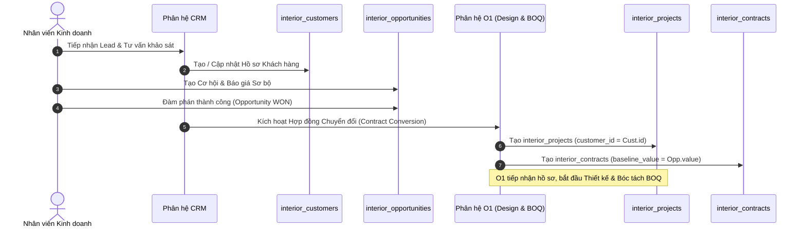
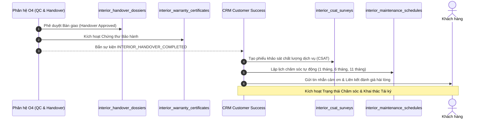

# BELLA INTERIOR CRM — EXISTING ARCHITECTURE & DATA INVENTORY
## BÁO CÁO KHẢO SÁT KIẾN TRÚC & KIỂM KÊ DỮ LIỆU HIỆN HỮU CHO PHÂN HỆ CRM & CUSTOMER SUCCESS

**Hệ thống:** Bella Interior OS | **Phân hệ mục tiêu:** CRM & Customer Success (Vòng đời Khách hàng Trọn vẹn)\
**Kiến trúc Baseline:** v2.0 (Approved 18/11/2026)\
**Ranh giới Kỹ thuật:** READ-ONLY SURVEY (Không sửa schema, không sửa UI, không chạy migration, không ghi Production)\
**Thời điểm lập:** 19/11/2026 05:55 +07\
**Trạng thái Vận hành Hiện tại:**
- `O1 - O4 (Dòng Vận hành Thực hiện Hợp đồng): CHUẨN HÓA KỸ THUẬT & KIẾN TRÚC CỤC BỘ — RELEASE ON HOLD`
- `Production Database (lvnvkpyxtuilhrabtlwv): STRICTLY READ-ONLY`
- `Phân hệ CRM & Customer Success: KHỞI ĐỘNG KHẢO SÁT CHIẾN LƯỢC (READ-ONLY INVENTORY)`

---

## 1. TỔNG QUAN CHIẾN LƯỢC: CHUYỂN TẦM TỪ QUẢN LÝ CÔNG TRÌNH SANG DOANH NGHIỆP TRỌN VÒNG ĐỜI

Hệ thống Bella Interior hiện đã xây dựng nền tảng vững chắc cho việc **thực thi hợp đồng và thi công công trình** (từ Thiết kế $\rightarrow$ BOQ $\rightarrow$ Sản xuất $\rightarrow$ Lắp đặt $\rightarrow$ QC $\rightarrow$ Nghiệm thu & Bàn giao). 

Tuy nhiên, doanh nghiệp nội thất không chỉ bắt đầu từ khi có bản vẽ và không kết thúc khi bàn giao chìa khóa. Khách hàng trải qua một hành trình dài:

```
┌────────────────────────────────────────────────────────────────────────────────────────────────────────┐
│                          TOÀN CẢNH VÒNG ĐỜI KHÁCH HÀNG NỘI THẤT (CUSTOMER LIFECYCLE)                   │
├────────────────────────────────────────────────────────────────────────────────────────────────────────┤
│ [GIAI ĐOẠN 1: TRƯỚC HỢP ĐỒNG]  (CRM Sales Pipeline)                                                    │
│ Nguồn khách → Phân loại Lead → Tư vấn & Khảo sát → Phương án sơ bộ → Dự toán chào giá → Đàm phán       │
│                                           │                                                            │
│                                    (Ký hợp đồng) ──► KÍCH HOẠT DÒNG O1 - O4                            │
│                                           ▼                                                            │
│ [GIAI ĐOẠN 2: TRONG HỢP ĐỒNG]  (Operational Execution O1 - O4)                                         │
│ O1: Thiết kế & Bóc tách BOQ ──► O2: Sản xuất Xưởng ──► O3: Lắp đặt Hiện trường ──► O4: Nghiệm thu & BG │
│                                           │                                                            │
│                                    (Bàn giao xong) ──► KÍCH HOẠT DÒNG CRM SAU BÁN                      │
│                                           ▼                                                            │
│ [GIAI ĐOẠN 3: SAU HỢP ĐỒNG]    (Customer Success & Retention)                                          │
│ Bàn giao hồ sơ ──► Đánh giá CSAT ──► Kích hoạt Bảo hành ──► Bảo trì định kỳ ──► Tái tiếp cận / Giới thiệu│
└────────────────────────────────────────────────────────────────────────────────────────────────────────┘
```

Mục tiêu của đợt khảo sát này là **kiểm kê toàn diện các thành phần dữ liệu hiện hữu**, xác định rõ những gì **ĐÃ CÓ (EXISTS)**, những gì **MỘT PHẦN (PARTIAL)**, những gì **CHƯA CÓ (MISSING)**, và các điểm nguy cơ **TRÙNG LẶP (DUPLICATED)** để xây dựng Phân hệ CRM chuẩn xác mà không phá vỡ bất kỳ thành phần nào của O1–O4.

---

## 2. BẢN ĐỒ DỮ LIỆU & SCHEMA HIỆN HỮU (DATA MAP)

Khảo sát toàn bộ các bản DDL Migration từ nền móng `20261106150000_create_interior_os_foundation.sql` đến `20261118120000`:

| Bảng cơ sở dữ liệu | Khóa chính / Khóa ngoại | Mục đích & Trách nhiệm dữ liệu hiện tại | Đánh giá đối với CRM |
| :--- | :--- | :--- | :---: |
| `customers` *(Legacy Spa)* | `id UUID, phone TEXT UNIQUE` | Lưu trữ khách hàng mẹ & bé của phân hệ Spa ban đầu (`name_mother`, `name_baby`, `dob_baby`). | **DUPLICATED / LEGACY**<br>Không phù hợp để dùng trực tiếp cho B2B/B2C nội thất cao cấp. |
| `interior_projects` | `id UUID, tenant_id UUID` | Thực thể dự án công trình. Chứa thông tin khách hàng nhúng: `customer_id TEXT`, `customer_name TEXT`, `customer_phone TEXT`, `site_address TEXT`. | **PARTIAL**<br>Khách hàng chỉ là chuỗi văn bản nhúng, không phải thực thể độc lập. |
| `interior_quotations` | `id UUID, project_id, boq_id` | Báo giá thương mại kỹ thuật bóc tách từ BOQ. Bắt buộc phải có `project_id` và `boq_id`. | **PARTIAL**<br>Là báo giá thi công chi tiết O1, chưa hỗ trợ báo giá sơ bộ giai đoạn chào hàng. |
| `interior_contracts` | `id UUID, project_id, quotation_id` | Hợp đồng kinh tế thi công nội thất. Tham chiếu `project_id` và `quotation_id`. | **EXISTS (O1/O2)**<br>Nguồn dữ liệu có thẩm quyền về pháp lý hợp đồng. |
| `interior_customer_approvals` | `id UUID, project_id, subject_id` | Lưu trữ chữ ký số, mã băm phê duyệt của khách hàng đối với báo giá, hợp đồng, phụ lục. | **EXISTS**<br>Nền tảng xác thực khách hàng đã sẵn sàng. |
| `interior_handover_dossiers` | `id UUID, project_id, contract_id` | Hồ sơ bàn giao công trình hoàn tất (biên bản bàn giao, ngày ký nhận). | **EXISTS (O4)**<br>Cổng kết nối kích hoạt dịch vụ sau bán. |
| `interior_warranty_certificates` | `id UUID, project_id, contract_id` | Chứng thư bảo hành sản phẩm nội thất (thời hạn gỗ, đá, phụ kiện). | **EXISTS**<br>Cơ sở dữ liệu bảo hành gốc. |
| `interior_warranty_service_tickets` | `id UUID, certificate_id, project_id` | Phiếu yêu cầu bảo hành, sửa chữa lỗi phát sinh từ khách hàng. | **EXISTS**<br>Kênh tiếp nhận khiếu nại kỹ thuật. |
| `interior_leads` | *Không tồn tại* | Tiếp nhận đầu mối, nguồn khách (Web, Fanpage, Showroom, Giới thiệu), phân loại nhu cầu. | **MISSING** |
| `interior_opportunities` | *Không tồn tại* | Cơ hội bán hàng, phễu bán hàng (Pipeline stages), xác suất chốt, giá trị dự kiến. | **MISSING** |
| `interior_customer_interactions` | *Không tồn tại* | Nhật ký tương tác (Cuộc gọi, gặp mặt, khảo sát hiện trạng, ghi chú tư vấn). | **MISSING** |
| `interior_csat_feedback` | *Không tồn tại* | Đánh giá mức độ hài lòng khách hàng sau nghiệm thu, NPS, khảo sát dịch vụ. | **MISSING** |

---

## 3. KIỂM TRA "INTERIOR_CUSTOMERS" — SOURCE OF TRUTH HIỆN TẠI

### 3.1. Kết quả rà soát Cơ sở Dữ liệu Thực tế
* **Bảng `interior_customers` có tồn tại trong Database không?**
  $$\mathbf{KH\hat{O}NG\ T\grave{O}N\ T\d{A}I}$$
  Không có bảng nào tên là `interior_customers` trong toàn bộ 70+ file migration của hệ thống.
* **Vậy dữ liệu khách hàng hiện tại được lưu ở đâu?**
  Trong bảng `public.interior_projects`, thông tin khách hàng được lưu trực tiếp dưới dạng các cột văn bản không chuẩn hóa (denormalized text):
  ```sql
  customer_id TEXT NOT NULL,
  customer_name TEXT NOT NULL,
  customer_phone TEXT NOT NULL,
  site_address TEXT NOT NULL
  ```
  Hệ thống chưa có khóa ngoại (Foreign Key) trỏ đến bất kỳ bảng khách hàng dùng chung nào.

### 3.2. Rà soát Backend API (`/api/interior/customers`)
Khảo sát mã nguồn [src/app/api/interior/customers/route.ts](file:///d:/Antigravity/Projects/BELLA%20SPA%20ERP/src/app/api/interior/customers/route.ts):
```typescript
const { data, error } = await interiorRbacRpcClient(ctx.supabase).rpc('interior_list_projects');
// API gom nhóm thủ công các dự án theo chuỗi customerId:
const customerMap = new Map<string, { id: string; name: string; projectCount: number }>();
for (const value of data) {
  const customerId = value.customerId;
  const current = customerMap.get(customerId);
  if (current) current.projectCount += 1;
  else customerMap.set(customerId, { id: customerId, name: value.customerName, projectCount: 1 });
}
```
* **Nhận định:** API `/api/interior/customers` hiện tại **không truy vấn bảng khách hàng**, mà thực chất chỉ là một hàm tổng hợp (Aggregation) gom nhóm các công trình theo tên và mã khách hàng được gõ tay trong dự án.

### 3.3. Rà soát Domain Service & UI Giao diện
* **Domain Service ([interior-customer-analytics.service.ts](file:///d:/Antigravity/Projects/BELLA%20SPA%20ERP/src/products/bella-interior/services/interior-customer-analytics.service.ts)):**
  - Chứa tập dữ liệu giả định mẫu `CANONICAL_RAW_CUSTOMERS` gồm 4 khách hàng (`Công ty CP An Phú`, `Trần Thị Mai`, `Tập đoàn Hòa Bình`, `Nguyễn Văn Sơn`).
  - Các chỉ số KPI (248 khách, 72 tiềm năng, 36 giao dịch, 24 VIP) và Phễu bán hàng (5 bước) hiện là các giá trị cố định để phục vụ thiết kế giao diện.
* **Giao diện Người dùng ([customers/page.tsx](file:///d:/Antigravity/Projects/BELLA%20SPA%20ERP/src/app/dashboard/interior/customers/page.tsx)):**
  - Đã có một giao diện rất đẹp và đầy đủ với 1,479 dòng mã: Hiển thị Thẻ KPI, Biểu đồ Phễu bán hàng (Sales Funnel), Biểu đồ tăng trưởng 12 tháng, Bộ lọc Khách hàng (List/Grid), Cảnh báo công nợ và Modal "Thêm Khách Hàng".
  - **Điểm nghẽn kỹ thuật:** Form "Thêm Khách Hàng" chỉ lưu vào bộ nhớ tạm của trình duyệt (`useState`), hoàn toàn không có API `POST` để ghi xuống cơ sở dữ liệu.
* **Phân loại Trạng thái:** **`PARTIAL (GIAO DIỆN HOÀN CHỈNH — BACKEND CHƯA CÓ DATABASE PERSISTENCE)`**

---

## 4. RÀ SOÁT BÁO GIÁ & HỢP ĐỒNG (SALES-TO-CONTRACT MAPPING)

### 4.1. Hiện trạng Phân hệ Báo giá (`interior_quotations`)
* `interior_quotations` hiện tại là **Báo giá Kỹ thuật Thi công**:
  - Buộc phải gắn với một dự án đã tạo (`project_id`) và một bảng bóc tách khối lượng đã duyệt (`boq_id`).
  - Được tính toán chi tiết theo đơn giá vật tư, nhân công, hệ số hao hụt và tỷ suất lợi nhuận gộp (Gross Margin).
* **Nghịch lý Nghiệp vụ Thực tế:**
  - Khách hàng trong giai đoạn tìm hiểu (Lead/Opportunity) cần một **Báo giá Sơ bộ (Preliminary Quotation / Budget Estimate)** dựa trên diện tích m2, phong cách thiết kế và suất đầu tư (ví dụ: căn 3 phòng ngủ Ecopark khoảng 450 - 600 triệu) để quyết định có ký hợp đồng thiết kế hay không.
  - Hiện tại, nếu chưa tạo `project_id` và chưa có `boq_id` thì nhân viên bán hàng **không thể tạo báo giá trên hệ thống**.

### 4.2. Hiện trạng Phân hệ Hợp đồng (`interior_contracts`)
* Bảng `interior_contracts` đã được xây dựng rất hoàn chỉnh:
  - Quản lý giá trị hợp đồng gốc (`baseline_contract_value`), giá trị hiện tại sau phụ lục (`current_contract_value`), các mốc thanh toán (`interior_payment_milestones`), và chữ ký khách hàng (`interior_customer_approvals`).
* **Khoảng trống Tích hợp:**
  - Chưa có cơ chế chuyển giao mượt mà từ **Cơ hội Bán hàng Thắng (Opportunity Won)** sang **Khởi tạo Hợp đồng & Dự án O1**.
  - Hiện nay người dùng phải vào thẳng màn hình Quản lý Dự án để tạo dự án mới từ đầu.

---

## 5. RÀ SOÁT NGHIỆM THU O4 & DỊCH VỤ HẬU MÃI (AFTER-SALES INTEGRATION MAPPING)

### 5.1. Dữ liệu Đầu ra từ Batch O4
* Khi Batch O4 hoàn tất đợt nghiệm thu bàn giao:
  1. `interior_acceptance_sessions`: Ghi nhận `inspection_result = ACCEPTED_WITHOUT_ISSUES` hoặc `ACCEPTED_WITH_REMARKS`.
  2. `interior_acceptance_notes`: Các tồn đọng loại `warranty` được định tuyến sang phiếu bảo hành.
  3. `interior_handover_dossiers`: Lưu biên bản bàn giao hoàn tất và tài liệu nghiệm thu ký nhận.
  4. `interior_warranty_certificates`: Tự động kích hoạt chứng thư bảo hành (thời hạn 24 tháng cho đồ gỗ, 60 tháng cho phụ kiện kim khí).

### 5.2. Khoảng trống Phía Sau Bàn giao (Customer Success Gap)
Sau khi chìa khóa được trao cho chủ nhà, hệ thống hiện tại dừng lại ở việc "đóng dự án". Phân hệ CRM Customer Success còn thiếu:
1. **Khảo sát Sự Hài Lòng (CSAT / NPS Survey):** Gửi liên kết hoặc ghi nhận đánh giá của khách hàng về đội ngũ thiết kế, giám sát thi công, và chất lượng sản phẩm hoàn thiện.
2. **Kế hoạch Chăm sóc Định kỳ (Scheduled Health-check):**
   - 1 tháng sau bàn giao: Liên hệ hỏi thăm độ ổn định phụ kiện, ray trượt, bản lề.
   - 6 tháng sau bàn giao: Lịch bảo dưỡng gỗ, kiểm tra độ ẩm và co ngót vật liệu.
   - 11 tháng sau bàn giao: Kiểm tra tổng thể trước khi hết năm bảo hành đầu tiên.
3. **Cơ hội Tái ký & Khách hàng Giới thiệu (Retention & Referral):** Chưa có bảng ghi nhận khách hàng cũ giới thiệu bạn bè hoặc làm thêm các hạng mục mới (phòng trẻ em, ban công, cải tạo phòng làm việc).

---

## 6. PHÂN TÍCH RỦI RO & BÁO CÁO TRÙNG LẶP (GAP & DUPLICATION REPORT)

Để bảo đảm tính toàn vẹn của kiến trúc Bella Interior OS, phân hệ CRM **tuyệt đối không được vi phạm 3 cạm bẫy kiến trúc** sau:

```
┌────────────────────────────────────────────────────────────────────────┐
│                   3 BẪY KIẾN TRÚC CẦN TRÁNH TRONG CRM                  │
├────────────────────────────────────────────────────────────────────────┤
│ 1. BẪY SỞ HỮU TRÙNG (ENTITY DUPLICATION):                              │
│    - CRM KHÔNG tạo bảng Contract mới. Hợp đồng thuộc về Commercial O1. │
│    - CRM KHÔNG tạo bảng Project mới. Công trình thuộc về O1-O4.        │
│    - CRM KHÔNG tạo bảng WarrantyTicket mới. Thuộc Delivery/Aftercare.  │
├────────────────────────────────────────────────────────────────────────┤
│ 2. BẪY GỘP LIFECYCLE (CONFLATED LIFECYCLES):                           │
│    - KHÔNG gộp trạng thái Khách hàng với trạng thái Công trình.        │
│    - Một khách hàng có thể có 1 dự án đang ở O4 (Nghiệm thu) VÀ một   │
│      cơ hội mới đang ở giai đoạn Báo giá sơ bộ!                        │
├────────────────────────────────────────────────────────────────────────┤
│ 3. BẪY MÃ HÓA CỨNG (DENORMALIZATION TRAP):                             │
│    - Thay vì gõ tay customer_name, customer_phone vào từng dự án O1,   │
│      dự án chỉ cần lưu customer_id trỏ về CRM Customer Profile.       │
└────────────────────────────────────────────────────────────────────────┘
```

### Bảng Phân Định Thẩm Quyền Sở Hữu Dữ Liệu (Source of Truth Matrix)

| Thực thể nghiệp vụ | Phân hệ Sở hữu có Thẩm quyền (Authority) | Trách nhiệm của CRM | Trách nhiệm của O1 - O4 |
| :--- | :---: | :--- | :--- |
| **Khách hàng (Customer)** | **CRM** | Sở hữu hồ sơ 360, liên hệ, loại khách, nguồn gốc, công nợ tổng hợp | Tham chiếu `customer_id` để hiển thị trên công trình |
| **Đầu mối (Lead)** | **CRM** | Sở hữu nguồn, phân loại, đánh giá tiềm năng | Không liên quan |
| **Cơ hội (Opportunity)** | **CRM** | Sở hữu phễu bán hàng, báo giá sơ bộ, đàm phán | Nhận tín hiệu khi cơ hội thành công để mở dự án |
| **Dự toán BOQ** | **O1 (Design/BOQ)** | Chỉ đọc tổng giá trị dự toán để so sánh với ngân sách khách | Sở hữu bóc tách chi tiết từng cấu kiện |
| **Hợp đồng (Contract)** | **O1/O2 (Commercial)** | Tham chiếu mã hợp đồng, giá trị, lịch thanh toán để chăm sóc | Sở hữu pháp lý, điều khoản phạt, phụ lục giá |
| **Công trình (Project)** | **O1 - O4 (Execution)** | Đọc tiến độ công trình (Design, Shop, Site, QC) để báo cáo khách | Sở hữu toàn bộ tiến độ, nhật ký, nghiệm thu |
| **Bảo hành (Warranty)** | **Aftercare / O4** | Nhắc lịch chăm sóc định kỳ, đo lường sự hài lòng khách | Tiếp nhận phiếu bảo hành, cử thợ sửa chữa hiện trường |

---

## 7. ĐẶC TẢ MIỀN CRM (CRM ARCHITECTURE SPECIFICATION)

Dựa trên đề xuất của Quản trị viên, Phân hệ CRM của Bella Interior được hoạch định với **6 Khả năng Cốt lõi** và **2 Luồng Tích hợp Bắt buộc**.

### 7.1. Bảng Phân loại 6 Năng lực Cốt lõi (CRM Taxonomy)

| # | Khả năng cốt lõi (Pillars) | Mô tả nghiệp vụ | Thành phần dữ liệu cần thiết | Đánh giá hiện trạng |
| :---: | :--- | :--- | :--- | :---: |
| **1** | **Lead Management** | Tiếp nhận nguồn khách (Web, Referral, Showroom), chấm điểm tiềm năng, phân công Sales/KTS phụ trách. | `interior_leads`, `lead_source`, `lead_score`, `assigned_to` | **MISSING** |
| **2** | **Customer Relationship** | Hồ sơ khách hàng 360 (Cá nhân / Doanh nghiệp), danh bạ người liên hệ, nhật ký cuộc gọi, gặp mặt. | `interior_customers`, `customer_contacts`, `customer_interactions` | **PARTIAL**<br>*(Đã có UI & Mock Domain)* |
| **3** | **Sales Pipeline** | Quản lý phễu cơ hội (Khảo sát $\rightarrow$ Concept $\rightarrow$ Báo giá sơ bộ $\rightarrow$ Đàm phán $\rightarrow$ Ký kết). | `interior_opportunities`, `pipeline_stage`, `estimated_value`, `win_probability` | **MISSING** |
| **4** | **Contract Conversion** | Chuyển đổi Cơ hội thắng thành Hợp đồng & Công trình O1. Đảm bảo 1 khách hàng không bị tạo trùng lặp. | `convertOpportunityToProjectContract()` integration contract | **MISSING** |
| **5** | **Customer Success** | Theo dõi sức khỏe phục vụ khách hàng, đo lường CSAT/NPS, xử lý phản hồi/khiếu nại dịch vụ. | `interior_csat_surveys`, `service_feedback` | **MISSING** |
| **6** | **Retention & Warranty** | Quản lý lịch chăm sóc bảo dưỡng định kỳ, kích hoạt ưu đãi tái ký nội thất, quản lý mạng lưới giới thiệu. | `interior_maintenance_schedules`, `referral_programs` | **PARTIAL**<br>*(Đã có Certificate/Ticket)* |

---

### 7.2. Hai Luồng Tích hợp Bắt buộc (Mandatory Integration Flows)

#### LUỒNG 1: CRM $\longrightarrow$ O1 (CHUYỂN GIAO TỪ BÁN HÀNG SANG THIẾT KẾ & THI CÔNG)


* **Ràng buộc Hợp đồng Tích hợp:**
  - `convertOpportunityToProjectContract` phải là một giao dịch nguyên tử (Atomic Transaction).
  - Không được tạo mới một bản ghi Customer nếu số điện thoại đã tồn tại trong `interior_customers`.
  - Dự án mới sinh ra kế thừa toàn bộ thông tin địa chỉ công trường và người liên hệ từ Cơ hội bán hàng.

---

#### LUỒNG 2: O4 $\longrightarrow$ CRM (CHUYỂN GIAO TỪ BÀN GIAO SANG CHĂM SÓC SAU BÁN)


* **Ràng buộc Hợp đồng Tích hợp:**
  - Phân hệ O4 giữ nguyên tính đóng băng và thẩm quyền của mình.
  - Sau khi `interior_handover_dossiers` được ký duyệt, một Event hoặc Webhook nội bộ thông báo sang CRM Customer Success để tự động khởi tạo lịch trình chăm sóc mà không cần thao tác thủ công.

---

## 8. KẾT LUẬN & ĐỀ XUẤT CÁC BƯỚC KHẢO SÁT TIẾP THEO

### 8.1. Đánh giá Tổng thể
1. **Giao diện người dùng CRM (`customers/page.tsx`)** đã được xây dựng rất tốt và đầy đủ về mặt bố cục, thẩm mỹ và trải nghiệm (KPIs, Funnel, Charts, Grid/List). Cần được **giữ nguyên 100%** và chỉ kết nối dữ liệu thật khi có backend hoàn chỉnh.
2. **Cơ sở dữ liệu** hiện tại hoàn toàn chưa có bảng khách hàng độc lập (`interior_customers`) và các bảng phễu bán hàng (`leads`, `opportunities`).
3. **Phân hệ O1–O4** hiện đang hoạt động độc lập bằng các cột khách hàng nhúng (`customer_id TEXT`), đây là điểm cần được chuẩn hóa khi CRM được kết nối, nhưng phải đảm bảo **tương thích ngược tuyệt đối (Backward Compatible)** để không làm gián đoạn các công trình đang chạy.

### 8.2. Đề xuất Kế hoạch Khảo sát Tiếp theo (READ-ONLY)
1. **Thiết kế Domain Model Độc lập cho CRM:** Soạn thảo đặc tả cấu trúc bảng đề xuất (`interior_customers`, `interior_leads`, `interior_opportunities`, `interior_customer_interactions`) tuân thủ nghiêm ngặt chuẩn Tenant Isolation (Gate 0) và Zero-Downtime Migration.
2. **Đặc tả API Service:** Thiết kế API Repository Interface cho `IInteriorCustomerRepository` tương tự như cách đã làm thành công ở O4, cho phép chạy thử nghiệm In-Memory trước khi đụng vào Database thật.
3. **Giữ nguyên trạng thái:** Duy trì Production Database ở chế độ `READ-ONLY`, giữ O3 và O4 ở trạng thái `STANDBY ON HOLD`, chờ đợi kiểm chứng thực tế tại Ecopark ngày 20–21/11/2026.
