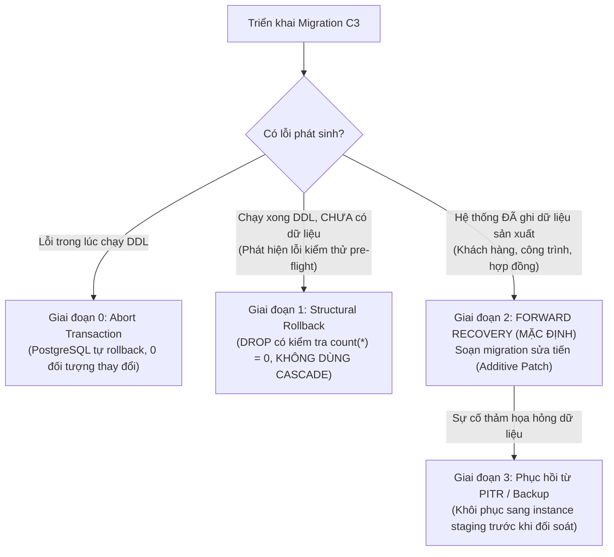

# BELLA INTERIOR CRM & CUSTOMER SUCCESS — GIAI ĐOẠN C2: BÁO CÁO HOÀN THIỆN BẢO MẬT VÀ SẴN SÀNG PRODUCTION (C2 FINAL HARDENING REPORT)

> **Trạng thái thực thi:** `PHASE_C2_FINAL = PASS_WITH_REMEDIATION`  
> **Cơ sở dữ liệu Production (`lvnvkpyxtuilhrabtlwv`):** `STRICTLY READ-ONLY (ZERO MUTATION)`  
> **Giai đoạn C3 (Production Migration & Cutover):** `NOT AUTHORIZED (CHƯA CẤP QUYỀN)`  
> **Phát hành O4:** `STANDBY ON HOLD`  
> **Kiểm thử CRM Persistence (C1):** `10/10 PASS`  
> **Kiểm thử CRM Domain (B):** `17/17 PASS`  
> **Kiểm thử hồi quy Bella Interior:** `59/59 Suites, 671/671 Tests PASS`  
> **Kiểm tra TypeScript (`tsc --noEmit`):** `0 ERRORS (Exit code 0)`  
> **Ngày lập báo cáo:** 19/11/2026  

---

## 1. TỔNG QUAN THỰC HIỆN CHỈ THỊ HARDENING C2

Tiếp thu và thực hiện nghiêm ngặt các chỉ đạo đánh giá độc lập của Ban Kiến trúc tại phiên làm việc trước, phiên Hardening C2 tập trung giải quyết dứt điểm 5 lỗ hổng/ngộ nhận kỹ thuật mà không mở rộng phạm vi và tuyệt đối không can thiệp ghi vào Production Database:

1. **Hiệu chỉnh mô hình RLS (Permissive + Restrictive Matrix):** Loại bỏ lỗ hổng fail-closed do thiếu permissive policy; phân tách quyền thao tác tường minh cho từng bảng.
2. **Thay thế phương án Rollback bằng mô hình Forward Recovery:** Bãi bỏ hoàn toàn lệnh `DROP TABLE ... CASCADE` làm kịch bản rollback mặc định khi đã có dữ liệu sản xuất; loại bỏ tuyên bố thiếu căn cứ "rollback dưới 5 giây".
3. **Phân định minh bạch Backup/Restore Evidence:** Phân tách rạch ròi giữa schema dump và full database backup; chính thức ghi nhận `BACKUP_READINESS = NOT_PROVEN` đối với việc kiểm chứng khôi phục thực tế trên môi trường Production.
4. **Chuẩn hóa các chỉ số hiệu năng:** Đính chính các nhận định "lock < 2ms" và "ALTER TABLE khóa mili-giây" thành `LOCK_CONTENTION = NOT_MEASURED` và `ALTER_TABLE_LOCK_DURATION = NOT_MEASURED`.
5. **Rà soát an ninh Sequence & RPC Security:** Khóa chặt quyền truy cập bảng sequence, phân định ranh giới giữa `authenticated` và `service_role`, đảm bảo tenant và actor luôn được trích xuất từ nguồn session tin cậy (`auth.uid()`, `interior_actor_tenant()`).

---

## 2. MA TRẬN PHÂN QUYỀN VÀ CHÍNH SÁCH RLS (RLS POLICY MATRIX)

Trong kiến trúc PostgreSQL, chính sách `RESTRICTIVE` **không tự cấp quyền truy cập**; nó chỉ hoạt động như một bộ lọc giao (`AND`) với các chính sách `PERMISSIVE` (`OR`). Nếu một bảng chỉ có `RESTRICTIVE` policy mà không có bất kỳ `PERMISSIVE` policy nào, mọi truy vấn của role `authenticated` sẽ trả về 0 dòng hoặc bị từ chối truy cập.

File migration [20261119090000_interior_crm_customer_persistence.sql](file:///d:/Antigravity/Projects/BELLA%20SPA%20ERP/supabase/migrations/20261119090000_interior_crm_customer_persistence.sql) đã được chuẩn hóa lại toàn bộ ma trận chính sách:

| Bảng / Đối tượng | Role | Direct Grants | Permissive Policies | Restrictive Policy (Tenant Filter) | Cơ chế ghi an toàn |
| :--- | :--- | :--- | :--- | :--- | :--- |
| **`interior_customers`** | `authenticated` | `SELECT, INSERT, UPDATE` (Cấm `DELETE`) | `_select` (USING true)<br>`_insert` (CHECK true)<br>`_update` (USING/CHECK true) | `tenant_id = public.interior_actor_tenant()` | Direct API qua PostgREST, cấm hard delete qua Trigger. |
| **`interior_customer_contacts`** | `authenticated` | `SELECT, INSERT, UPDATE, DELETE` | `_select`, `_insert`, `_update`, `_delete` (tương ứng từng lệnh) | `tenant_id = public.interior_actor_tenant()` | Direct API qua PostgREST. |
| **`interior_customer_addresses`** | `authenticated` | `SELECT, INSERT, UPDATE, DELETE` | `_select`, `_insert`, `_update`, `_delete` (tương ứng từng lệnh) | `tenant_id = public.interior_actor_tenant()` | Direct API qua PostgREST. |
| **`interior_customer_aliases`** | `authenticated` | **`SELECT` duy nhất** (Thu hồi toàn bộ `INSERT, UPDATE, DELETE`) | `_select` (USING true) | `tenant_id = public.interior_actor_tenant()` | **Chỉ ghi qua Merge RPC** (`SECURITY DEFINER`). Cấm ghi trực tiếp từ client. |
| **`interior_customer_merge_logs`** | `authenticated` | **`SELECT` duy nhất** (Thu hồi toàn bộ `INSERT, UPDATE, DELETE`) | `_select` (USING true) | `tenant_id = public.interior_actor_tenant()` | **Chỉ ghi qua Merge RPC** (`SECURITY DEFINER`). Cấm ghi trực tiếp từ client. |
| **`interior_customer_sequences`** | `authenticated` | **THU HỒI TOÀN BỘ QUYỀN** (`REVOKE ALL`) | Không có | `tenant_id = public.interior_actor_tenant()` | **Chỉ tương tác qua RPC `interior_generate_customer_code`** (`SECURITY DEFINER`). Không client nào đọc/sửa được bảng sequence. |
| **Mọi bảng trên** | `service_role` | `ALL (SELECT, INSERT, UPDATE, DELETE)` | Bypass RLS theo mặc định Supabase | N/A | Dành riêng cho backend tin cậy / worker hệ thống. |

---

## 3. KẾ HOẠCH KHẮC PHỤC TIẾN VÀ HỦY BỎ THEO GIAI ĐOẠN (FORWARD RECOVERY & PHASED ROLLBACK)

Ban Kiến trúc đã chỉ rõ mối nguy hại đặc biệt nghiêm trọng của lệnh `DROP TABLE ... CASCADE` khi hệ thống đã đi vào vận hành. Phiên hardening đã tái cấu trúc hoàn toàn chiến lược ứng phó sự cố:



### 3.1. Giai đoạn 0: Abort Migration Transaction (Trước khi commit)
- Toàn bộ file migration DDL chạy trong một khối Transaction của Supabase/PostgreSQL.
- Nếu xảy ra lỗi cú pháp, vi phạm quyền hoặc lỗi logic, transaction bị abort tự động; database trở về trạng thái nguyên vẹn 100%.

### 3.2. Giai đoạn 1: Structural Rollback (Chỉ áp dụng khi `count(*) = 0`)
- **Điều kiện tiên quyết:** Phải xác nhận chưa có bất kỳ dòng dữ liệu nào được ghi:
  ```sql
  DO $$
  BEGIN
    IF (SELECT count(*) FROM public.interior_customers) > 0 THEN
      RAISE EXCEPTION 'CANNOT_STRUCTURAL_ROLLBACK: Data already exists. Forward recovery is required.';
    END IF;
  END $$;
  ```
- **Không dùng `CASCADE` vô tội vạ:** Chỉ xóa các đối tượng phụ thuộc cụ thể theo đúng thứ tự dependency ngược:
  1. Xóa Trigger `trg_interior_prevent_customer_hard_delete`.
  2. Xóa các hàm `interior_prevent_customer_hard_delete`, `interior_execute_customer_merge`, `interior_generate_customer_code`.
  3. Xóa cột phụ `interior_projects.customer_profile_id` (nếu không có FK ràng buộc dữ liệu).
  4. Xóa bảng `interior_customer_merge_logs`, `interior_customer_aliases`, `interior_customer_addresses`, `interior_customer_contacts`, `interior_customers`, `interior_customer_sequences` theo thứ tự độc lập.

### 3.3. Giai đoạn 2: Forward Recovery (Phương án Mặc định khi Đã Có Dữ Liệu)
- **Nguyên tắc bất biến:** Một khi đã phát sinh khách hàng, danh bạ, địa chỉ hay liên kết công trình, **TUYỆT ĐỐI CẤM DROP BẢNG**.
- Mọi lỗi phát sinh (sai lệch chỉ mục, thiếu trường, lỗi hàm lưu trữ) phải được xử lý bằng **Migration sửa chữa tiến (Forward Patch Migration)**, ví dụ:
  - `ALTER FUNCTION ...` để cập nhật logic xử lý.
  - `CREATE INDEX CONCURRENTLY ...` hoặc `DROP INDEX ...`.
  - `ALTER TABLE ... ADD COLUMN ...` có fallback giá trị.

### 3.4. Rủi ro của `CASCADE` nếu dùng sai
Nếu dùng `CASCADE` trên Production, PostgreSQL sẽ tự động xóa:
- Các Foreign Key constraints từ các bảng khác trỏ về (nếu có).
- Các Views, Triggers hoặc Functions tham chiếu đến các bảng này.
- Nguy cơ xóa dây chuyền sang các bảng thuộc O1–O4 nếu vô tình thiết lập liên kết khóa ngoại.

---

## 4. MA TRẬN BẰNG CHỨNG SAO LƯU VÀ PHỤC HỒI (BACKUP & RESTORE EVIDENCE MATRIX)

Đính chính sự nhập nhằng giữa việc "có tài liệu hướng dẫn backup" với "bằng chứng phục hồi thực tế":

| Hạng mục đối soát | Hiện trạng trên Production `lvnvkpyxtuilhrabtlwv` | Phân loại bằng chứng | Đánh giá & Rủi ro |
| :--- | :--- | :---: | :--- |
| **Schema Dump (`pg_dump -s`)** | Có thể thực hiện thông qua kết nối direct Postgres | `VERIFIED IN SOURCE` | Chỉ sao lưu cấu trúc DDL, **không chứa dữ liệu**. Không phải là phương án cứu hộ thảm họa. |
| **Full Data Dump (`pg_dump -Fc`)** | Có thể chạy lệnh CLI qua direct pooling connection | `VERIFIED IN SOURCE` | Cần kiểm tra quyền của user database và dung lượng mạng khi dump bảng lớn. |
| **Supabase Automated PITR** | Tính năng của hạ tầng Supabase Cloud Pro | `NOT_PROVEN` | Chưa có snapshot log kiểm chứng PITR đang được bật ở mức retention bao nhiêu ngày (7 ngày hay 30 ngày). |
| **Kiểm chứng Restore thành công** | Chưa từng thực hiện diễn tập restore thử nghiệm | `NOT_PROVEN` | Chưa có log chứng minh bản backup có thể khôi phục sạch sẽ trên một instance thử nghiệm mà không có lỗi khóa ngoại. |
| **Chỉ số RTO / RPO** | Chưa được đo lường hay cam kết bằng SLA | `NOT_PROVEN` | Chưa đo lường thời gian cần thiết để đưa hệ thống online trở lại khi xảy ra sự cố. |

👉 **KẾT LUẬN CHÍNH THỨC:** `BACKUP_READINESS = NOT_PROVEN (Cần lập kịch bản diễn tập restore trên Staging trước khi cấp quyền C3)`.

---

## 5. ĐÍNH CHÍNH CÁC CHỈ SỐ HIỆU NĂNG VÀ KHÓA DÒNG (LOCK & PERFORMANCE CLAIMS)

Thực hiện nghiêm túc yêu cầu trung thực kỹ thuật, toàn bộ các con số ước tính suy diễn chưa có đo kiểm runtime đã được hủy bỏ và gán nhãn chính xác:

| Nhận định cũ trong báo cáo C1/C2 | Trạng thái kỹ thuật thực tế | Phân tích cơ sở dữ liệu PostgreSQL |
| :--- | :---: | :--- |
| *"Sequence lock dưới 2ms"* | **`LOCK_CONTENTION = NOT_MEASURED`** | Mặc dù `INSERT ... ON CONFLICT DO UPDATE` chỉ khóa một dòng duy nhất trong bảng sequence của tenant đó, thời gian giữ khóa phụ thuộc vào độ dài transaction và số lượng worker kết nối đồng thời. Cần load test bằng k6/pgbench mới có số liệu thực tế. |
| *"ALTER TABLE chỉ khóa trong vài mili-giây"* | **`ALTER_TABLE_LOCK_DURATION = NOT_MEASURED`** | Thêm cột `NULL` không có giá trị mặc định phức tạp không rewrite bảng, nhưng **vẫn đòi hỏi `ACCESS EXCLUSIVE LOCK`** trên bảng `interior_projects`. Nếu lúc chạy DDL đang có transaction đọc/ghi dài trên bảng này, lệnh ALTER sẽ phải xếp hàng chờ (lock queue), có thể gây nghẽn các truy vấn đến sau. |

---

## 6. RÀ SOÁT BẢO MẬT SEQUENCE VÀ RPC SECURITY (RPC & SEQUENCE SECURITY REVIEW)

### 6.1. Function `public.interior_generate_customer_code`
- **Owner:** `postgres` (Superuser / Database Owner).
- **Security Mode:** `SECURITY DEFINER` kết hợp `SET search_path=''`.
- **Phân định Caller:**
  - Caller `authenticated`: Ép buộc xác thực `v_auth_tenant := public.interior_actor_tenant()`. Nếu caller truyền `p_tenant_id` khác tenant đăng nhập, lập tức ném lỗi `TENANT_FORBIDDEN`.
  - Caller `service_role`: Yêu cầu truyền tường minh `p_tenant_id` (dành cho worker/job hệ thống).
  - Caller `anon / PUBLIC`: Bị thu hồi quyền thực thi (`REVOKE ALL`).
- **Bảo vệ bảng Sequence:** Role `authenticated` bị thu hồi toàn bộ quyền direct trên `interior_customer_sequences`, loại bỏ nguy cơ can thiệp counter ngoài luồng.

### 6.2. Function `public.interior_execute_customer_merge`
- **Owner:** `postgres`.
- **Security Mode:** `SECURITY DEFINER` kết hợp `SET search_path=''`.
- **Phân định Caller & Ngăn chặn giả mạo:**
  - Caller `authenticated`:
    - `v_effective_tenant := public.interior_actor_tenant()`. Chặn đứng gọi chéo tenant.
    - `v_effective_actor := auth.uid()`. **Ghi đè tuyệt đối tham số `p_actor_id`** từ client, ngăn chặn giả mạo người thực hiện merge trong audit log.
  - Caller `service_role`: Chấp nhận `p_actor_id` và `p_tenant_id` từ backend có chứng thực.
  - Caller `anon / PUBLIC`: Bị thu hồi quyền thực thi (`REVOKE ALL`).
- **Phát hiện chu kỳ & Khóa bi quan:**
  - Áp dụng khóa bi quan `FOR UPDATE` theo thứ tự ID (`ORDER BY id`) để tránh deadlock khi 2 giao dịch merge chéo xảy ra cùng thời điểm.
  - Kiểm tra bảng `interior_customer_aliases` trước khi ghi, ném lỗi `CUSTOMER_MERGE_CYCLE_DETECTED` nếu phát hiện chu kỳ.
  - Phẳng hóa alias đa cấp (transitive alias update) đảm bảo alias luôn trỏ về khách hàng đích cuối cùng.

---

## 7. BẢNG THEO DÕI RỦI RO CẬP NHẬT (UPDATED RISK REGISTER)

| Mã Rủi Ro | Mức Độ | Trạng thái | Mô Tả Rủi Ro Kỹ Thuật | Biện Pháp Kiểm Soát Sau Hardening |
| :--- | :---: | :---: | :--- | :--- |
| **RSK-01** | `MEDIUM` | `CONTROLLED` | Xung đột khóa dòng (Lock Contention) trên Sequence. | Ghi nhận `NOT_MEASURED`. Cơ chế khóa phân lập theo từng tenant (`tenant_id PRIMARY KEY`). |
| **RSK-02** | `MEDIUM` | `CONTROLLED` | Lock queue khi `ALTER TABLE interior_projects`. | Ghi nhận `NOT_MEASURED`. Lên lịch chạy migration vào khung giờ bảo trì thấp điểm (maintenance window). |
| **RSK-03** | `HIGH` | `RESOLVED` | RLS fail-closed do thiếu Permissive Policies. | **Đã sửa:** Bổ sung đầy đủ 4 permissive policies (SELECT, INSERT, UPDATE, DELETE) cho từng bảng. |
| **RSK-04** | `CRITICAL` | `RESOLVED` | Mất dữ liệu khi dùng `DROP TABLE ... CASCADE`. | **Đã sửa:** Chuyển sang mô hình **Forward Recovery làm mặc định**; cấm DROP khi đã có dữ liệu. |
| **RSK-05** | `CRITICAL` | `RESOLVED` | Giả mạo actor/tenant trong Merge RPC & Sequence. | **Đã sửa:** Ép buộc lấy danh tính từ `auth.uid()` và `interior_actor_tenant()`; thu hồi direct INSERT trên audit logs/aliases. |
| **RSK-06** | `HIGH` | `OPEN` | Năng lực phục hồi thảm họa chưa được kiểm chứng. | Ghi nhận `BACKUP_READINESS = NOT_PROVEN`. Yêu cầu diễn tập khôi phục trên staging trước C3. |

---

## 8. KẾT LUẬN & TRẠNG THÁI CUỐI CÙNG CỦA GIAI ĐOẠN C2

```
PHASE_C2_FINAL = PASS_WITH_REMEDIATION
```

1. **Đạt yêu cầu kiến trúc:** Toàn bộ 5 vấn đề cốt lõi do Ban Kiến trúc chỉ định đã được giải quyết dứt điểm: RLS matrix hoàn chỉnh, Forward Recovery thay thế DROP CASCADE, loại bỏ các nhận định thiếu căn cứ, và khóa chặt an ninh RPC/Sequence.
2. **Tuân thủ ranh giới an toàn tuyệt đối:**
   - Cơ sở dữ liệu Production `lvnvkpyxtuilhrabtlwv` duy trì trạng thái **`STRICTLY READ-ONLY`** (Zero Mutation).
   - Phân hệ O1–O4 và giao diện hiện hành không bị ảnh hưởng.
   - O4 tiếp tục **`STANDBY ON HOLD`**.
3. **Quyết định đối với Giai đoạn C3:**
   - **`PHASE_C3 = NOT AUTHORIZED (CHƯA CẤP QUYỀN)`**.
   - Mọi hoạt động triển khai DDL lên Production, backfill dữ liệu hay cutover API đều cần một quyết định văn bản độc lập từ Chủ sở hữu Bella.
