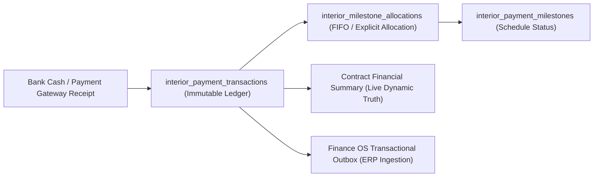

# Bella Interior OS — Architectural Seal: Contract Financial Integrity & Payment Ledger Roadmap

**Date:** 2026-11-08  
**Scope:** Bella Interior OS (`src/products/bella-interior/`, `src/app/dashboard/interior/`, `src/app/api/interior/`)  
**Resolution:** `PR #519` (Commit `e8d78e69467908a33519eb261ff847454408519b`) merged into `main`  
**Architectural Status:** `SEALED & PASS` (Contract Financial Integrity) / `NEXT STAGE` (Payment Ledger & Reconciliation)

---

## 1. Executive Status & Architectural Boundary

```ini
CONTRACT_FINANCIAL_INTEGRITY = SEALED_PASS
DUBAI_MOCK_LEAKAGE          = ELIMINATED (Zero synthetic contracts returned in DB mode)
SINGLE_SOURCE_OF_TRUTH      = ENFORCED (DB-first resolution via Supabase repository)
BOQ_CONTRACT_INDEPENDENCE   = ENFORCED (Approved BOQ does not overwrite executed contract)
OVERCOLLECTION_AWARENESS    = ENFORCED (Outstanding is unclamped: displays negative balances as overcollection)
EMPTY_STATE_DISCIPLINE      = ENFORCED (Explicit UI empty states for uncontracted projects)
ZERO_ANY_TYPES              = ENFORCED
TENANT_ISOLATION_GATE_0     = ENFORCED
PAYMENT_LEDGER_STATUS       = NEXT_STAGE_CAPABILITY (Architecture roadmap defined)
```

---

## 2. Core Problem Solved & Verified Architecture

Prior to PR #519, the `/dashboard/interior/contracts` route and contract analytics service returned a hardcoded synthetic Dubai contract (`CON-DUBAI-001`, 418M, 259M collected) whenever a project lacked an executed contract or when no project ID was provided. This caused critical discrepancies between the BOQ estimator, executive dashboard, and commercial contract views.

### Architectural Core Principles Established:
1. **DB-First Resolution:** The contract analytics service queries `repository.getContractByProject(tenantId, projectId)`. If a project has an executed contract in PostgreSQL, its real snapshot data and milestone schedule are loaded.
2. **Explicit Empty States Over Mock Fallbacks:** When a project does not have an executed contract in the database, the system returns `{ hasContract: false }` with reference BOQ figures. It presents a dedicated Empty State with actionable next steps (e.g. generate contract from approved BOQ). Synthetic data is **never** fabricated to make a dashboard look populated.
3. **SSOT Financial Hierarchy:**
   - **Approved BOQ:** Internal costing & commercial budget estimate (`1.68B` for Villa Sunrise `INT-2024-001`, `1.25B` for Thao Dien `INT-THD-2026`).
   - **Executed Contract:** Legally binding commercial snapshot (`1.35B` for `INT-THD-2026`). Approved BOQs do not overwrite executed contracts; amendments require formal contract addenda.
   - **Payment Milestones:** Scheduled collection tranches specified in the contract (`sum(milestones) = scheduledAmount`).
   - **Collected Amount:** Sum of settled receipts/milestone payments (`netCollected`).
   - **Outstanding / Overcollection:** Computed as `outstandingAmount = contractValue - netCollected`. If collections exceed contract value, the value is **not clamped to 0**; instead, it is reported as a negative balance with the label `"Thu vượt hợp đồng"`.

---

## 3. Verified PostgreSQL State

The verified PostgreSQL database state across all 5 standard Bella Interior projects:

| Project Code | Project UUID | Database Contract State | BOQ Baseline | Contract Financial View |
|---|---|---|---|---|
| **`INT-THD-2026`** | `77a11111-1111-4111-8111-111111111111` | Contract `HD-NT-2026/08` (1.35B, 5 milestones, 50% paid) | `BOQ-THD-2026-01` (1.25B Client / 750M COGS) | **Live Contract Data**: 1.35B signed, 675M collected, 675M outstanding |
| **`INT-2024-001`** | `77a11111-1111-4111-8111-111111111101` | *No contract row in DB* | BOQ Villa Sunrise (1.68B) | **Explicit Empty State** with 1.68B BOQ estimate reference |
| **`INT-2024-002`** | `77a11111-1111-4111-8111-111111111102` | *No contract row in DB* | No BOQ | **Explicit Empty State** (Dubai mock permanently eliminated) |
| **`INT-2024-003`** | `77a11111-1111-4111-8111-111111111103` | *No contract row in DB* | No BOQ | **Explicit Empty State** |
| **`INT-2024-004`** | `77a11111-1111-4111-8111-111111111104` | *No contract row in DB* | No BOQ | **Explicit Empty State** |

---

## 4. Current Limitations & The Next Architectural Stage

While **Contract Financial Integrity** is fully sealed, the payment collection ledger operates at milestone resolution and must evolve into a double-entry cash receipt architecture in subsequent phases:

### Current State
`interior_payment_milestones` simultaneously stores milestone tranches and collection status (`paid_at`, `receipt_number`). Collected revenue is aggregated from settled milestones.

### Target Architecture (Payment Ledger & Reconciliation Roadmap)
To support multi-tranche allocations, overpayments, refunds, reversed transactions, and bank statements, the system will implement the following pipeline:



#### Key Capabilities for the Next Stage:
1. **Immutable Transaction Ledger (`interior_payment_transactions`):**
   - Tracks actual cash events: deposits, bank transfers, credit card payments, merchant fees, chargebacks, and partial refunds.
   - Enforces immutability: transactions cannot be deleted or updated; corrections require explicit reversal transactions (`type = 'reversal'`).
2. **Milestone Allocations (`interior_milestone_allocations`):**
   - Decouples transaction receipts from milestone tranches.
   - Supports 1:N allocations (one large lump-sum payment covering milestones 1 and 2) and N:1 allocations (multiple micro-transfers paying one major milestone).
   - Unallocated receipts are held in an unallocated fund balance (`unallocatedAmount`) rather than creating phantom milestone reconciliations.
3. **Bank Statement Reconciliation:**
   - Automated matching of bank CSV/API statements against recorded transactions with status tracking (`matched`, `unmatched`, `discrepant`).
4. **Finance OS Outbox Integration:**
   - Dispatches audited commercial revenue events to the core Finance ledger without direct cross-domain database writes.

---

## 5. Summary of Verification Evidence

- **Commit SHA:** `e8d78e69467908a33519eb261ff847454408519b` (Merged via PR #519).
- **TypeScript:** Strict `tsc --noEmit` clean (0 errors).
- **Jest Unit & Regression:** 343/343 tests passing across 26 test suites in `src/products/bella-interior/__tests__/`.
- **Contract Analytics Tests:** 38 tests dedicated to multi-project isolation, empty states, and overcollection reporting.
- **CI Enforcement:** PR #519 passed all required GitHub Actions checks (Architecture Guard, Healthcare Constitution, Logistics Regression, CodeQL, Semgrep CE, Changed-file Lint, Relevant App Build).
- **Hard Kernel Freeze:** Healthcare OS H1–H12 and Logistics OS E7 untouched.

---

## 6. Development Authorization & Next Steps

With Contract Financial Integrity sealed and the payment ledger roadmap established, development effort shifts from verification loops to delivering high-impact product features:
1. **Design Revision Lock & CAD/3D Approval Workflow:** Enforce Gate 2 approval transitions before downstream execution.
2. **Production Order Release Console:** Workshop material requirements & cutting lists derived from locked designs and approved BOQs.
3. **BOQ-to-Contract Generation Wizard:** Seamless creation of executed contracts in PostgreSQL from finalized BOQ estimations.
4. **Payment Transaction Ledger Migration:** Schema design and implementation of `interior_payment_transactions` and allocation tables when prioritized.
