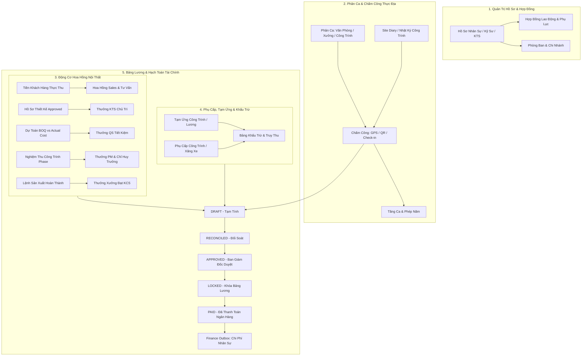
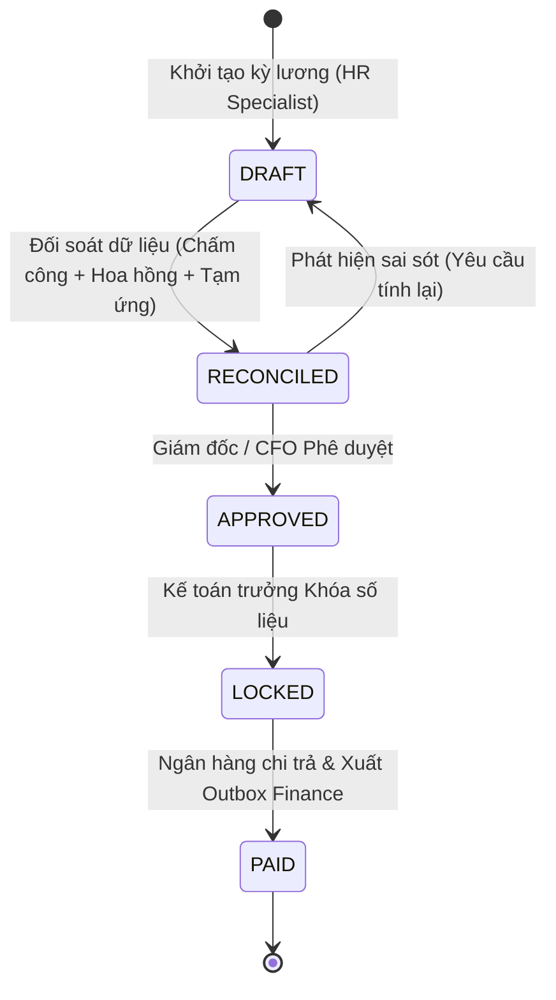

# BELLA INTERIOR OS — HR & WORKFORCE MANAGEMENT SPECIFICATION
## Enterprise Human Resources, Time & Attendance, Commission & Payroll Domain Specification

> **Document Status:** CANONICAL SPECIFICATION  
> **Product Vertical:** Bella Interior OS (`bella_interior`)  
> **Architectural Classification:** Product Domain Vertical (Clean Separation from Frozen Kernels H1–H12 & E7)  
> **Security & Governance:** Strict Tenant Isolation (Gate 0), Scoped RBAC, Zero-Downtime Additive Migration, Financial Outbox Integrity  
> **Version:** 1.0.0 — Production Specification

---

## 1. Executive Summary & Business Context

Trong các doanh nghiệp thiết kế và thi công nội thất, con người và nguồn lực nhân sự là hạt nhân quyết định tiến độ, chi phí, chất lượng và trải nghiệm của chủ đầu tư. Tuy nhiên, mô hình nhân sự ngành nội thất có những đặc thù sâu sắc khác biệt hoàn toàn với doanh nghiệp bán lẻ hay dịch vụ thông thường:

1. **Đa dạng hình thái lao động:** Từ khối văn phòng (Kiến trúc sư, Sales, QS, Kế toán), khối xưởng sản xuất (Thợ mộc, Quản đốc xưởng, Thợ sơn, KCS), đến khối công trình (Chỉ huy trưởng, Giám sát thi công, Đội thầu phụ khoán việc).
2. **Thu nhập gắn chặt với kết quả dự án:** Thu nhập không chỉ gồm lương cơ bản cố định mà cấu thành trọng yếu từ **Hoa hồng kinh doanh (Sales commission)**, **Thưởng thiết kế (Design release reward)**, **Thưởng dự toán (QS accuracy incentive)**, **Thưởng tiến độ & chất lượng công trình (Site milestone bonus)** và **Thưởng năng suất xưởng (Factory yield incentive)**.
3. **Phân biệt rạch ròi 3 giá trị thương mại:**
   - **Giá trị Hợp đồng đã ký (Contract Value):** Tiềm năng doanh số, chưa phát sinh quyền hưởng hoa hồng thực nhận.
   - **Doanh thu nghiệm thu thực tế (Earned Value / Handover Milestone):** Điều kiện đủ để ghi nhận tiến độ công việc và tính thưởng kỹ thuật.
   - **Tiền thực thu từ khách hàng (Actual Cash Collected):** Điều kiện tiên quyết để giải ngân hoa hồng Sales/Tư vấn nhằm phòng ngừa rủi ro nợ xấu hoặc hủy hợp đồng.
4. **Cơ chế Clawback (Hoàn trả / Thu hồi hoa hồng):** Khi công trình phát sinh phạt tiến độ, lỗi bảo hành nghiêm trọng, hoặc phụ lục giảm giá trị/hoàn tiền, hệ thống phải tự động truy thu hoặc khấu trừ hoa hồng đã tạm tính/tạm chi.
5. **Kỳ lương 5 trạng thái bất biến:** Luồng bảng lương tuân thủ FSM: `DRAFT → RECONCILED → APPROVED → LOCKED → PAID`. Sau khi `LOCKED`, tuyệt đối không cho phép chỉnh sửa âm thầm dữ liệu quá khứ; mọi phát sinh phải thông qua chứng từ điều chỉnh có chữ ký số và truy vết kiểm toán.

---

## 2. Bounded Context & Functional Matrix



### Bảng phân hệ chi tiết:

| Phân Hệ | Thực Thể Dữ Liệu | Trách Nhiệm Nghiệp Vụ | Quy Tắc Kiểm Soát |
| :--- | :--- | :--- | :--- |
| **Hồ sơ nhân sự** | `interior_employees` | Quản lý thông tin định danh cá nhân, mã nhân viên, chức vụ, bộ phận (Thiết kế, Kinh doanh, Dự toán QS, Dự án PM, Giám sát, Sản xuất xưởng), chi nhánh, người quản lý trực tiếp. | Không trùng mã định danh; liên kết 1-1 với Supabase Auth khi nhân viên có tài khoản ERP. |
| **Hợp đồng lao động** | `interior_employee_contracts` | Loại hợp đồng (Thử việc, Chính thức có thời hạn, Không xác định thời hạn, Cộng tác viên thiết kế, Khoán nhân công), mức lương cơ bản, phụ cấp đóng bảo hiểm, phụ cấp chức vụ. | Versioning có phụ lục; chỉ có duy nhất 1 hợp đồng ACTIVE tại một thời điểm cho mỗi nhân viên. |
| **Phân ca & Chấm công** | `interior_shifts`, `interior_attendance_records` | Phân lịch theo ca (Ca hành chính văn phòng, Ca kíp xưởng mộc, Ca theo chân công trình). Chấm công qua định vị GPS trạm công trình hoặc mã QR xưởng, tính giờ OT, ca đêm. | Chấm công công trình bắt buộc đối soát tọa độ dự án hoặc chỉ huy trưởng xác nhận trong `Site Diary`. |
| **Quy tắc hoa hồng** | `interior_commission_plans`, `interior_commission_rules` | Thiết lập công thức hoa hồng theo vai trò và điều kiện kích hoạt: Tỷ lệ % trên tiền thực thu, % trên doanh thu gộp thiết kế, thưởng định mức tiết kiệm BOQ. | Không cho phép cấu hình "trả trước 100% khi ký hợp đồng"; có ngưỡng giữ lại bảo hành (Retainage Commission). |
| **Giao dịch hoa hồng** | `interior_commission_events` | Nhật ký ghi nhận hoa hồng phát sinh, tạm giữ, đủ điều kiện chi trả và điều chỉnh (Clawback). | Trỏ trực tiếp đến `contract_id`, `project_id`, `payment_id` hoặc `boq_id`. |
| **Tạm ứng & Khấu trừ** | `interior_salary_advances` | Quản lý phiếu tạm ứng lương, tạm ứng chi phí công tác công trình, quyết toán hoàn ứng và các khoản phạt vi phạm an toàn lao động / hỏng vật tư. | Phải được Trưởng bộ phận duyệt trước khi hạch toán vào kỳ lương. |
| **Kỳ lương & Bảng lương** | `interior_payroll_periods`, `interior_payrolls`, `interior_payroll_items` | Tập hợp toàn bộ ngày công, OT, lương cơ bản, phụ cấp, hoa hồng đủ điều kiện, tạm ứng, trừ bảo hiểm để tính thực lĩnh (Net Pay). | FSM 5 bước: `DRAFT → RECONCILED → APPROVED → LOCKED → PAID`. |
| **Báo cáo & Phân tích** | Analytics & Materialized Views | Báo cáo chi phí nhân sự theo công trình (Job Costing - Labor component), tỷ trọng hoa hồng trên doanh thu thực thu, năng suất thiết kế và tỷ lệ hao hụt sản xuất. | Dữ liệu đối soát bảo đảm tổng chi phí nhân sự hạch toán khớp 100% với Sổ cái Kế toán Finance. |

---

## 3. Đặc Thù Hoa Hồng & Thưởng Theo Từng Khối Nghiệp Vụ Nội Thất

Đây là hạt nhân cốt lõi tạo nên sức mạnh của Bella Interior OS, giải quyết triệt để xung đột lợi ích và bảo vệ dòng tiền doanh nghiệp:

### 3.1. Khối Kinh Doanh (Sales & BD)
- **Cơ sở tính:** Tiền thực thu từ khách hàng (`actual_cash_collected`), KHÔNG tính trên giá trị hợp đồng ký kết (`contract_value`).
- **Quy tắc giải ngân phân kỳ (Milestone Split):**
  * Đợt 1 (Đặt cọc thiết kế): Không trích hoa hồng thi công.
  * Đợt 2 (Ký hợp đồng thi công & Tạm ứng lần 1): Chi trả 40% phần hoa hồng tương ứng số tiền thực thu.
  * Đợt 3 (Thu tiền các đợt thi công thô & lắp đặt nội thất): Chi trả tiếp theo tỷ lệ tiền thu.
  * Đợt 4 (Nghiệm thu quyết toán & Thu hồi hết công nợ): Chi trả toàn bộ phần còn lại.
- **Biên độ lợi nhuận (Gross Margin Floor):** Nếu hợp đồng bị giảm giá (discount) làm giảm Margin < 25%, hoa hồng Sales tự động giảm trừ tỷ lệ theo ma trận biên lợi nhuận.

### 3.2. Khối Thiết Kế (Architects & Interior Designers)
- **Cơ sở tính:** Trạng thái hồ sơ thiết kế và tiến độ nghiệm thu bản vẽ (`interior_design_revisions`).
- **Điều kiện kích hoạt:**
  * 30% khi hồ sơ concept 3D được khách hàng ký duyệt (Design Freeze).
  * 50% khi hồ sơ bản vẽ kỹ thuật thi công 2D chi tiết được duyệt và chuyển giao cho QS lập BOQ.
  * 20% khi công trình hoàn thành lắp đặt thực tế đạt đúng tinh thần thiết kế và không phát sinh lỗi thiết kế phải chỉnh sửa tại hiện trường.

### 3.3. Khối Dự Toán & Chi Phí (Quantity Surveying - QS)
- **Cơ sở tính:** Độ chính xác của bảng dự toán BOQ (`interior_boqs`) so với Chi phí thực tế mua sắm vật tư & nhân công (`actual_material_cost + actual_labor_cost`).
- **Điều kiện kích hoạt:**
  * Thưởng độ chính xác (Cost Variance Bonus): Nếu sai số giữa BOQ duyệt và giá thành thực tế nghiệm thu $\le 3\%$, QS được thưởng theo tỷ lệ định mức dự án.
  * Phạt vượt chi phí (Overrun Penalty): Nếu BOQ bóc tách thiếu khối lượng hoặc sai đơn giá gây thất thoát $> 5\%$ mà không có phát sinh từ phía khách hàng, trừ điểm KPI và khấu trừ thưởng dự án.

### 3.4. Khối Quản Trị Dự Án & Chỉ Huy Trưởng (PM & Site Engineers)
- **Cơ sở tính:** 3 trụ cột: **Tiến độ bàn giao (On-time)**, **Ngân sách thực hiện (Within Budget)**, và **Chỉ số lỗi khi nghiệm thu (Punch-list Defect Rate)**.
- **Điều kiện kích hoạt:**
  * 50% sau khi hoàn thành nghiệm thu từng giai đoạn (Phần thô ME, Hoàn thiện ốp lát, Lắp đặt mộc).
  * 50% sau khi khách hàng ký biên bản bàn giao chính thức (`HANDOVER_COMPLETED`) và hoàn thành đóng toàn bộ danh mục dặm vá `PUNCH_LIST_CLOSED` trong vòng 7 ngày.

### 3.5. Khối Sản Xuất Xưởng Mộc (Factory Production)
- **Cơ sở tính:** Sản lượng hoàn thành đúng tiêu chuẩn KCS/QC (`interior_production_orders`).
- **Điều kiện kích hoạt:**
  * Thưởng năng suất theo m2 hoàn thiện đạt chuẩn xuất xưởng.
  * Trừ điểm hao hụt ván/gỗ và trừ điểm khi xưởng trả về sản phẩm không đúng quy cách bản vẽ kỹ thuật.

### 3.6. Khối Quản Lý Chất Lượng (QC Inspector)
- **Cơ sở tính:** Thưởng chất lượng nghiệm thu và Tỷ lệ khiếu nại bảo hành sau 30 ngày bàn giao (`post_handover_warranty_rate`).
- **Quy tắc:** Nếu trong 30 ngày đầu khách hàng khiếu nại lỗi thi công do bỏ sót kiểm tra, QC phụ trách công trình bị khấu trừ thưởng chất lượng tương ứng.

### 3.7. Giao Thức Thu Hồi Hoa Hồng (Clawback Protocol)
Khi phát sinh các sự kiện thương mại bất lợi:
- Khách hàng hủy hợp đồng hoặc yêu cầu hoàn tiền đợt thanh toán.
- Giảm trừ giá trị quyết toán do phạt chậm tiến độ hoặc cắt giảm hạng mục.
- Công nợ quá hạn > 90 ngày không thu hồi được.
Hệ thống tạo tự động một bản ghi `interior_commission_events` loại `CLAWBACK` có giá trị âm, tự động bù trừ vào kỳ tính lương tiếp theo của nhân sự liên quan.

---

## 4. Bảng Lương & Quy Trình 5 Trạng Thái Bất Biến (Payroll FSM)

Bảng lương kỳ của Bella Interior OS vận hành theo máy trạng thái hữu hạn (FSM) nghiêm ngặt nhằm bảo đảm tính toàn vẹn tài chính và kiểm toán:



### Các quy tắc cốt tử của từng trạng thái:
1. **`DRAFT` (Dự thảo):**
   - Hệ thống tự động quét dữ liệu chấm công từ `interior_attendance_records`, gom các khoản hoa hồng `ELIGIBLE_FOR_PAYROLL` từ `interior_commission_events`, và các khoản tạm ứng/khấu trừ `ACTIVE`.
   - Có thể chạy lại hàm tính toán `calculate_payroll()` nhiều lần khi có cập nhật giải trình công.
2. **`RECONCILED` (Đã đối soát):**
   - HR và Quản lý phòng ban đã kiểm tra chéo từng dòng phiếu lương.
   - Nhân viên nhận được bảng đối soát tạm tính (Draft Payslip) để gửi thắc mắc (nếu có).
3. **`APPROVED` (Đã phê duyệt):**
   - Ban Giám đốc ký duyệt bảng lương.
   - Không cho phép tự động tính toán lại, không cho sửa thủ công chi tiết các dòng lương.
4. **`LOCKED` (Đã khóa kỳ):**
   - Đóng băng toàn bộ cấu trúc dữ liệu của kỳ lương.
   - Bất kỳ thay đổi hồi tố nào phát sinh sau đó bắt buộc phải tạo chứng từ điều chỉnh bổ sung trong kỳ lương tiếp theo (Retroactive Adjustment).
5. **`PAID` (Đã thanh toán):**
   - Kế toán hoàn tất ủy nhiệm chi ngân hàng.
   - Kích hoạt Domain Event đẩy thông điệp vào bảng Outbox Kế toán: `enqueue_interior_finance_event('PAYROLL_DISBURSED', ...)`.

---

## 5. Schema Thiết Kế Cơ Sở Dữ Liệu (Additive Migration DDL)

Cấu trúc các bảng dữ liệu mới hoàn toàn nằm trong namespace `interior_*`, tuân thủ 100% nguyên tắc Zero-Downtime, khóa ngoại UUID, RLS có tenant isolation và audit timestamp:

```sql
-- 1. BẢNG HỒ SƠ NHÂN SỰ NỘI THẤT
CREATE TABLE IF NOT EXISTS public.interior_employees (
    id UUID PRIMARY KEY DEFAULT gen_random_uuid(),
    tenant_id UUID NOT NULL REFERENCES public.tenants(id) ON DELETE RESTRICT,
    user_id UUID REFERENCES auth.users(id) ON DELETE SET NULL,
    employee_code TEXT NOT NULL,
    full_name TEXT NOT NULL,
    email TEXT,
    phone TEXT,
    department TEXT NOT NULL, -- 'sales', 'design', 'qs', 'project_management', 'factory', 'qc', 'office'
    position_title TEXT NOT NULL,
    branch_id UUID REFERENCES public.interior_branches(id) ON DELETE SET NULL,
    direct_manager_id UUID REFERENCES public.interior_employees(id) ON DELETE SET NULL,
    status TEXT NOT NULL DEFAULT 'probation', -- 'probation', 'active', 'on_leave', 'terminated'
    hire_date DATE NOT NULL,
    termination_date DATE,
    bank_account_number TEXT,
    bank_name TEXT,
    tax_code TEXT,
    id_card_number TEXT,
    created_at TIMESTAMPTZ NOT NULL DEFAULT clock_timestamp(),
    updated_at TIMESTAMPTZ NOT NULL DEFAULT clock_timestamp(),
    CONSTRAINT uq_interior_employee_code UNIQUE (tenant_id, employee_code)
);

-- 2. BẢNG HỢP ĐỒNG LAO ĐỘNG & ĐIỀU KHOẢN LƯƠNG
CREATE TABLE IF NOT EXISTS public.interior_employee_contracts (
    id UUID PRIMARY KEY DEFAULT gen_random_uuid(),
    tenant_id UUID NOT NULL REFERENCES public.tenants(id) ON DELETE RESTRICT,
    employee_id UUID NOT NULL REFERENCES public.interior_employees(id) ON DELETE RESTRICT,
    contract_number TEXT NOT NULL,
    contract_type TEXT NOT NULL, -- 'probation', 'fixed_term', 'indefinite', 'contractor', 'piecework'
    base_salary NUMERIC(15,2) NOT NULL DEFAULT 0,
    insurance_salary NUMERIC(15,2) NOT NULL DEFAULT 0,
    standard_working_days NUMERIC(4,1) NOT NULL DEFAULT 26.0,
    lunch_allowance NUMERIC(15,2) NOT NULL DEFAULT 0,
    site_allowance NUMERIC(15,2) NOT NULL DEFAULT 0,
    phone_allowance NUMERIC(15,2) NOT NULL DEFAULT 0,
    effective_from DATE NOT NULL,
    effective_to DATE,
    status TEXT NOT NULL DEFAULT 'active', -- 'draft', 'active', 'expired', 'terminated'
    created_at TIMESTAMPTZ NOT NULL DEFAULT clock_timestamp(),
    updated_at TIMESTAMPTZ NOT NULL DEFAULT clock_timestamp(),
    CONSTRAINT uq_interior_employee_contract_num UNIQUE (tenant_id, contract_number)
);

-- 3. BẢNG CHẤM CÔNG & NHẬT KÝ LÀM VIỆC CÔNG TRÌNH / XƯỞNG
CREATE TABLE IF NOT EXISTS public.interior_attendance_records (
    id UUID PRIMARY KEY DEFAULT gen_random_uuid(),
    tenant_id UUID NOT NULL REFERENCES public.tenants(id) ON DELETE RESTRICT,
    employee_id UUID NOT NULL REFERENCES public.interior_employees(id) ON DELETE RESTRICT,
    work_date DATE NOT NULL,
    shift_code TEXT NOT NULL DEFAULT 'STANDARD', -- 'OFFICE', 'SITE', 'FACTORY_DAY', 'FACTORY_NIGHT'
    project_id UUID REFERENCES public.interior_projects(id) ON DELETE SET NULL, -- Gắn nếu đi công trình
    check_in_time TIMESTAMPTZ,
    check_out_time TIMESTAMPTZ,
    work_units NUMERIC(4,2) NOT NULL DEFAULT 1.0, -- 1.0 = Đủ ngày công, 0.5 = Nửa ngày
    overtime_hours NUMERIC(4,2) NOT NULL DEFAULT 0.0,
    overtime_type TEXT, -- 'normal_1.5', 'weekend_2.0', 'holiday_3.0'
    location_lat DOUBLE PRECISION,
    location_lng DOUBLE PRECISION,
    verified_by_site_lead BOOLEAN NOT NULL DEFAULT FALSE,
    notes TEXT,
    created_at TIMESTAMPTZ NOT NULL DEFAULT clock_timestamp(),
    updated_at TIMESTAMPTZ NOT NULL DEFAULT clock_timestamp(),
    CONSTRAINT uq_interior_employee_work_date UNIQUE (tenant_id, employee_id, work_date)
);

-- 4. BẢNG SỰ KIỆN HOA HỒNG & THƯỞNG DỰ ÁN
CREATE TABLE IF NOT EXISTS public.interior_commission_events (
    id UUID PRIMARY KEY DEFAULT gen_random_uuid(),
    tenant_id UUID NOT NULL REFERENCES public.tenants(id) ON DELETE RESTRICT,
    employee_id UUID NOT NULL REFERENCES public.interior_employees(id) ON DELETE RESTRICT,
    project_id UUID NOT NULL REFERENCES public.interior_projects(id) ON DELETE RESTRICT,
    contract_id UUID REFERENCES public.interior_contracts(id) ON DELETE SET NULL,
    payment_receipt_id UUID, -- Trỏ về biên nhận thanh toán thực thu
    role_category TEXT NOT NULL, -- 'sales', 'lead_designer', 'qs_estimator', 'site_pm', 'qc_inspector', 'factory_team'
    event_type TEXT NOT NULL, -- 'CASH_COLLECTED', 'DESIGN_APPROVED', 'BOQ_ACCURACY', 'HANDOVER_MILESTONE', 'CLAWBACK'
    calculation_basis_amount NUMERIC(15,2) NOT NULL DEFAULT 0, -- Số tiền gốc (VD: tiền thực thu, giá trị gói thiết kế)
    commission_rate_percent NUMERIC(5,2) NOT NULL DEFAULT 0, -- Tỷ lệ %
    commission_amount NUMERIC(15,2) NOT NULL DEFAULT 0, -- Giá trị hoa hồng phát sinh (âm nếu CLAWBACK)
    retained_warranty_amount NUMERIC(15,2) NOT NULL DEFAULT 0, -- Khoản giữ lại bảo hành (nếu có)
    payout_status TEXT NOT NULL DEFAULT 'PENDING_ELIGIBILITY', -- 'PENDING_ELIGIBILITY', 'ELIGIBLE_FOR_PAYROLL', 'INCLUDED_IN_PAYROLL', 'PAID', 'CLAWED_BACK'
    payroll_id UUID, -- Gắn vào bảng lương khi được duyệt chi
    notes TEXT,
    created_at TIMESTAMPTZ NOT NULL DEFAULT clock_timestamp(),
    updated_at TIMESTAMPTZ NOT NULL DEFAULT clock_timestamp()
);

-- 5. BẢNG TẠM ỨNG & CÁC KHOẢN KHẤU TRỪ
CREATE TABLE IF NOT EXISTS public.interior_salary_advances (
    id UUID PRIMARY KEY DEFAULT gen_random_uuid(),
    tenant_id UUID NOT NULL REFERENCES public.tenants(id) ON DELETE RESTRICT,
    employee_id UUID NOT NULL REFERENCES public.interior_employees(id) ON DELETE RESTRICT,
    project_id UUID REFERENCES public.interior_projects(id) ON DELETE SET NULL,
    advance_type TEXT NOT NULL, -- 'SALARY_ADVANCE', 'SITE_EXPENSE_ADVANCE', 'PENALTY_DEDUCTION', 'UNIFORM_TOOL'
    amount NUMERIC(15,2) NOT NULL,
    repayment_months INTEGER NOT NULL DEFAULT 1,
    deducted_amount NUMERIC(15,2) NOT NULL DEFAULT 0,
    status TEXT NOT NULL DEFAULT 'PENDING_APPROVAL', -- 'PENDING_APPROVAL', 'APPROVED', 'RECOVERING', 'RECOVERED', 'REJECTED'
    approved_by UUID REFERENCES auth.users(id),
    approved_at TIMESTAMPTZ,
    payroll_period_id UUID,
    created_at TIMESTAMPTZ NOT NULL DEFAULT clock_timestamp(),
    updated_at TIMESTAMPTZ NOT NULL DEFAULT clock_timestamp()
);

-- 6. BẢNG KỲ LƯƠNG & BẢNG LƯƠNG TỔNG HỢP
CREATE TABLE IF NOT EXISTS public.interior_payroll_periods (
    id UUID PRIMARY KEY DEFAULT gen_random_uuid(),
    tenant_id UUID NOT NULL REFERENCES public.tenants(id) ON DELETE RESTRICT,
    period_code TEXT NOT NULL, -- 'PR-2026-11'
    period_month INTEGER NOT NULL, -- 11
    period_year INTEGER NOT NULL, -- 2026
    start_date DATE NOT NULL,
    end_date DATE NOT NULL,
    status TEXT NOT NULL DEFAULT 'DRAFT', -- 'DRAFT', 'RECONCILED', 'APPROVED', 'LOCKED', 'PAID'
    total_gross_salary NUMERIC(15,2) NOT NULL DEFAULT 0,
    total_commission_paid NUMERIC(15,2) NOT NULL DEFAULT 0,
    total_allowances NUMERIC(15,2) NOT NULL DEFAULT 0,
    total_deductions NUMERIC(15,2) NOT NULL DEFAULT 0,
    total_net_payable NUMERIC(15,2) NOT NULL DEFAULT 0,
    approved_by UUID REFERENCES auth.users(id),
    approved_at TIMESTAMPTZ,
    locked_by UUID REFERENCES auth.users(id),
    locked_at TIMESTAMPTZ,
    paid_at TIMESTAMPTZ,
    finance_transaction_ref TEXT,
    created_at TIMESTAMPTZ NOT NULL DEFAULT clock_timestamp(),
    updated_at TIMESTAMPTZ NOT NULL DEFAULT clock_timestamp(),
    CONSTRAINT uq_interior_payroll_period UNIQUE (tenant_id, period_code)
);

-- 7. CHI TIẾT PHIẾU LƯƠNG TỪNG NHÂN VIÊN
CREATE TABLE IF NOT EXISTS public.interior_payrolls (
    id UUID PRIMARY KEY DEFAULT gen_random_uuid(),
    tenant_id UUID NOT NULL REFERENCES public.tenants(id) ON DELETE RESTRICT,
    payroll_period_id UUID NOT NULL REFERENCES public.interior_payroll_periods(id) ON DELETE RESTRICT,
    employee_id UUID NOT NULL REFERENCES public.interior_employees(id) ON DELETE RESTRICT,
    actual_work_days NUMERIC(4,1) NOT NULL DEFAULT 0,
    overtime_hours NUMERIC(4,2) NOT NULL DEFAULT 0,
    base_salary_earned NUMERIC(15,2) NOT NULL DEFAULT 0,
    overtime_salary_earned NUMERIC(15,2) NOT NULL DEFAULT 0,
    total_allowances NUMERIC(15,2) NOT NULL DEFAULT 0,
    total_commissions NUMERIC(15,2) NOT NULL DEFAULT 0,
    gross_pay NUMERIC(15,2) NOT NULL DEFAULT 0,
    social_insurance_deduction NUMERIC(15,2) NOT NULL DEFAULT 0,
    personal_income_tax NUMERIC(15,2) NOT NULL DEFAULT 0,
    advances_deducted NUMERIC(15,2) NOT NULL DEFAULT 0,
    penalties_deducted NUMERIC(15,2) NOT NULL DEFAULT 0,
    net_pay NUMERIC(15,2) NOT NULL DEFAULT 0,
    notes TEXT,
    created_at TIMESTAMPTZ NOT NULL DEFAULT clock_timestamp(),
    updated_at TIMESTAMPTZ NOT NULL DEFAULT clock_timestamp(),
    CONSTRAINT uq_interior_employee_payroll_period UNIQUE (tenant_id, payroll_period_id, employee_id)
);
```

---

## 6. Tích Hợp RBAC Phase 6 & Phân Quyền Nhân Sự

Phân hệ Nhân sự & Thu nhập sẽ bổ sung các Action Permissions vào Catalog RBAC của Bella Interior:

| Action Permission | Tên Quyền | Phạm Vi (Scope) Áp Dụng | Vai Trò Mặc Định Được Cấp |
| :--- | :--- | :--- | :--- |
| `interior:hr:view` | Xem danh sách hồ sơ & hợp đồng nhân sự | `TENANT`, `BRANCH` | OWNER, ADMIN, HR_MANAGER |
| `interior:hr:write` | Tạo, cập nhật hồ sơ, hợp đồng, tiếp nhận | `TENANT`, `BRANCH` | OWNER, ADMIN, HR_MANAGER |
| `interior:attendance:record` | Chấm công hàng ngày, check-in công trình | `SELF` | TOÀN BỘ NHÂN VIÊN |
| `interior:attendance:verify` | Duyệt bảng chấm công hiện trường | `PROJECT`, `BRANCH` | PM_DIRECTOR, SITE_MANAGER |
| `interior:commission:calculate`| Chạy đối soát & tính hoa hồng dự án | `TENANT`, `BRANCH` | OWNER, CFO, HR_MANAGER |
| `interior:payroll:reconcile` | Đối soát & lập dự thảo bảng lương kỳ | `TENANT` | HR_MANAGER, ACCOUNTANT |
| `interior:payroll:approve` | Phê duyệt bảng lương kỳ | `TENANT` | OWNER, GENERAL_DIRECTOR |
| `interior:payroll:lock` | Khóa sổ kỳ lương, tạo chứng từ | `TENANT` | CHIEF_ACCOUNTANT |
| `interior:payroll:pay` | Xác nhận chi trả ngân hàng & xuất Outbox | `TENANT` | CHIEF_ACCOUNTANT |

---

## 7. Quy Chuẩn API Contracts

### Danh sách Endpoints RESTful / RPC:
- `POST /api/interior/hr/employees`: Thêm mới hồ sơ nhân sự (gán chức vụ, phòng ban, chi nhánh).
- `GET /api/interior/hr/employees`: Truy vấn danh sách nhân sự (lọc theo phòng ban, chi nhánh, trạng thái).
- `POST /api/interior/hr/contracts`: Tạo hợp đồng lao động & thiết lập công thức đãi ngộ.
- `POST /api/interior/attendance/check-in`: Ghi nhận chấm công (tọa độ GPS, định danh công trình/xưởng).
- `GET /api/interior/commissions/events`: Bảng kê hoa hồng theo dự án & nhân sự (phân biệt trạng thái giải ngân).
- `POST /api/interior/commissions/trigger-cash-collected`: Hook tự động khi khách hàng thanh toán để kích hoạt hoa hồng Sales.
- `POST /api/interior/payroll/periods`: Mở kỳ lương mới (`PR-YYYY-MM`).
- `POST /api/interior/payroll/periods/[id]/calculate`: Trigger tính toán bảng lương tự động từ nguồn dữ liệu thực tế.
- `PATCH /api/interior/payroll/periods/[id]/transition`: Chuyển trạng thái FSM (`DRAFT → RECONCILED → APPROVED → LOCKED → PAID`).
- `GET /api/interior/payroll/my-payslip`: Nhân viên xem phiếu lương cá nhân của chính mình.

---

## 8. Lộ Trình Triển Khai (Phased Rollout Plan)

1. **Phase 7A (Database & Core HR):** Triển khai migration bảng nhân sự, hợp đồng và API CRUD hồ sơ nhân sự.
2. **Phase 7B (Time & Site Attendance):** Triển khai chấm công GPS hiện trường công trình tích hợp với Site Diary.
3. **Phase 7C (Interior Commission Engine):** Kết nối nguồn thu từ Hợp đồng & Phiếu thu tiền để kích hoạt hoa hồng Sales, KTS, QS và Chỉ huy trưởng.
4. **Phase 7D (5-Stage Payroll & Finance Outbox):** Hoàn thiện FSM kỳ lương, lập phiếu lương chi tiết và liên kết phát sinh chi phí nhân sự vào phân hệ Kế toán tài chính.

