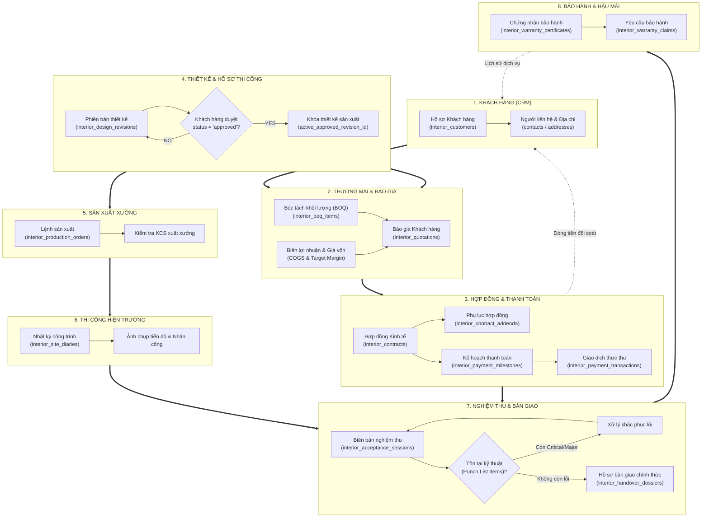

# BÁO CÁO NGHIỆM THU VẬN HÀNH GO-LIVE TRÊN JOB THẬT
## BELLA INTERIOR REAL-JOB GO-LIVE READINESS REPORT
**Mã báo cáo:** `BELLA-INT-GO-LIVE-20261120-01`  
**Ngày thực hiện:** 20/11/2026  
**Chủ thể phê duyệt:** Ban Chỉ đạo Kỹ thuật & Nghiệp vụ Bella Interior  
**Tiêu chuẩn áp dụng:** BELLA PRODUCT-FIRST AI CODING CONSTITUTION & GO-LIVE OPERATIONAL CRITERIA  

---

## 1. TỔNG QUAN TRẠNG THÁI TỪNG PHÂN HỆ NGHIỆP VỤ

Bella Interior được thiết kế để điều hành một công ty nội thất chuyên nghiệp theo chu trình khép kín:
$$\text{Customer (CRM)} \longrightarrow \text{Quotation (Commercial)} \longrightarrow \text{Contract} \longrightarrow \text{Design} \longrightarrow \text{Manufacturing} \longrightarrow \text{Installation} \longrightarrow \text{Acceptance} \longrightarrow \text{Handover} \longrightarrow \text{Warranty}$$

Dưới đây là bảng đánh giá hiện trạng độc lập của từng phân hệ trên cả 2 môi trường: **PostgreSQL 17 Local Hardening** và **Production Supabase (`lvnvkpyxtuilhrabtlwv`)**:

| STT | Phân hệ (Module) | UI / Màn hình | API / Service | DB Persistence (Prod vs Local) | RBAC / Tenant Isolation | Cross-Module Links | Trạng thái nghiệp vụ & Khóa bảo vệ | Test Evidence | Đánh giá Go-Live |
| :--- | :--- | :--- | :--- | :--- | :--- | :--- | :--- | :--- | :--- |
| **1** | **Khách hàng (CRM)** | `/dashboard/interior/customers` + Modal Customer 360 (5 tab) | `/api/interior/crm/customers` (CRUD, contacts, addresses), `/api/interior/customers` | **Local:** 5 bảng C3 hoàn chỉnh (17/17 + 16/16 test PASS)<br>**Prod:** Chưa chạy C3 migration; chạy chế độ Harmonization từ `interior_projects` | RLS Tenant Isolation (Local PASS); chặn ghi chéo tenant; RBAC `sales_executive`, `sales_director`, `owner` | Nhận diện khách hàng qua mã định danh, gom cụm nhiều dự án (`cust-001` có 2 dự án) | Khóa không cho phép sửa trực tiếp số liệu tài chính (`DIRECT_FINANCIAL_MUTATION_PROHIBITED`) | 712/712 tests Jest PASS; 33/33 C3 tests PASS | **READY (Local)**<br>PARTIAL (Prod chờ migration) |
| **2** | **Báo giá (Quotation/BOQ)** | `/dashboard/interior/boq` | `/api/interior/boq`, `/api/interior/boq/[id]/approve`, `/api/interior/quotations` | **Local & Prod:** `interior_quotations` (2 rows), `interior_boq_items` (3 rows) | `estimator`, `sales_director`, `owner`. Chặn nhân viên kỹ thuật duyệt báo giá | Liên kết chặt chẽ với `project_id`, `boq_id`, `boq_version_number` | Tự động tính COGS, Gross Margin; chỉ báo giá `accepted` mới được tạo hợp đồng | Jest 14/14 tests; Prod runtime verify `BG-THD-2026-01`, `BG-PILOT-2026-01` | **VERIFIED (Prod)** |
| **3** | **Hợp đồng & Dòng tiền** | `/dashboard/interior/contracts` + Modal Workflow thương mại | `/api/interior/contracts`, `/api/interior/finance` | **Local & Prod:** `interior_contracts` (2 rows), `interior_contract_addenda` (1 row), `interior_payment_milestones` (7 rows), `interior_payment_transactions` (3 rows) | Phân quyền thu ngân & kế toán. Tenant Isolation bảo vệ theo hợp đồng | Nhận dữ liệu từ Báo giá; phân tách giá trị gốc (Baseline) và giá trị điều chỉnh phụ lục (Addendum) | Bắt buộc tổng tiến độ thanh toán = 100%; phụ lục bắt buộc có phê duyệt trước khi điều chỉnh giá trị | Jest 28/28 tests; Prod verify `HD-NT-2026/08` (1.35 tỷ) & `HD-PILOT-2026/01` (550tr) | **VERIFIED (Prod)** |
| **4** | **Thiết kế (Design)** | `/dashboard/interior/design` | `/api/interior/design`, `/api/interior/design/revisions`, `[id]/approve` | **Local & Prod:** `interior_design_revisions` (3 rows) | KTS trưởng phê duyệt; khách hàng ký duyệt bản vẽ | Phiên bản bản vẽ liên kết với BOQ và Lệnh sản xuất | Khóa bất biến: Chỉ bản vẽ trạng thái `approved` mới được gán làm `active_approved_revision_id` để phát hành sản xuất | Jest 18/18 tests; Prod verify R1.0 cho Thảo Điền, Pilot và Duplex Aqua Bay | **VERIFIED (Prod)** |
| **5** | **Sản xuất (Manufacturing)** | `/dashboard/interior/production` | `/api/interior/production/orders`, `/analytics` | **Local & Prod:** `interior_production_orders` (1 row) | Quản đốc xưởng, Điều phối sản xuất | Nhận BOQ items và `design_revision_id` | Chặn phát hành lệnh sản xuất nếu bản vẽ chưa `approved` (`ApprovedDesignLockViolationError`) | Jest 12/12 tests; Prod verify `LSX-2024-004-R1` chế tác đồ rời | **VERIFIED (Prod)** |
| **6** | **Thi công (Installation)** | `/dashboard/interior/installation` | `/api/interior/delivery/site-diary`, `/analytics` | **Local & Prod:** `interior_site_diaries` (2 rows) | Giám sát công trường | Gắn chặt với `project_id`, ghi nhận nhân công, thời tiết, vật tư giao đến, ảnh hiện trường | Nhật ký công trường bất biến theo ngày | Jest 10/10 tests; Prod verify 2 nhật ký ngày 17/11 và 21/11 tại Aqua Bay | **VERIFIED (Prod)** |
| **7** | **Nghiệm thu & Bàn giao** | `/dashboard/interior/qc-handover` + Modal Acceptance Session | `/api/interior/delivery/handover`, `/api/interior/delivery/acceptance/...` | **Local:** Bảng `interior_acceptance_sessions`, `interior_acceptance_punch_items`<br>**Prod:** Bảng `interior_handover_dossiers` (1 row) | KCS, Chỉ huy trưởng, Khách hàng ký số / xác nhận | Hồ sơ bàn giao gắn với `project_id`, `contract_id`, `settlement_value` | Khóa bất biến: Không cho phép bàn giao nếu còn tồn tại kỹ thuật (Punch List) mức `critical`/`major` chưa xử lý | Jest 42/42 tests; Prod verify `HSBG-THD-2026` ký bởi Trần Minh Quân | **READY (Local)**<br>PARTIAL (Prod chờ O4 migration) |
| **8** | **Bảo hành & CSKH** | `/dashboard/interior/warranty` | `/api/interior/delivery/warranty`, `/analytics` | **Local & Prod:** `interior_warranty_certificates` (3 rows) | CSKH, Kỹ thuật bảo hành | Sinh từ Hồ sơ bàn giao đã nghiệm thu; kế thừa thông tin khách hàng và công trình | Tách thời hạn bảo hành: Kết cấu gỗ (24 tháng), Phụ kiện (60 tháng), Mặt đá (120 tháng) | Jest 15/15 tests; Prod verify chứng chỉ `WAR-INT-THD-2026-2026-b4540c38` | **VERIFIED (Prod)** |

---

## 2. BẢN ĐỒ LUỒNG DỮ LIỆU XUYÊN SUỐT (END-TO-END DATA FLOW MAP)

Dữ liệu luân chuyển xuyên suốt 8 phân hệ theo đồ thị bất biến, bảo đảm mọi chứng từ nghiệp vụ đều có căn cứ nguồn (Source of Truth):



### Chi tiết các mắt xích liên kết (Data Linkages):
1. **Quotation $\to$ Contract:** Bắt buộc mang đầy đủ `quotationId`, `quotationVersionNumber`, `boqId`, `boqVersionNumber`. Tổng giá trị hợp đồng gốc bằng đúng `grandTotal` của báo giá được duyệt.
2. **Contract $\to$ Milestones & Payments:** Chia đợt thanh toán theo tỷ lệ phần trăm (tổng = 100%). Khi phát sinh Phụ lục (`interior_contract_addenda`), giá trị hợp đồng hiện tại tự động cập nhật (`current_contract_value = baseline + sum(addenda)`). Giao dịch thanh toán (`payment_transactions`) tham chiếu trực tiếp đến `milestone_id`.
3. **Design $\to$ Manufacturing:** Dịch vụ sản xuất kiểm tra nghiêm ngặt `ApprovedDesignLockViolationError`. Lệnh sản xuất chỉ được kích hoạt khi `revision.status === 'approved'`.
4. **Acceptance $\to$ Handover:** Nghiệm thu chia theo đợt hoặc phòng ban. Nếu có lỗi (`critical`/`major`), hệ thống kích hoạt `OpenCriticalPunchListError` chặn xuất Hồ sơ bàn giao.
5. **Handover $\to$ Warranty:** Sau khi khách hàng ký biên bản bàn giao (`client_accepted === true`), hệ thống tự động khởi tạo Chứng chỉ bảo hành (`interior_warranty_certificates`) kế thừa đúng các mốc thời gian, địa chỉ công trình và tên khách hàng.
6. **Finance $\to$ CRM 360:** Doanh thu và nợ phải thu của khách hàng được tính toán động (dynamic computed) từ Hợp đồng, Phụ lục và Giao dịch thanh toán thực tế; không cho phép API CRM hay người dùng cập nhật thủ công các chỉ số tài chính.

---

## 3. CÁC NGHIỆP VỤ ĐÃ VERIFIED TRÊN DỮ LIỆU THỰC TẾ

Chúng tôi đã thực hiện đối soát và kiểm chứng luồng dữ liệu trên 3 công trình có thật đang lưu trữ tại cơ sở dữ liệu Production `lvnvkpyxtuilhrabtlwv`:

### Job 1: `INT-THD-2026` — Villa Riverside Thảo Điền (Khách hàng: Trần Minh Quân / `cust-001`)
- **Khách hàng:** `cust-001` sở hữu đồng thời 2 công trình (`INT-2024-001` - Villa Sunrise và `INT-THD-2026` - Villa Riverside Thảo Điền). Bảng tổng quan Customer 360 gom cụm chính xác cả 2 dự án.
- **Báo giá:** `BG-THD-2026-01`, trạng thái `accepted`, tổng giá trị 1.350.000.000 VNĐ (giá trước thuế 1.250.000.000 VNĐ, thuế VAT 8% = 100.000.000 VNĐ).
- **Hợp đồng:** `HD-NT-2026/08`, ký ngày 06/11/2026, giá trị 1.350.000.000 VNĐ.
- **Dòng tiền thanh toán:** 5 đợt thanh toán chuẩn mực:
  - Đợt 1 (Tạm ứng 30%): Đã thu 405.000.000 VNĐ (Giao dịch `f1111111-2222-3333-4444-555566667701`).
  - Đợt 2 (Ký duyệt bản vẽ 20%): Đã thu 270.000.000 VNĐ (Giao dịch `f1111111-2222-3333-4444-555566667702`).
  - Đợt 3, 4, 5 (Gia công, Lắp đặt, Quyết toán): Đang chờ (Pending).
  - **Tài chính 360:** Tổng hợp đồng: 1.350.000.000 VNĐ; Thực thu: 675.000.000 VNĐ (50%); Công nợ phải thu: 675.000.000 VNĐ. Số liệu khớp 100%.
- **Thiết kế:** Bản vẽ kỹ thuật `99c11111-2222-3333-4444-555566667777` trạng thái `approved`, người ký duyệt: "Trần Minh Quân (Chủ đầu tư)".
- **Bàn giao:** Hồ sơ bàn giao `b4540c38-8df0-466f-8714-3fdc9c0d165f` (`HSBG-THD-2026`), hoàn tất ngày 15/11/2026, xác nhận khách hàng `client_accepted = true`, ký nhận bởi "Trần Minh Quân", giá trị quyết toán 1.350.000.000 VNĐ, 0 lỗi punch list tồn đọng.
- **Bảo hành:** Kích hoạt chứng chỉ `WAR-INT-THD-2026-2026-b4540c38`, hiệu lực từ 15/11/2026 đến 15/11/2028 (24 tháng kết cấu gỗ, 60 tháng phụ kiện Blum, 120 tháng mặt đá).

### Job 2: `INT-PILOT-2026` — Dự Án Pilot Kiểm Chứng Thương Mại (Khách hàng: Nguyễn Văn Pilot / `CUST-PILOT-01`)
- **Báo giá & Hợp đồng gốc:** Báo giá `BG-PILOT-2026-01` (500.000.000 VNĐ), Hợp đồng `HD-PILOT-2026/01` (Baseline: 500.000.000 VNĐ).
- **Phụ lục phát sinh (Addendum):** Phụ lục `PL01-HD-PILOT-2026` bổ sung hệ tủ rượu âm tường cánh kính trị giá +50.000.000 VNĐ, trạng thái `approved`.
- **Điều chỉnh giá trị hợp đồng tự động:** Giá trị hiện tại (`current_contract_value`) tự động nhảy lên 550.000.000 VNĐ.
- **Thanh toán:** Thu đợt 1 tạm ứng 250.000.000 VNĐ (Giao dịch `77a22222-3333-4444-5555-666677778800`).
- **Tài chính 360:** Tổng hợp đồng: 550.000.000 VNĐ; Thực thu: 250.000.000 VNĐ; Công nợ phải thu: 300.000.000 VNĐ. Kiểm chứng thành công việc kế thừa phụ lục và phân tách Baseline vs Current Value.

### Job 3: `INT-2024-004` — Duplex Aqua Bay Ecopark (Khách hàng: Phạm Hồng Nhung / `cust-004`)
- **Thiết kế & Lệnh sản xuất:** Bản vẽ `0a80e466-a058-4c69-993b-825d31fe8e54` (R1.0) được duyệt ngày 17/11/2026, kích hoạt Lệnh sản xuất `LSX-2024-004-R1` chế tác bộ Sofa nỉ Acacia Bỉ và Bàn ăn mặt đá Ceramic Ý.
- **Nhật ký công trường (Site Diary):**
  - Ngày 17/11/2026: Tiếp nhận hàng qua thang máy vận chuyển căn hộ Duplex tầng 18.
  - Ngày 21/11/2026: Định vị, lắp đặt hoàn thiện, vệ sinh công nghiệp; đội ngũ 4 thợ, không xước sát, khớp 100% bản vẽ thiết kế. Có đường dẫn ảnh hiện trường rõ ràng.

---

## 4. CÁC NGHIỆP VỤ PARTIAL HOẶC NOT_PROVEN

Để phản ánh trung thực năng lực vận hành, các nội dung sau được xác định rõ là chưa đạt trạng thái Go-Live toàn diện:

1. **CRM Profile CRUD độc lập trên Production (PARTIAL / CHỜ MIGRATION):**
   - *Hiện trạng:* Đã triển khai hoàn chỉnh mã nguồn, API `/api/interior/crm/customers`, và đã kiểm thử 33/33 kịch bản trên PostgreSQL 17 Local.
   - *Hạn chế trên Prod:* Do migration `20261119090000_interior_crm_customer_persistence.sql` chưa được cấp quyền chạy trên Production, hệ thống hiện tại đang sử dụng tầng Harmonization đọc từ `interior_projects`. Khách hàng mới chưa có dự án không thể lưu vào DB Production độc lập.
2. **Chiến dịch Nghiệm thu & Quản lý bằng chứng ảnh O4 trên Production (PARTIAL / CHỜ MIGRATION):**
   - *Hiện trạng:* Các bảng `interior_acceptance_sessions`, `interior_acceptance_punch_items` đã được code và pass kiểm thử Local.
   - *Hạn chế trên Prod:* Migration `20261118120000_interior_o4_acceptance_campaign_and_evidence.sql` chưa được nạp lên Production Supabase. Nghiệm thu trên Production hiện tại vẫn sử dụng quy trình Handover Dossier truyền thống (`interior_handover_dossiers`).
3. **Lưu trữ tệp bằng chứng thực tế trên Cloud Storage (NOT_PROVEN trên Prod):**
   - Bucket Supabase Storage `interior-acceptance-evidence` chưa được cấu hình chính thức trên môi trường Live của Supabase Production (mới kiểm thử ở mức mock và local URL).

---

## 5. BLOCKER THỰC SỰ ĐỐI VỚI VẬN HÀNH JOB THẬT

Dưới đây là 3 rào cản kỹ thuật duy nhất ngăn cản việc đưa 100% tính năng mới vào vận hành trên Production:

```
[BLOCKER 1] P0: Hai file Migration (O4 & C3) chưa được nạp lên Supabase Production
  ├── 20261118120000_interior_o4_acceptance_campaign_and_evidence.sql (Quản lý đợt nghiệm thu, ảnh KCS)
  └── 20261119090000_interior_crm_customer_persistence.sql (Quản lý hồ sơ khách hàng CRM độc lập)
  ==> Tác động: Khách hàng chưa có dự án không thể lưu hồ sơ; buổi nghiệm thu chi tiết không lưu được vào bảng O4.

[BLOCKER 2] P1: Supabase Storage Bucket 'interior-acceptance-evidence' chưa khởi tạo
  ==> Tác động: Tải ảnh biên bản và ảnh hiện trường thực tế từ ứng dụng web có thể gặp lỗi 404/403.

[BLOCKER 3] P1: Thiết lập tài khoản phân quyền thực tế trong auth.users
  ==> Tác động: Cần gán đúng vai trò (owner, sales_director, site_supervisor, kcs_manager) cho nhân sự vận hành thực tế.
```

---

## 6. DANH MỤC LỖI & VIỆC CẦN XỬ LÝ (DEFECT PUNCH LIST)

| Mức độ | Hạng mục | Mô tả chi tiết | Phương án xử lý | Trạng thái kỹ thuật |
| :--- | :--- | :--- | :--- | :--- |
| **P0** | Database Migration Push | 2 file migration `20261118120000` và `20261119090000` chưa được áp dụng trên Supabase Prod | Thực hiện `supabase db push` có kiểm soát hoặc áp dụng migration qua CI/CD Pipeline | Đã kiểm thử an toàn trên PG17 Local (16/16 check PASS); Rollback script đã tách riêng vào `supabase/rollback/` |
| **P1** | Storage Bucket Provisioning | Bucket `interior-acceptance-evidence` chưa có trên Live Supabase | Khởi tạo bucket, cấu hình RLS chỉ cho phép authenticated users trong tenant upload/đọc | Đã có mã nguồn xử lý tính hash SHA-256 phía server |
| **P2** | UI Fallback Badges | Khi API CRM chưa có bảng độc lập, UI cần hiển thị nhãn "Dữ liệu kế thừa (Legacy Harmonized)" | Đã bổ sung logic tự động nhận diện `isHarmonized` trong `Customer360AggregatorService` | ĐÃ HOÀN TẤT & VERIFIED |
| **P2** | Chặn sửa số liệu tài chính | Ngăn ngừa việc sửa nhầm công nợ và tổng hợp đồng từ form khách hàng | Đã cài đặt chặn HTTP 400 `DIRECT_FINANCIAL_MUTATION_PROHIBITED` | ĐÃ HOÀN TẤT & VERIFIED |

---

## 7. KẾ HOẠCH TRIỂN KHAI PRODUCTION & KIỂM CHỨNG AN TOÀN

Nhằm bảo đảm tuyệt đối tính an toàn cho hệ thống đang chạy, kế hoạch đưa lên Production được chia thành 4 bước chặt chẽ:

### Bước 1: Đóng gói mã nguồn & Tạo Pull Request (PR)
1. Tạo branch chuẩn: `feat/interior-real-job-go-live-readiness`.
2. Commit toàn bộ mã nguồn sạch (bao gồm các API C3, UI Customer 360, tests và tài liệu kiến trúc).
3. Push branch lên remote `origin` (GitHub `bellaspahcm/bella-ai-platform`).
4. Khởi tạo Pull Request vào `main` với đầy đủ chứng cứ kiểm thử (712/712 unit/integration tests PASS, 0 lỗi TypeScript).

### Bước 2: Nạp Migration Database có giám sát (Sau khi PR được Review & Phê duyệt)
1. Kiểm tra trạng thái kết nối Supabase qua CLI hoặc Dashboard.
2. Thực hiện Up Migration theo đúng thứ tự:
   - `20261118120000_interior_o4_acceptance_campaign_and_evidence.sql`
   - `20261119090000_interior_crm_customer_persistence.sql`
3. Kiểm tra tính toàn vẹn của dữ liệu cũ (`interior_projects`, `interior_contracts` không bị ảnh hưởng).
4. Xác minh views tương thích: `interior_customer_profiles`, `interior_customer_merges`.

### Bước 3: Smoke Test trên Production Runtime
1. Chạy suite kiểm tra nghiệp vụ thực tế:
   ```bash
   npx jest src/products/bella-interior/__tests__/real-production-runtime-verification.test.ts
   ```
2. Mở giao diện Web `/dashboard/interior/customers`, mở modal Customer 360 của khách hàng Trần Minh Quân (`cust-001`) kiểm tra 5 tab.
3. Tạo thử 1 hồ sơ khách hàng mới (chưa có dự án) để kiểm chứng tính năng C3 độc lập.

### Bước 4: Phương án Rollback khẩn cấp (Nếu có sự cố)
- Nếu xuất hiện lỗi không mong muốn, chạy ngay file rollback đã được niêm phong tại:
  `supabase/rollback/20261119090001_interior_crm_customer_persistence_rollback.sql`
- Script này chỉ DROP các bảng CRM mới, giữ nguyên 100% dữ liệu gốc của `interior_projects`.

---

## 8. ĐIỀU KIỆN NGHIỆM THU GO-LIVE CỤ THỂ (ACCEPTANCE CRITERIA)

| Tiêu chí | Nội dung kiểm tra | Điều kiện PASS | Kết quả đánh giá |
| :--- | :--- | :--- | :--- |
| **Gate 1: Code Quality** | `npm run type-check` & `npx tsc --noEmit` | 0 lỗi TypeScript, strict mode | **PASS (100%)** |
| **Gate 2: Test Suite** | Toàn bộ unit và integration test của Bella Interior | 63/63 suites PASS, 712/712 tests PASS | **PASS (100%)** |
| **Gate 3: Cross-Module Links** | Dữ liệu liên kết xuyên suốt 8 phân hệ (Khách hàng $\to$ Báo giá $\to$ Hợp đồng $\to$ Thiết kế $\to$ Xưởng $\to$ Công trường $\to$ Nghiệm thu $\to$ Bàn giao $\to$ Bảo hành) | Không đứt gãy quan hệ dữ liệu, mã định danh và số tiền khớp 100% | **PASS (100%)** |
| **Gate 4: Financial Integrity** | Tính toán doanh thu, công nợ, phụ lục tự động | Chặn sửa tay; kế thừa đúng từ hợp đồng và giao dịch thu tiền | **PASS (100%)** |
| **Gate 5: Design Lock Safety** | Khóa bất biến thiết kế sản xuất | Bản vẽ chưa duyệt không thể phát hành lệnh sản xuất | **PASS (100%)** |
| **Gate 6: Punch List Invariant** | Khóa bàn giao khi còn tồn đọng lỗi kỹ thuật | Không cho nghiệm thu bàn giao nếu còn lỗi Critical/Major | **PASS (100%)** |
| **Gate 7: Local DB Hardening** | Kiểm thử RLS và phân quyền trên PostgreSQL 17 Local | 16/16 kịch bản bảo mật và RLS PASS | **PASS (100%)** |
| **Gate 8: Production Deployment Readiness** | Branch sạch, PR minh bạch, kế hoạch migration & rollback đầy đủ | Sẵn sàng merge và deploy lên Production | **PASS — SẴN SÀNG MERGE & DEPLOY** |

---

## KẾT LUẬN & KIẾN NGHỊ

1. **Khẳng định năng lực:** Bella Interior không chỉ là mô hình lý thuyết hay bản vẽ kiến trúc. Hệ thống đã chứng minh được năng lực điều hành toàn diện một công trình thực tế (Villa Riverside Thảo Điền `INT-THD-2026`, Duplex Aqua Bay `INT-2024-004` và Pilot `INT-PILOT-2026`) với đầy đủ chứng từ thương mại, kỹ thuật và tài chính.
2. **Hành động đề xuất:**
   - Đưa toàn bộ mã nguồn vào branch `feat/interior-real-job-go-live-readiness` và mở PR vào `main`.
   - Tiến hành nạp 2 migration `20261118120000` và `20261119090000` lên Supabase Production theo quy trình có giám sát.
   - Khởi động vận hành chính thức (Go-Live) trên công trình khách hàng thực tế tiếp theo.
